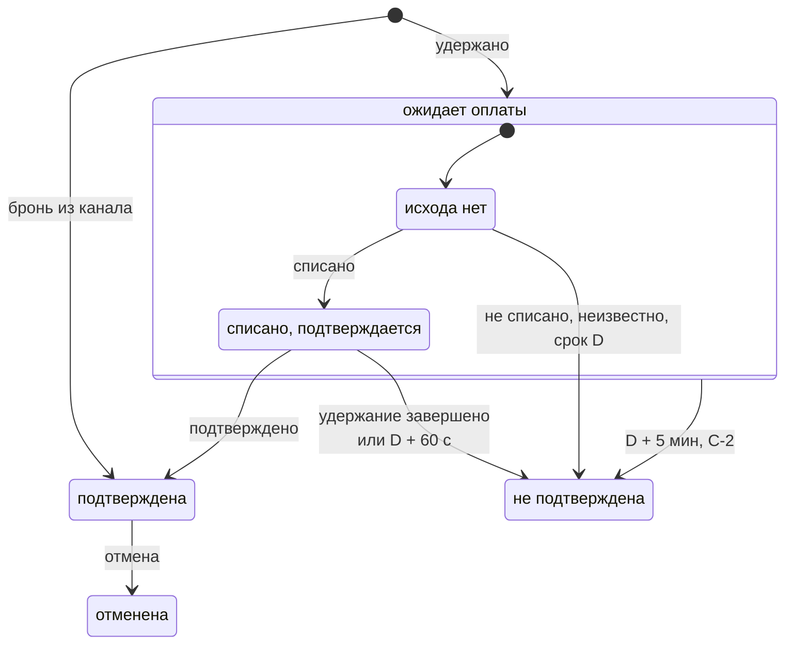

# ADR-0004: Сага бронирования

- Статус: принято
- Дата: 2026-10-21
- Уточняет: [ADR-0002](0002-service-boundaries-and-data-ownership.md) — повтор «удержать» после истечения удержания, id брони до удержания, срок хранения токена карты в booking; [ADR-0003](0003-sync-and-async-interactions.md) — запас окна попыток, подтверждение после срока удержания, запрос статуса при закрытии брони, воркеры запросов статуса, планировщики при втором экземпляре

## Контекст

Прямая бронь проходит три шага в трёх сервисах:
1. inventory удерживает номера;
2. payment списывает деньги через провайдера;
3. inventory подтверждает удержание — это точка невозврата.

Оркестратор — booking ([карта контекстов](../prd.md#4-карта-контекстов)). Как сервисы общаются, решил [ADR-0003](0003-sync-and-async-interactions.md):
- удержание — синхронный REST в запросе гостя;
- списание — команда RabbitMQ и фоновый шаг payment;
- «подтвердить» и «снять» — фоновые шаги booking;
- исходы оплаты — сообщения в booking.

Без ответов на следующие вопросы нельзя писать контракты и код:
- какие состояния у брони и какие события их меняют;
- кто закрывает бронь по сроку и как не дать двум участникам закрыть её по-разному;
- кто и когда запрашивает статус платежа и что делать с исходом, который пришёл после закрытия брони;
- как не списать деньги после срока и не вернуть их дважды;
- что отвечать на повтор «удержать» после истечения или снятия удержания — вопрос из ADR-0002;
- какой запас нужен окну попыток списания до крайнего срока — вопрос из ADR-0003.

Ограничения:
- **П-8:** удержание действует 15 минут, подтвердить его после срока нельзя, а «удержать», «подтвердить» и «снять» идемпотентны. Повторы оплаты укладываются в 10 минут и не выходят за срок удержания.
- **П-9:** каждое списание относится к брони, которая была подтверждена, либо по нему запущен возврат. Повторное списание исключено.
- **НФТ-5:** исход за 5 с p95.
- **НФТ-10:** нет броней в «ожидает оплаты» дольше срока удержания плюс 5 минут, ни одного возврата по невозвратной отмене.
- **НФТ-16:** простой RabbitMQ до 5 минут исходов не меняет.
- Часы сервисов синхронизированы, но не идеально.

## Варианты

1. **Хореография.** Сервисы реагируют на события друг друга: payment — на «бронь создана», inventory — на «оплачено».
   - Плюсы: нет центрального участника, сервисы не вызывают друг друга напрямую.
   - Минусы:
     - у сроков и компенсаций нет владельца: неясно, кто закроет бронь, если оплата не пришла, и кто вернёт деньги, если подтверждение не удалось;
     - payment и inventory пришлось бы знать о бронях и друг о друге;
     - инвариант П-9 не проверить в одном месте, а П-6 требует, чтобы все переходы делал booking;
     - события о брони расходились бы по нескольким сервисам. Через Kafka исход брони зависел бы от её доступности (НФТ-8), через RabbitMQ каждый сервис подписывался бы на чужие события.
2. **Оркестрация в booking.** Состояние саги — данные брони в базе booking, шаги — команды и фоновые шаги из ADR-0003.
   - Плюсы:
     - сроки, компенсации и инвариант П-9 собраны в одном сервисе, рядом с данными брони;
     - транспорты уже решены.
   - Минусы:
     - booking знает протоколы inventory и payment;
     - машина состояний — свой код, и тестировать её нужно целиком;
     - сроки отслеживает отдельный процесс — планировщик сроков, и его остановку нужно замечать отдельным алертом.
3. **Движок процессов** — Temporal или Camunda.
   - Плюсы: надёжные таймеры, повторы и история шагов из коробки.
   - Минусы:
     - отдельный кластер со своей базой — ещё память (Р-1);
     - PHP-воркеры Temporal работают на RoadRunner, то есть рядом с PHP-FPM появляется второй рантайм;
     - цель проекта — показать механику саги, а не настройку движка.

Внутри booking переходы можно описать компонентом Symfony Workflow. Но состояние брони двумерное — статус, исход оплаты и возврат, — и ему лучше подходит явная таблица переходов. Блокировку строки и условное применение результата внешнего вызова всё равно пришлось бы писать вокруг Workflow.

## Решение

Оркестрация в booking. Переходы описывает свой агрегат брони с явной матрицей «состояние × событие». Дальше D — срок удержания из ответа inventory, он же крайний срок списания.

### Модель брони

- **Статус и причина** — по П-6: «ожидает оплаты», «подтверждена», «не подтверждена» с причиной, «отменена». Служебных статусов нет: «подтверждается» — это «ожидает оплаты» с исходом «списано».
- **Исход оплаты** — что booking знает о деньгах:
  - «нет» — сообщений о списании ещё не было;
  - «неизвестно» — payment не смог выяснить исход;
  - «списано»;
  - «не списано» — провайдер отказал или по запросу статуса денег нет. Payment сообщает эти случаи раздельно, для саги они одно и то же.
- **Статус возврата** — по П-6, плюс номер попытки возврата.
- **Снимки** из ответа «удержать»: сумма, момент заезда и D. Срок бесплатной отмены booking считает из момента заезда (П-10).

Исход только уточняется:
- «неизвестно» не затирает известный исход;
- «списано» побеждает «не списано». Такое противоречие даёт алерт, а по брони, которая не была подтверждена, ещё и возврат;
- повторный исход ничего не меняет.

### Шаги саги

Транспорты и повторы взяты из ADR-0003, ниже — сводка по шагам саги.

| Шаг | Способ | Защита от дублей | Срок или бюджет | Если не удалось |
|---|---|---|---|---|
| «удержать» | REST в запросе гостя | id брони | 2 с, без повторов внутри запроса | 503; повтор с тем же ключом продолжает то же удержание |
| списание | команда RabbitMQ; провайдера вызывает фоновый шаг payment | `charge:{бронь}` | окно попыток: до 10 минут и не позже D − 30 с | запрос статуса; если исход неизвестен — «нет исхода оплаты» и сверка |
| запрос статуса | команда RabbitMQ; провайдера вызывает фоновый шаг payment | id сообщения | бронь ответа не ждёт | исход выясняет сверка (С-5) |
| «подтвердить» | REST из фонового шага booking | id брони | 2 с на вызов, до D + 60 с | «удержание не подтверждено», «снять» и возврат |
| «снять» | REST из фонового шага booking | id брони | потолок паузы 5 минут, бюджет 24 часа | failure transport и алерт (Р-21) |
| возврат | команда RabbitMQ; провайдера вызывает фоновый шаг payment | `refund:{бронь}:{попытка}` | потолок паузы 5 минут, бюджет 24 часа | «не удался», failure transport, алерт, ручная попытка |
| продажа из канала | REST из фонового шага booking | id брони | потолок паузы 1 минута, бюджет 24 часа | failure transport и алерт |

### Создание брони

1. Booking записывает ключ идемпотентности: аренду, отпечаток тела и id брони (UUID v7). Брони до удержания нет. Id живёт в записи ключа, и повтор с тем же ключом берёт тот же id.
2. Booking вызывает «удержать» — не дольше 2 с, через circuit breaker.
3. Вторая транзакция идёт, только если аренда ключа всё ещё у этого запроса и брони с этим id ещё нет. Одним коммитом пишутся:
   - бронь «ожидает оплаты» со снимками, ПДн и токеном брони;
   - команда списания в outbox: D, сумма, email для чека и токен карты. Токен карты в booking живёт только в теле этой команды;
   - `booking.v1`;
   - ответ 201 под ключом.
4. Итоги под ключом — 201, 409 «нет мест», 409 «сумма изменилась» и 409 «удержание истекло». 503 и другие 5xx итогом не считаются, и аренда ключа освобождается сразу.

Повтор после 503 снова вызывает «удержать» с тем же id:
- удержание действует — inventory отдаёт его со снимком, и создание продолжается;
- удержание истекло или снято — inventory отказывает, booking отвечает 409 «удержание истекло», клиент повторяет с новым ключом;
- до D меньше 60 с — booking ставит «снять» и тоже отвечает 409 «удержание истекло»: такую бронь уже не оплатить, окно попыток закрыто.

В ответе 409 «удержание истекло» нет id брони: брони так и не было.

Если повтора не было, делать ничего не нужно. Удержание освобождает inventory по сроку (С-1), а запись ключа живёт 24 часа. Id в таком удержании ссылается на бронь, которой нет. Это допустимая висячая ссылка: она уточняет правило ADR-0002 о ссылках на чужие сущности.

### Inventory: операции по id брони

- **Хранение.** У брони не больше одного удержания: id брони уникален. Результат удержания хранится не меньше 24 часов — столько же, сколько ключ идемпотентности. Иначе поздний повтор создал бы второе удержание.
- **Повтор «удержать».** Действующее удержание → то же удержание со снимком. Истекло или снято → отказ «удержание завершено».
- **«Подтвердить»** проверяет по порядку:
  1. «снято» или удержания нет → отказ «удержание завершено»;
  2. уже подтверждено → «подтверждено», даже после D;
  3. срок → после D отказ «удержание завершено».
- **«Снять»** снимает удержание или продажу и оставляет отметку «снято», даже если по этому id ничего не было. После отметки «удержать», «подтвердить» и продажа из канала по этой брони отказывают. Отметка хранится не меньше 30 дней — дольше, чем живёт сообщение в failure transport.
- **Порядок.** Операции по одному id выполняются последовательно.

### Списание и окно попыток

- **Ключ.** Ключ идемпотентности платежа — `charge:{бронь}`, повтор с ним не создаёт второго списания.
- **Окно.** W = min(первая попытка + 10 мин, D − 30 с) по часам payment. Как payment хранит D и время первой попытки, описывает ADR-0003.
- **Повторы.**
  - Пауза между попытками растёт от 1 с вдвое, потолок 30 с.
  - Retry-After окно не продлевает: повтор за пределами окна не планируется.
  - Окончательный сбой внутри окна, например «ключ уже использован с другими параметрами», прекращает попытки. Payment сразу запрашивает статус: возможно, платёж по этому ключу уже есть.
- **Запрос статуса.**
  - Если последняя попытка не дала исхода, payment сразу запрашивает статус у провайдера, не больше двух раз.
  - Запрос статуса — отдельный вид шага со своими воркерами, которых он не делит с возвратами. Иначе после сбоя провайдера хвост запросов задержал бы первые попытки новых броней.
- **Исход.** Итог — «списано», «не списано» или «неизвестно» — payment отправляет booking и при этом закрывает операцию.
- **Аренда брони** в payment держится на время шага. Она не короче самого долгого шага — запроса статуса с двумя попытками, около 11 с, — и не длиннее срока, через который очередь отдаёт шаг упавшего воркера другому.

Запас 30 с покрывает худший путь от конца окна до подтверждения:

| Слагаемое | Время |
|---|---|
| последний вызов провайдера, начатый до конца окна | до 5 с |
| запрос статуса, если вызов не дал исхода, две попытки | до 11 с |
| доставка исхода в booking: relay, консьюмер, постановка шага | около 2 с |
| «подтвердить» с одним повтором | до 5 с |
| проверка отложенных шагов в очереди | до 2 с |
| расхождение часов payment и inventory | до 1 с |

Итого 15–26 с. Третья попытка запроса статуса в запас уже не помещается.

В таблице — время выполнения без ожидания в очереди. Если провайдер лежит, запросы статуса копятся, их итоги приходят после D, и бронь без исхода закрывается в D с причиной «нет исхода оплаты», как требует Г-2. Поздний итог потом уточняет исход.

### Ограда от списаний после окна

Деньги после окна не списываются, даже если сообщение пришло поздно или его повторили из failure transport.
- **Окно.** Payment проверяет окно перед каждым вызовом провайдера, вне окна — только запрос статуса.
- **Конец окна.** Токен карты и email стираются.
- **Закрытие операции.** Операция в payment закрывается, когда:
  - payment отправляет booking любой исход;
  - приходит запрос статуса от booking.

  Если запрос статуса пришёл раньше команды списания, операция создаётся уже закрытой. Эта ограда не зависит от часов.
- **Что запрещает закрытие.** После закрытия токен и email стёрты, а вызовы списания по брони запрещены. Поздняя команда списания их в журнал не записывает. Запросы статуса и возвраты по брони идут как обычно.
- **Ответ из журнала.** Payment отвечает booking из журнала, если исход окончательный или провайдера ни разу не вызывали. Поэтому отметку «попытка начата» payment пишет до каждого вызова провайдера — и для списания, и для возврата. Если команда списания пришла уже после конца окна, провайдера не вызывали, и ответ — «не списано».
- **Просроченная команда.** Команду списания, у которой D уже прошёл, relay booking не отправляет, а удаляет вместе с токеном. Так после простоя booking токен не уходит в RabbitMQ. Механику задаёт ADR об outbox и inbox.

### Исходы до закрытия брони

Пока бронь «ожидает оплаты»:
- «не списано» → «не подтверждена» с причиной «оплата отклонена» и «снять». Так же и тогда, когда команда пришла в payment после конца окна и карту не пытались списать: деньги точно не списаны, а гостю, как и при отказе, остаётся создать бронь заново;
- «неизвестно» → сразу «не подтверждена» с причиной «нет исхода оплаты» и «снять». Payment уже запросил статус, ждать до D нечего, дальше исход выясняет сверка (С-5);
- «списано» → шаг «подтвердить».

Если бронь закрывается позже D + 5 мин, причина — «завершена принудительно» и алерт (раздел «Сроки»).

### Подтверждение — точка невозврата

- Бронь с исходом «списано» закрывает шаг «подтвердить»: 2 с на вызов, пауза между повторами до 30 с. Планировщик сроков такую бронь в D не трогает.
- Границу подтверждения держат часы inventory, поэтому booking попытки по своим часам не обрезает. После D вызов только узнаёт итог: если inventory успел подтвердить до срока, повтор вернёт «подтверждено».
- Если inventory недоступен, попытки идут до D + 60 с. Последняя ставится ровно на D + 60 с, даже если по паузе следующий повтор пришёлся бы позже.
- «Подтверждено» → «подтверждена» и `booking.v1`.
- «Удержание завершено» или D + 60 с без ответа → «не подтверждена» с причиной «удержание не подтверждено», «снять» и возврат. Если подтверждение на самом деле прошло, «снять» снимет продажу, а деньги вернутся.
- После D + 5 мин любой итог шага ведёт к С-2: «завершена принудительно», «снять», возврат и алерт. Даже позднее «подтверждено» бронь уже не подтверждает, продажу снимет «снять». Поэтому результат не зависит от того, кто первым взял блокировку — шаг или планировщик.

### Сроки

Сроки отслеживает отдельный процесс booking — планировщик сроков. Раз в 1–2 с он выбирает брони «ожидает оплаты» по частичному индексу на D. Таймера на каждую бронь нет, отложенных строк в очереди тоже. Второму экземпляру booking блокировка лидера не нужна: брони между планировщиками делит `FOR UPDATE SKIP LOCKED`, а каждый переход идёт под блокировкой строки с проверкой клетки матрицы.

- **В D** закрывает брони без исхода: «не подтверждена» с причиной «нет исхода оплаты», дальше — по разделу «Закрытие без исхода».
- **В D + 2 мин** бронь попадает в метрику для алерта «бронь в «ожидает оплаты» дольше срока удержания плюс 2 минуты». Метрику считает запрос к базе вне планировщика, а у самого планировщика есть heartbeat с алертом на его отсутствие: иначе упавший планировщик не заметит никто.
- **В D + 5 мин** выполняет С-2 с точностью до периода опроса:
  - причина «завершена принудительно», «снять»;
  - если деньги списаны — возврат, иначе — как при закрытии без исхода;
  - алерт.

Правило одно на всех: любое закрытие брони «ожидает оплаты» позже D + 5 мин получает причину «завершена принудительно» и алерт, кто бы его ни сделал — планировщик после рестарта booking, консьюмер исхода оплаты или запоздавший шаг подтверждения.

### Закрытие без исхода

Когда бронь закрывается, а исход «нет»:
- inventory получает «снять»;
- неотправленная команда списания удаляется из outbox вместе с токеном. Если relay уже взял строку в работу, команда считается отправленной: ждать relay booking не будет. Как это согласовано, описывает ADR об outbox и inbox;
- в payment уходит запрос статуса — всегда, а не только вместо неотправленной команды.

Запрос статуса — единственный способ узнать о деньгах раньше сверки, если команда всё-таки ушла: например, relay упал после публикации или исход застрял в outbox payment. Кроме того, он закрывает операцию в payment. Ответа booking не ждёт.

### Поздние исходы и возврат

- **«Списано» по брони «не подтверждена»** — из ответа на списание, ответа на запрос статуса или итога сверки — запускает возврат попыткой 1. Условие: статус возврата «нет». Статус брони не меняется (Г-2). Если до этого исход был «не списано», срабатывает ещё и алерт о противоречии.
- **Email уже обезличен** по предельному сроку — вместо возврата статус возврата сразу становится «не удался», срабатывает алерт, и бронь уходит дежурному: возврат и чек оформляются вручную через провайдера. Без email провайдер не отправит чек возврата (54-ФЗ). Статус «не удался» нужен и для НФТ-10: списание по неподтверждённой брони без возврата сверка посчитала бы нарушением.
- **Возврат уже есть** — «в процессе», «выполнен» или «не удался» — новое «списано» ничего не запускает. Три «списано» по одной брони дают один возврат.
- **«Не списано» и «неизвестно» после закрытия** только уточняют исход по общему правилу.
- **Брони «подтверждена» и «отменена».** Исход тоже только уточняется. Возврат по отменённой брони решает отмена: ни одного возврата по невозвратной отмене (НФТ-10).
- **Команда возврата.** Несёт email для чека из booking и номер попытки, ключ идемпотентности платежа — `refund:{бронь}:{попытка}`. Сумму возврата payment берёт из журнала списания.
- **Попытки.**
  - Создание попытки N в payment закрывает попытки меньше N. По ним провайдера больше не вызывают, даже при ручном повторе из failure transport.
  - На попытку N payment всегда отвечает исходом: «выполнен», в том числе если деньги вернула прошлая попытка, или «не удался».
  - В booking «выполнен» по любой попытке окончателен, а «не удался» по прошлой попытке статус не меняет.
- **Новая попытка** запускается только из «не удался», вручную, консольной командой booking (ADR-0002):
  - Booking под блокировкой строки увеличивает номер попытки, ставит «в процессе» и отправляет команду. При другом статусе возврата или без email команда отказывает.
  - Payment сначала выясняет, что стало с прошлыми попытками. Попытка без отметки «попытка начата» до провайдера не доходила и новую не блокирует.
  - По начатым попыткам решают данные провайдера о самом платеже: сколько по нему уже вернули. Деньги уже вернулись — попытка N получает «выполнен». Возвратов нет — попытка N идёт к провайдеру. Ответ провайдера по ключу прошлой попытки, в том числе «ключ не найден», ничего не решает.
  - Если данные провайдера о платеже недоступны, попытка N получает «не удался», и её повторяют позже.
- **Сумма возвратов** по брони не больше списания — это входит в контракт провайдера.

### Исход не выяснен

Исход не выяснен, если у брони «не подтверждена» исход оплаты «нет» или «неизвестно». Причина при этом может быть любой, в том числе «завершена принудительно».

- `booking.v1` несёт признак «исход не выяснен», и по нему сверка платежей ищет исход у провайдера.
- Сверка сообщает booking окончательный исход — и «списано», и «не списано», — чтобы признак снялся. Проверяет она все неподтверждённые прямые брони, а не только с причиной «нет исхода оплаты»: «не списано» тоже может оказаться ошибкой. Деньги сверка сама не возвращает, решение принимает booking по правилам выше (ADR-0002).
- Через 7 дней срабатывает алерт.
- Пока исход не выяснен или возврат «в процессе» или «не удался», откладывается обезличивание только email: он нужен для чека возврата. Остальные данные гостя обезличиваются в обычный срок.
- Email ждёт не дольше 90 дней после обычного срока, затем обезличивается, а бронь уходит дежурному на ручной разбор (П-15). За 14 дней до этого срабатывает алерт, чтобы успеть выяснить исход или завершить возврат, пока email ещё есть.

### Отмена прямой брони

- Отменить можно только прямую бронь «подтверждена» и только до момента заезда, иначе ответ 409 (Г-4). Бронь из канала отменяет только канал (К-3). «Отменена» ставится сразу, ответ — 200.
- Бесплатность определяется по времени, когда сервер получил запрос (П-10).
- «Снять» — фоновый шаг с бюджетом 24 часа, затем failure transport и алерт (Р-21).
- При бесплатной отмене уходит возврат попыткой 1.

### Брони из каналов

- Бронь из канала создаётся сразу «подтверждённой» (П-6), оплаты и возвратов у неё нет (П-11).
- Продажа из канала — фоновый шаг booking. Перед вызовом он проверяет статус брони: продавать по отменённой брони нечего.
- Флаг овербукинга ставится по ответу продажи.
- Отмена из канала — «отменена» и «снять». Отметка «снято» не даёт запоздавшей продаже пройти после отмены.
- Команда отмены может обогнать команду брони: RabbitMQ порядка не держит. Такую отмену booking запоминает по паре «канал, внешний id» и применяет, когда появится бронь (К-3): бронь сразу создаётся «отменённой», без продажи.

### Последовательность и гонки

- **Транзакция на переход.** Строка брони блокируется (`SELECT … FOR UPDATE`), проверяется клетка матрицы, применяется переход. Действия — «снять», команды, `booking.v1` — пишутся в той же транзакции через outbox и очереди шагов.
- **Входящие сообщения.** Переход по входящему сообщению применяет сам консьюмер, в той же транзакции, что и inbox: это запись в базу без внешних вызовов (ADR-0003), поэтому бюджет НФТ-5 не меняется.
- **Внешние вызовы** идут вне транзакции. Результат применяется, только если бронь всё ещё в том состоянии, из которого вызов начинался.
- **У каждого состояния один закрывающий по сроку:**
  - исхода нет — планировщик сроков в D;
  - «списано» — шаг «подтвердить»;
  - всё, что не закрылось к D + 5 мин, — планировщик по С-2.

  Бронь без исхода закрывает и консьюмер исхода оплаты — по «не списано» и «неизвестно» (раздел «Исходы до закрытия брони»).
- **Дубли.** Дубли сообщений отсекает inbox, повторные исходы — правило уточнения исхода. Payment обрабатывает одну бронь последовательно, под арендой (ADR-0003).

| Гонка | Что происходит | Почему безопасно |
|---|---|---|
| подтверждение в полёте и закрытие брони | inventory подтвердил, а booking уже закрыл бронь | «снять» снимает продажу и ставит отметку, деньги возвращаются |
| исход или подтверждение и С-2 | исход оплаты или итог подтверждения пришёл после D + 5 мин | любое закрытие после D + 5 мин — «завершена принудительно» и алерт, кто бы ни взял блокировку первым |
| продажа из канала и отмена | «снять» прошло раньше продажи | после отметки «снято» продажа отказывает |
| исход и планировщик сроков | «списано» пришло, пока планировщик закрывает бронь | кто первым взял блокировку, тот и решил; «списано» по закрытой брони даёт возврат |
| ответ на запрос статуса и поздний исход | оба сообщают «списано» | возврат запускается, только если статус возврата «нет» |
| повтор создания и исходный запрос | оба вызвали «удержать» | вторая транзакция идёт только при своей аренде и если брони ещё нет |
| две попытки возврата | ручной повтор прошлой попытки из failure transport | попытка N закрывает попытки меньше N |

### Матрица переходов

Сага прямой брони. «—» значит, что событие только записывается в журнал. Каждая клетка, в том числе с «—», проверяется табличным тестом.

Если клетка закрывает бронь «ожидает оплаты» позже D + 5 мин, причина — «завершена принудительно» и алерт, остальные действия клетки сохраняются.

| Событие | Ожидает оплаты, исхода нет | Ожидает оплаты, списано | Не подтверждена | Подтверждена или отменена |
|---|---|---|---|---|
| «списано» | шаг «подтвердить» | — | исход — «списано»; если было «не списано» — алерт; если статус возврата «нет» — возврат попыткой 1, а если email уже обезличен — вместо возврата «не удался», алерт и ручной разбор | — |
| «не списано» | «оплата отклонена», «снять» | алерт о противоречии | уточнить исход; если было «списано» — алерт | алерт о противоречии |
| «неизвестно» | «нет исхода оплаты», «снять» | — | уточнить исход, если было «нет» | — |
| «подтверждено» от inventory | — | до D + 5 мин — «подтверждена»; позже — «завершена принудительно», «снять», возврат, алерт | — | — |
| «удержание завершено» или D + 60 с | — | до D + 5 мин — «удержание не подтверждено», позже — «завершена принудительно» и алерт; «снять», возврат | — | — |
| наступил D | «нет исхода оплаты», закрытие без исхода | — | — | — |
| наступил D + 5 мин | «завершена принудительно», закрытие без исхода, алерт | «завершена принудительно», «снять», возврат, алерт | — | — |

Отмены, возвраты и брони из каналов:

| Событие | Когда применяется | Что делает booking | В остальных случаях |
|---|---|---|---|
| отмена гостем | прямая бронь «подтверждена», запрос до момента заезда | «отменена», «снять», возврат попыткой 1 при бесплатной отмене | «отменена» — 200 без изменений; «ожидает оплаты», «не подтверждена», после момента заезда, бронь из канала — 409 |
| ручная попытка возврата | статус возврата «не удался» и email ещё есть | номер попытки + 1, «в процессе», команда возврата | команда отказывает |
| исход возврата | исход по текущей попытке, статус возврата ещё не «выполнен» | статус возврата | «выполнен» по прошлой попытке тоже окончателен; после «выполнен» и прочие исходы прошлых попыток — «—» |
| бронь из канала | новая пара «канал, внешний id» | «подтверждена», шаг продажи | дубль — «—»; есть запомненная отмена — бронь сразу «отменена», без продажи |
| ответ продажи из канала | бронь «подтверждена» | флаг овербукинга по ответу | бронь «отменена» — «—» |
| отмена из канала | бронь из канала «подтверждена» | «отменена», «снять» | «отменена» — «—»; брони ещё нет — отмена запоминается (К-3) |

### Сбои и деньги

| Что недоступно | Деньги | Бронь |
|---|---|---|
| RabbitMQ до 5 минут | команды ждут в outbox, окно начинается с первой попытки и успевает до D | исход не меняется (НФТ-16) |
| RabbitMQ дольше | если команда не дошла до payment за окно, списания нет; если дошла и деньги списаны, позднее «списано» даёт возврат | в D — «нет исхода оплаты», запрос статуса ждёт в outbox (Р-22); если payment успел до D ответить «не списано» — «оплата отклонена» |
| payment | поздняя команда только запрашивает статус, после закрытия брони списаний нет | в D — «нет исхода оплаты», ответ на запрос статуса уточнит исход; если payment успел до D ответить «не списано» — «оплата отклонена» |
| booking до D + 5 мин | исходы ждут в очереди, шаги продолжаются после рестарта | подтверждение или закрытие по сроку после рестарта |
| booking дольше D + 5 мин | списанные деньги возвращаются | «завершена принудительно» по С-2, алерт |
| inventory во время подтверждения | если итог подтверждения не выяснен до D + 60 с, деньги возвращаются | «удержание не подтверждено»; если подтверждение прошло, «снять» снимет продажу |
| провайдер | повторы в окне, затем запрос статуса; при «неизвестно» исход выясняет сверка (Р-12) | «оплата отклонена» или «нет исхода оплаты» |

### События, журнал и время

- **`booking.v1`** уходит при каждом изменении брони: публичный статус и причина, признак «исход не выяснен», статус возврата, версия брони. Подсостояний и ПДн в событии нет.
- **Журнал переходов** — какое событие, из какого состояния и в какое — хранится без ПДн и нужен для разбора.
- **Служебные сообщения без ПДн.** В запросе статуса, исходах оплаты и возврата, итогах сверки и ответе 409 «удержание истекло» нет email, токена карты и токена брони.
- **Часы.**
  - D ставят часы inventory, конец окна W — часы payment, сроки броней — часы booking.
  - Расхождение любой пары — не больше 1 с, за ним следит метрика. Бронь без исхода может закрыться на секунду раньше или позже D — деньги это не меняет.
  - Если часы payment уйдут дальше запаса, списание может пройти после D. Тогда позднее «списано» вызовет возврат, а после закрытия брони списаний уже не будет: их остановит ограда запросом статуса.
- **Что осознанно не покрыто:**
  - если воркер списания упал в последние 30–60 с до D, шаг вернётся в работу уже после окна. Исход придёт после закрытия брони и выяснится запросом статуса;
  - НФТ-10 держится, пока работает booking. Если он лежит, брони закроются после рестарта, позже D + 5 мин — по С-2 с алертом;
  - пока booking лежит, токен карты остаётся в outbox его базы дольше D. В RabbitMQ просроченная команда уже не уйдёт, а одноразовый токен у провайдера действует не дольше часа.

### Проверка

- Табличный тест обеих матриц: на каждую клетку — переход или «—». Клетки, которые закрывают бронь «ожидает оплаты», проверяются ещё и позже D + 5 мин.
- Интеграционные тесты:
  - ветки Г-2, Г-4, С-2 и С-5;
  - гонки из таблицы;
  - попытки возврата: «выполнен» по прошлой попытке, ручной повтор прошлой попытки после новой, ручная попытка 2 после того, как попытка 1 исчерпала бюджет на 5xx;
  - контракт inventory: повтор «удержать», порядок проверок «подтвердить», продажа и «подтвердить» после «снять».
- Сценарии сбоев из таблицы «Сбои и деньги», провайдер — учение «провайдер оплаты отвечает 5xx».

## Последствия

- **Проще:**
  - сага, сроки и инвариант П-9 собраны в одном сервисе, каждая ветка PRD — клетка матрицы;
  - деньги не зависят от часов: списания после закрытия операции останавливает ограда, а подтверждение после срока — inventory;
  - возврат запускается не больше одного раза на попытку, а попытки не пересекаются.
- **Сложнее:**
  - машина состояний — свой код с тестом каждой клетки;
  - отдельный процесс планировщика сроков;
  - запрос статуса при каждом закрытии без исхода, закрытие операций и попыток в payment;
  - в контракте inventory — хранение результата удержания, отметки «снято» и порядок проверок.
- **Риски:**
  - провайдер ответит «не списано», пока запрос с этим ключом ещё выполняется. Заглушка в таком случае отвечает «неизвестно», а для настоящего провайдера это условие контракта; последняя страховка — сверка (Р-12);
  - «снять» застрянет в failure transport (Р-21);
  - долгий простой RabbitMQ (Р-22).
- **Решают другие ADR:**
  - как согласованы снятие неотправленной команды и relay и как relay отбрасывает просроченную команду — ADR об outbox и inbox;
  - алерты и метрики — D + 2 мин, heartbeat планировщика сроков, принудительное завершение, противоречие исходов, «возврат не удался», email за 14 дней до предельного срока, расхождение часов — ADR о наблюдаемости;
  - хранение токена брони — ADR о доступе.
- **Когда пересмотреть:** появится многошаговая оплата (3-D Secure), частичные возвраты или несколько платежей по брони — тогда стоит сравнить свой код с движком процессов.
