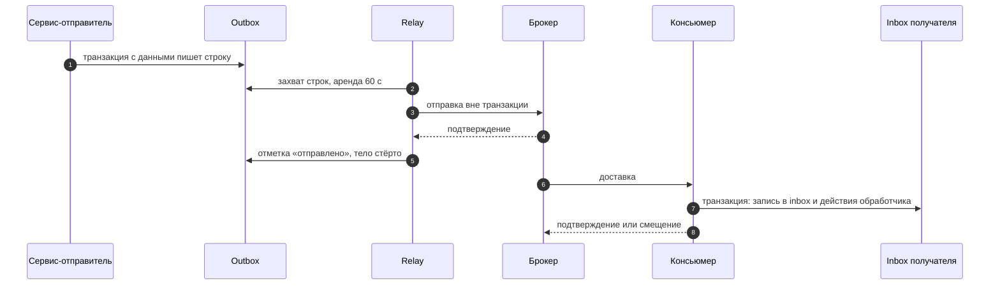

# ADR-0005: Outbox, inbox и доставка at-least-once

- Статус: принято
- Дата: 2026-10-21
- Уточняет: [ADR-0002](0002-service-boundaries-and-data-ownership.md) — сроки хранения outbox и inbox, конец жизни ПДн вебхука и токена карты, роль партиций; [ADR-0003](0003-sync-and-async-interactions.md) — опрос вместо уведомлений PostgreSQL, свой транспорт очередей в базе, один relay в Kafka на сервис, отзыв команды списания, PgBouncer, ошибки базы у консьюмеров, очистка очереди разбора; [ADR-0004](0004-booking-saga.md) — отзыв команды списания при закрытии брони

## Контекст

[ADR-0003](0003-sync-and-async-interactions.md) решил, что идёт через Kafka, что через RabbitMQ и что живёт в очередях в базе. Механику он оставил этому ADR:
- как сообщение попадает из транзакции сервиса в брокер;
- как получатель отсекает дубли;
- как устроены очереди в базе;
- какие настройки у продюсера и консьюмера Kafka;
- как проверяется НФТ-7.

[ADR-0004](0004-booking-saga.md) добавил обязательства:
- relay не отправляет команду списания с прошедшим крайним сроком D, а удаляет её вместе с токеном карты;
- закрывая бронь без исхода, booking снимает неотправленную команду списания;
- консьюмер booking применяет переход брони в той же транзакции, что и запись в inbox.

Открыт вопрос В-3: опрос базы или CDC.

Ограничения:
- **НФТ-7:** потерь ноль, повторная доставка не даёт повторного эффекта. Проверка — сверка id в outbox отправителя и в inbox получателя.
- **НФТ-8:** простой Kafka до 10 минут исходов не меняет, а outbox пустеет за 5 минут после восстановления. Для этого relay в Kafka отправляет около 900 событий в секунду (ADR-0003).
- **НФТ-16:** простой RabbitMQ до 5 минут исходов не меняет.
- **Бюджеты ADR-0003:** до 0,5 с p95 на переход саги (НФТ-5) и на relay в цепочке до канала (НФТ-2).
- **База:** один сервер PostgreSQL 17. У роли приложения только права на данные, миграции выполняет владелец базы (ADR-0002).
- **Ресурсы:** весь стек помещается на машине разработчика (Р-1).

Механика Symfony Messenger, librdkafka, php-rdkafka, PostgreSQL и RabbitMQ сверена с исходным кодом Symfony 7.4.21 и PostgreSQL 17 и с их документацией.

## Варианты

1. **Публикация после коммита.** Сервис коммитит данные и сразу публикует сообщение.
   - Плюсы: нет ни таблицы, ни отдельного процесса.
   - Минусы: падение между коммитом и публикацией теряет сообщение, а публикация до коммита отправляет то, чего не было. Это нарушает НФТ-7.
2. **Outbox и relay с опросом базы.** Сообщение пишется в таблицу outbox в той же транзакции, что и данные, а отдельный процесс отправляет его в брокер.
   - Плюсы: сообщение атомарно с данными; один механизм для обоих брокеров; всё на PHP и PostgreSQL.
   - Минусы: опрос нагружает базу; порядок коммитов relay не видит; таблицы нужно чистить.
3. **Outbox и CDC:** Debezium читает журнал PostgreSQL.
   - Плюсы: порядок коммитов и нет опроса.
   - Минусы:
     - отдельный процесс на JVM с Kafka Connect — ещё память (Р-1);
     - ещё одна роль, с правом репликации;
     - слот репликации держит журнал, пока коннектор лежит, и может заполнить диск;
     - для RabbitMQ нужен ещё Debezium Server;
     - цель проекта — показать механику своими руками.

**Уведомления PostgreSQL** (LISTEN и NOTIFY) будили бы relay и воркеры очередей сразу. Но каждый коммит, в котором был NOTIFY, берёт общую блокировку и держит её до конца коммита, вместе с записью журнала на диск. Поэтому такие коммиты идут по одному на весь сервер. При 50 бронях в секунду их около 500 в секунду, и на медленном диске стенда предел наступил бы раньше целевой нагрузки.

**Doctrine-транспорт Messenger** как outbox команд тоже не подходит:
- при подтверждении он удаляет строку, а её id нужен сверке НФТ-7;
- он берёт строки по одной;
- партиций и срока годности сообщения у него нет;
- Kafka он не обслуживает, и механизмов outbox стало бы два.

## Решение

Outbox с опросом базы — один механизм для Kafka и RabbitMQ, общий код в `platform`. Уведомлений PostgreSQL нет: relay и воркеры очередей в базе опрашивают таблицы.

### Outbox

**Таблица** живёт в базе каждого сервиса, с партициями по дням (UTC) по времени создания. Ключ — id и время создания: ключ партиционированной таблицы обязан включать ключ партиции. Поля:
- **id сообщения** — UUID v7. При повторной отправке он не меняется.
- **Время создания** — из `ClockInterface`. Оно же стоит в конверте сообщения и в свойстве `timestamp` RabbitMQ. Время из UUID v7 его не заменяет (ADR-0002), да PostgreSQL 17 и не извлекает время из v7.
- **Брокер, адрес, ключ, тип, заголовки и тело.** Адрес — топик или обменник, ключ — ключ Kafka или ключ маршрутизации.
- **Версия ключа с эпохой** — у событий compacted-топиков.
- **Срок годности** — у команды списания это D.
- **Срок хранения ПДн** — у сообщений, которым он нужен (см. «ПДн и сроки хранения»).
- **Состояние** — одно из четырёх:
  - ожидает отправки;
  - отправлено;
  - заменено;
  - отброшено.

  Три последних — конечные.
- **Служебные поля relay:**
  - число захватов;
  - число отказов по этой строке и время первого отказа;
  - время следующей попытки;
  - код последней ошибки без значений полей;
  - время отправки, а у Kafka ещё партиция и смещение.

Индексы:
- частичный по строкам, ожидающим отправки, свой у каждого брокера — чтобы relay RabbitMQ не просматривал накопившийся хвост Kafka;
- по сроку годности у ожидающих строк;
- по ключу и версии.

**Запись.**
- Только в открытой транзакции сервиса, иначе исключение: так outbox нельзя обойти.
- Сообщение не больше 256 КиБ, иначе исключение при записи. Лимит Kafka по умолчанию — около 1 МБ, RabbitMQ 4 — 16 МиБ.
- `synchronous_commit` не отключается.

**Отзыв команды списания.**
- Закрывая бронь без исхода, booking удаляет её неотправленную команду списания вместе с токеном карты. Удаляет всегда, даже если relay уже взял строку в работу, и из outbox, и из таблицы строк на разборе.
- Команда при этом считается возможно отправленной, поэтому запрос статуса уходит в любом случае (ADR-0004).
- Relay, который в это время отправляет строку, не найдёт её при отметке.
- Чтобы найти строку, booking хранит id и время создания своей команды списания.

**Срок годности.**
- Relay удаляет ожидающие строки с прошедшим сроком, в том числе строки на разборе. Делает он это в каждом цикле, а ещё до подключения к брокеру и в каждой паузе общего отказа — удаление не зависит от брокера.
- Перед публикацией relay проверяет, что до срока осталось больше, чем время ожидания подтверждения брокера.
- Так токен карты не уходит в RabbitMQ после D. В базе после D он остаётся, только если недоступны и booking, и его relay: при живом booking бронь в D закрывает планировщик и удаляет команду (ADR-0004). Тогда токен лежит до рестарта (ADR-0002).

**После подтверждённой отправки** стираются тело и заголовки. Остаются id, адрес, ключ, версия, тип, время отправки, а у Kafka — партиция и смещение: на них стоят правило «заменена» и сверка НФТ-7.

**Строки на разборе** — те, что брокер не принимает, — переезжают в отдельную небольшую таблицу без партиций. Так они не держат дневную партицию от удаления и остаются видны сверке.
- В отправку их возвращает консольная команда сервиса. Она отказывает, если строка отброшена, у неё прошёл срок годности или срок хранения ПДн.
- Событие compacted-топика так не возвращают. Строку, у ключа которой уже отправлена версия новее, relay сам помечает «заменена». Для остальных владелец консольной командой «опубликовать ключ заново» отправляет текущее состояние ключа новой версией: строка более новой версии могла уже уйти из outbox вместе с партицией, и правило «заменена» её бы не увидело.

**Relay не вызывает код сервиса.** Если сервису нужно знать об отправке, он смотрит на свою строку outbox: так channel-sync узнаёт, когда стирать ПДн вебхука (см. «ПДн и сроки хранения»).

### Relay

В каждом сервисе работает по одному процессу relay на брокер (ADR-0003). Цикл:
1. **Захват** — короткая транзакция. Relay берёт до 500 строк своего брокера, ожидающих отправки, у которых наступило время следующей попытки, — по частичному индексу с `FOR UPDATE SKIP LOCKED`. Захват увеличивает число захватов на 1 и сдвигает время следующей попытки на аренду — 60 с.
2. **Отправка** — вне транзакции: внешние вызовы в транзакции базы не держим.
3. **Запись итога** — короткая транзакция. Отметка «отправлено», снятие аренды, рост отказов и перенос на разбор идут с одним условием: «число захватов то же, и строка ещё ожидает отправки». Если аренду перехватил другой relay, строку отозвали или отбросили, relay её не трогает и не воскрешает из памяти.

Свойства цикла:
- **Без «последнего отправленного id».** Id и время создания выдаются до коммита, поэтому строка долгой транзакции становится видна позже соседних. Relay, который читает только строки после последней отправленной, пропустил бы её навсегда. Частичный индекс отдаст её, как только она станет видна.
- **Опрос.** Пока есть работа, relay берёт пачку за пачкой без паузы. Если выборка пустая, он ждёт 100 мс.
- **Дубли.** Если relay упал после отправки, но до отметки, строка уйдёт ещё раз, когда кончится аренда. Дубль отсекает inbox получателя.

**Отказы бывают двух видов.**

| | Отказ по строке | Общий отказ |
|---|---|---|
| Что это | брокер не принимает само сообщение: оно слишком большое, запись неверна или пришёл nack на часть строк | всё остальное: брокер недоступен, таймаут, ошибка доступа, нет топика или обменника, закрытие канала, nack на все строки |
| Что делает relay | растут отказы строки, пауза между попытками — от 1 с вдвое до 5 минут. После окончательной ошибки или 24 часов отказов строка уходит на разбор, срабатывает алерт | снимает аренду: время следующей попытки возвращается, отказы строк не растут. Пауза — от 0,5 до 5 с, алерт |

- Строку без отчёта о доставке relay считает «исход неизвестен» и не наказывает.
- Простой брокера не копит отказы строк, поэтому после восстановления накопленное уходит сразу (НФТ-8, НФТ-16).
- Если канал RabbitMQ раз за разом закрывается на одних и тех же строках, relay отправляет их по одной и так находит виноватую.

### Порядок и compaction

- **Порядок по ключу держат версии.** Событие несёт полное состояние ключа с версией, а потребитель не принимает событие старее сохранённого (ADR-0003, Р-14). Relay порядок коммитов не видит, а таймауты и повторы переставляют сообщения: при таймауте librdkafka может пропустить сообщение и записать следующие.
- **Compaction версий не знает.** Она оставляет у ключа последнюю запись по смещению. Если v1 уйдёт после v2, через 7 дней в топике останется v1. Тогда перестройка копии или новый потребитель получат устаревшее состояние, а у завершённой брони — навсегда.
- **Поэтому relay в Kafka один.** В каждом сервисе активен один relay в Kafka: он держит сессионную advisory-блокировку на прямом подключении, а второй экземпляр ждёт. Строки он берёт по времени создания, отправляет их пачками одну за другой и следует правилу «заменена»:
  - в пачке по одному ключу уходит только старшая версия. Младшие получают отметку «заменена» в записи итога — после подтверждённой доставки старшей, иначе ключ мог бы остаться без отправленного состояния;
  - строка, у ключа которой уже отправлена версия новее, не отправляется и сразу получает отметку «заменена».

  Событие с полным состоянием после более новой версии ничего не добавляет. У `payment.v1` compaction нет, и правило к нему не применяется.
- **Ограждение relay в Kafka.** Advisory-блокировка ограждает только базу. Relay, который потерял сессию или замер посреди отправки, мог бы дописать в Kafka старую версию уже после того, как новый relay отправил новую. Поэтому:
  - relay в Kafka не переподключается к базе: при любой ошибке соединения он сбрасывает очередь продюсера (`purge`) и завершает процесс;
  - пачку он отправляет, только если с последней успешной проверки блокировки по монотонным часам прошло меньше 20 с, иначе — `purge` и выход. Расчёт: 20 с до последней пачки плюс 30 с `message.timeout.ms` — меньше 60 с ожидания нового держателя. Поэтому даже после паузы процесса сообщения старого relay лягут в лог раньше, чем новый начнёт отправку;
  - новый процесс, взяв блокировку, сразу одним оператором читает и сбрасывает отметку чистого освобождения. Если прежний остановился штатно — дождался отчётов и поставил отметку, — ждать не нужно. Иначе новый процесс ждёт 60 с перед первой отправкой;
  - relay в Kafka работает под ролью приложения, и у неё не задаётся `idle_session_timeout`: сервер не должен закрыть сессию и снять блокировку во время долгого `flush`;
  - тихий обрыв связи с базой — пакеты пропадают, а соединение не закрыто — ограничен таймаутами TCP с обеих сторон. Без них relay висел бы в вызове базы до 15 минут повторов TCP, а сервер держал бы его сессию и блокировку до 2 ч 11 мин — столько по умолчанию ждёт keepalive Linux. Всё это время события сервиса в Kafka стояли бы. Поэтому:
    - в параметрах подключения libpq заданы `tcp_user_timeout`, `keepalives_idle`, `keepalives_interval` и `keepalives_count` — у relay в Kafka обязательно, у остальных процессов тоже;
    - на сервере PostgreSQL заданы `tcp_keepalives_idle`, `tcp_keepalives_interval`, `tcp_keepalives_count` и `tcp_user_timeout`;
    - простой 10 с, три пробы по 5 с и `tcp_user_timeout` 25 с снимают мёртвую сессию примерно за 25 с. Ограждение при этом не меняется.

  Транзакционный продюсер с постоянным `transactional.id` отсекал бы прежний процесс на стороне брокера. Но он добавил бы транзакцию Kafka на каждую пачку и зависимость от `isolation.level` у потребителей. При одном relay на сервис хватает выхода и паузы.
- **Relay в RabbitMQ** можно запускать несколько: у команд порядка нет (ADR-0003), а работу делит `SKIP LOCKED`.

### Kafka

**Продюсер** — php-rdkafka поверх librdkafka.

| Настройка | Значение | Почему |
|---|---|---|
| `enable.idempotence` | `true` | дубли от внутренних повторов отсекает брокер, порядок внутри партиции держится; по умолчанию выключено |
| `message.timeout.ms` | 30000 | время доставки вместе с повторами — меньше аренды |
| `request.timeout.ms` | 10000 | внутри срока доставки остаётся место для повтора запроса |
| `linger.ms` и `compression.codec` | 5 и `lz4` | пачки и сжатие |
| `partitioner` | `murmur2_random` | ключи раскладываются так же, как у Java-клиента; по умолчанию librdkafka считает CRC32 |

- Id строки уходит в `producev()` строкой-меткой и возвращается в отчёте о доставке.
- Relay ждёт отчёты через `flush` до срока, затем вызывает `purge` и `poll`. Строки, по которым отчёта нет, получают «исход неизвестен».
- После фатальной ошибки продюсер не работает, поэтому процесс relay перезапускается.

**Консьюмер.** Группа называется по имени сервиса (ADR-0002).

**Пачка** — до 500 сообщений или 100 мс.
- Сначала PHP разбирает и проверяет сообщения. То, что не разобралось, сразу откладывается, без попытки применить.
- Одна транзакция пишет всё наборами:
  - inbox — одной вставкой по всем сообщениям пачки с разобранным id;
  - копию — одним upsert с проверкой версии. Перед ним PHP схлопывает новые сообщения по ключу копии до старшей версии: одна команда upsert не может дважды изменить одну строку (ошибка 21000), а два события одного ключа в пачке — обычное дело;
  - фоновые шаги — одной вставкой.
- Точек сохранения на каждое сообщение нет: больше 64 вложенных транзакций в одной транзакции замедляют снимки на всём сервере.
- Ошибки базы разбираются по общей таблице (см. «Ошибки базы у консьюмеров»).

**«Ядовитое» сообщение.** Счётчика доставок у Kafka нет, поэтому консьюмер ведёт его сам. Перед пачкой он отдельной транзакцией записывает попытку: партицию, начальное смещение и номер попытки. Запись удаляется после успешной пачки. С третьей попытки сообщения идут по одному. Сообщение, на котором падает процесс, откладывается необработанным, срабатывает алерт. Так одно сообщение не останавливает чтение партиции.

**Смещения.**
- `enable.auto.offset.store=false`: смещение сохраняется только после коммита базы, а брокеру его отправляет автофиксация.
- Сохраняется смещение последнего сообщения в непрерывном записанном начале пачки этой партиции. Записанное — то, что вошло в закоммиченную транзакцию:
  - применено к копии;
  - отсечено как дубль или старая версия;
  - схлопнуто;
  - отложено.
- `offsetStore()` в php-rdkafka сохраняет переданное смещение плюс один. Поэтому ему передаётся смещение последнего записанного сообщения, а не следующего: иначе после каждого перезапуска терялось бы по сообщению.
- Служебные события librdkafka с кодом ошибки смещений не двигают, `enable.partition.eof=false`.
- При отзыве партиций консьюмер отбрасывает их незаписанную пачку и синхронно фиксирует то, что уже сохранено.

**Настройки консьюмера:**
- `auto.offset.reset=earliest` — у всех потребителей. Брокер хранит смещения группы 7 дней после того, как группа опустела. Со значением по умолчанию `latest` группа, которая лежала дольше, молча пропустила бы накопленное.
- `max.poll.interval.ms` — 300 с по умолчанию, а пачка укладывается в секунды.
- `queued.max.messages.kbytes` — 8 МиБ вместо 64 по умолчанию (Р-1).

**Отложенные сообщения** лежат в таблице в базе получателя с ключом «топик, партиция, смещение», вместе с телом: ПДн в событиях нет.
- Отложенное сообщение, у которого разобрался id, записывается в inbox той же транзакцией: оно не потеряно, а ждёт повтора.
- Повторяют отложенные фоновый шаг с паузой и консольная команда. Повтор идёт в обход inbox, а по версии ничего не меняет.
- Непустая таблица даёт алерт.
- Отложенное сообщение живёт до повтора или разбора, но не дольше 30 дней; за 7 дней до этого срока — ещё один алерт.

### RabbitMQ

- **Публикует только relay**, напрямую через ext-amqp. Транспорты Messenger для RabbitMQ только принимают, повторы у них выключены (ADR-0003). Отправитель Messenger не подходит:
  - он ждёт подтверждение после каждого сообщения;
  - сам не ставит `message_id`;
  - с флагом `mandatory` и без обработчика возврата сообщение у него пропадает молча.
- **Подтверждения.**
  - Канал работает в режиме подтверждений. Relay публикует пачку и по номерам сопоставляет подтверждения со строками, в том числе подтверждения сразу на несколько сообщений.
  - Подтверждений relay ждёт до 5 с. Это же время — запас при проверке срока годности.
  - От кворумной очереди подтверждение приходит, когда сообщение приняло большинство реплик. Сообщение, ушедшее в альтернативный обменник, брокер тоже подтверждает.
- **Без `mandatory`:** сообщение, которому некуда попасть, ловит альтернативный обменник (ADR-0003).
- **Свойства сообщения:**
  - постоянная доставка;
  - `message_id` — id строки;
  - `timestamp` — время создания в секундах;
  - `type` и `content_type`;
  - заголовки correlation id и `traceparent`;
  - заголовок «ПДн хранить до», если он есть у сообщения.
- **Ошибки.** Nack на часть строк — отказ по строке. Если канал закрылся с ошибкой 406 «сообщение больше лимита», relay открывает канал заново, а строку отправляет на разбор.
- **Подключение.** В ext-amqp heartbeat обслуживается только в блокирующих вызовах, и простаивающее соединение брокер может закрыть. Поэтому после простоя relay проверяет соединение до публикации и при необходимости переподключается. Это проверяется на этапе 3.

**Консьюмеры** — на Messenger, с middleware inbox `platform` (см. «Inbox»). Ошибки базы разбираются по той же таблице, что у Kafka.

### Ошибки базы у консьюмеров

| Класс | SQLSTATE | Kafka | RabbitMQ |
|---|---|---|---|
| конфликт, таймаут, обрыв сессии | `40001`, `40P01`, `55P03`, `57014`, `25P03`, `25P04`, `57P05` | переподключение и повтор пачки | повтор на месте несколько раз (ADR-0003), затем остановка |
| ошибка данных — виновато сообщение | `22`, `23`, кроме 23514 без имени ограничения | пачка делится пополам с сохранением порядка внутри партиции, затем идёт по одному сообщению, виноватое откладывается | failure transport с алертом (ADR-0003) |
| всё остальное | недоступность базы (`08`, `57P01`–`57P03`, `53`, `58`), «нет партиции» (23514 без имени ограничения), ошибки схемы (`42`), неизвестные коды | остановка без сохранения смещений, алерт; при старте консьюмер ждёт базу | остановка без подтверждения, алерт; при старте воркер ждёт базу |

Ошибки схемы, «нет партиции» и неизвестные коды — сбой выкладки или задачи партиций, а не сообщения. Если отправлять их в failure transport или в отложенные, поток молча разъедется по DLQ: например, все команды списания, и брони закроются «нет исхода оплаты».

**Остановка должна держаться.** Иначе после нескольких перезапусков сообщения всё равно ушли бы в DLQ. У RabbitMQ закрытие канала растит счётчик доставок, и после пяти свой middleware отправит сообщение в failure transport. У Kafka третья попытка пачки пойдёт по одному сообщению. Поэтому:
- при старте консьюмер проверяет готовность до приёма сообщений: версия миграций та, которую ждёт код, а партиции inbox на сегодня и завтра есть. Иначе он ждёт, не беря сообщений, и даёт алерт;
- остановка консьюмера Kafka по классу «всё остальное» не считается попыткой пачки: перед выходом он удаляет запись попытки.

### Inbox

**Таблица** — в базе получателя. Её колонки:
- потребитель — очередь RabbitMQ или топик Kafka;
- id сообщения;
- день создания;
- время приёма.

Ключ — потребитель, id и день создания, а партиции — по дню создания. Дубль приходит с тем же днём, попадает в ту же партицию, и ключ его отсекает. Партиции по времени приёма не годятся: уникальный ключ обязан включать ключ партиции, и дубль после полуночи прошёл бы.

**Id и время берутся из штампа `platform`.**
- При приёме middleware кладёт штамп в сообщение. Id в нём — из `message_id` RabbitMQ или из конверта Kafka, время — из конверта.
- Сообщение без id, без конверта или без времени создания сериализатор не принимает: из RabbitMQ оно уходит в очередь разбора, в Kafka — в отложенные.
- Штамп переживает запись в failure transport, а `AmqpReceivedStamp` Messenger — нет. Поэтому и ручной повтор находит запись в inbox.
- Проверка «уже записано» после пяти неудачных доставок (ADR-0003) читает тот же штамп.

**Запись.**
- Middleware inbox стоит внутри транзакции Messenger (`doctrine_transaction`): запись в inbox и действия обработчика коммитятся вместе (ADR-0004).
- Запрос возвращает два признака: «в окне» и «вставлено». Окно проверяется отдельно от вставки, иначе сообщение вне окна выглядело бы как дубль и молча пропало бы.
- Сообщение в окне, которое не вставилось, — дубль: обработчик не вызывается, сообщение подтверждается, растёт счётчик отсечённых дублей (НФТ-7).

**Окно inbox — 7 дней по часам базы.**
- Возраст сообщения проверяет SQL, а не PHP: так окно и удаление партиций считаются по одним часам.
- Партиция удаляется, когда её верхняя граница старше 8 дней. Это день запаса, чтобы удаление не совпало с записью.
- Сообщение старше окна обрабатывается без записи в inbox. Дубль тогда отсекает защита предметной области:
  - версии копий;
  - журнал и ключи платежа, в том числе у запросов статуса и попыток возврата;
  - пара «канал, внешний id»;
  - состояние брони.
- Из Kafka такое сообщение приходит при перечитывании топика для перестройки копии — это видно по метрике, без алерта.
- Из RabbitMQ оно законно приходит в двух случаях: при ручном повторе из failure transport и при возврате из очереди разбора. Инструмент разбора ставит на возвращённое сообщение свой заголовок. В остальных случаях это признак сбоя часов или переотправки без исходного конверта, и срабатывает алерт.
- Если время создания больше чем на час в будущем, сообщение испорчено и не принимается сериализатором.

**Чего inbox не делает.**
- Отправителя по самому сообщению inbox не проверяет: это решает ADR о доступе (ADR-0002). Основная граница от чужого или повторно отправленного сообщения — защита предметной области.
- Запись о принятом вебхуке в channel-sync — это данные channel-sync с ключом «канал, внешний id, вид вебхука» (П-14), а не этот inbox.

### Очереди в базе

Фоновые шаги и failure transport живут в Doctrine-транспорте Messenger (ADR-0003). В Symfony 7.4 этот транспорт на PostgreSQL вызывает `pg_notify` при каждой вставке. `use_notify` на это не влияет: опция отвечает только за приём.

**Свой транспорт `platform`** со своей схемой DSN работает для всех очередей шагов и failure transport.
- Вставка — без уведомления. Вместе со строкой пишутся колонки с исходными id и временем создания из штампа: они нужны сверке.
- Приём, подтверждение, отказ и просмотр — стандартные, с `use_notify: false`.
- Повтор шага и запись в failure transport Messenger отправляет через отправителя транспорта. Поэтому заменён весь транспорт, а не только постановка шага.

**Опрос и возврат шага.**
- Пауза опроса у воркеров — 0,2 с. Отложенный шаг воркер видит при первом опросе после его срока.
- Шаг, который взял упавший воркер, возвращается в работу через 30–60 с (ADR-0003).

**Таблицы.**
- Одна таблица шагов на сервис, вид шага — имя очереди. Отдельная таблица — у failure transport.
- Таблицы создают миграции владельца, `auto_setup: false`.
- Партиций у таблиц очередей нет: строка удаляется при подтверждении.

**Срок хранения failure transport.** Раз в сутки удаляются строки старше 30 дней по исходному времени создания, а также строки, у которых истёк срок хранения ПДн (см. «ПДн и сроки хранения»).

### Партиции

**Кто ведёт.** Партиции outbox и inbox ведёт функция, которой владеет владелец базы. Она выполняется с его правами (`SECURITY DEFINER`).
- **Вызов.** Задача эксплуатации вызывает функцию после миграций и раз в сутки ночью — под ролью партиций.
- **Права роли партиций.** Их только два: вызвать функцию и обслуживать (`MAINTAIN`) две небольшие таблицы с ПДн — строки на разборе и failure transport. Читать outbox и писать в него роль не может, а секрет владельца базы задаче не нужен.
- **Право вызова** у PUBLIC отозвано — и у этой функции, и по умолчанию у новых функций владельца. Выдано оно только роли партиций, иначе роль приложения или сверки могла бы вызвать функцию днём.
- **Имена.** У функции `search_path` — схема сервиса и `pg_temp` последней, а в динамическом SQL имена полностью квалифицированы (`format('%I.%I', …)`). Так временная таблица вызывающего не подменит партицию.
- **Один вызов — один шаг.** За вызов функция создаёт одну партицию или удаляет одну, в своей транзакции, и сообщает, осталась ли работа. Цикл и повторы — в задаче. Так исключительная блокировка родителя держится миллисекунды, а outbox и inbox не блокируются в одной транзакции. Иначе была бы взаимоблокировка с консьюмером, который пишет и в inbox, и в outbox. Процедура с `COMMIT` внутри не подходит: процедура с `SECURITY DEFINER` не управляет транзакциями.
- **Блокировка запуска.** На каждом шаге функция берёт транзакционную advisory-блокировку, поэтому два запуска не мешают друг другу.

**Шаги функции:**
1. **Создание.** Функция заводит партицию отдельной таблицей и подключает её через `ATTACH PARTITION` — вставки при этом не ждут. `CREATE TABLE … PARTITION OF` взял бы блокировку, при которой встают вставки. На новой партиции задаются настройки autovacuum. Задача держит партиции на 14 дней вперёд, а если их меньше чем на 7 дней — алерт.
2. **Удаление** партиции, у которой верхняя граница старше 8 дней.
   - Сначала функция проверяет, нет ли в партиции строк, ожидающих отправки. Проверка идёт по частичному индексу самой партиции, поэтому мгновенна, и у неё есть `statement_timeout`. Отправленные, заменённые и отброшенные строки удалению не мешают.
   - Затем отключает партицию (`DETACH`) с `lock_timeout` 1 с. Если блокировку не дали, шаг откатывается и задача повторит его позже: вставки ждали не дольше секунды, и только ночью.
   - После этого повторно проверяет по тому же индексу и выполняет `DROP`. Блокировка родителя держится до конца этого короткого шага.
   - Если ожидающие строки нашлись — откат и алерт.

   `DETACH … CONCURRENTLY` внутри функции не работает, потому что он не выполняется в транзакции.

**После функции** задача той же ролью переписывает две небольшие таблицы с ПДн через `VACUUM FULL` (см. «ПДн и сроки хранения»). У него тоже `lock_timeout` 1 с с повтором: иначе, пока он ждёт исключительную блокировку, за ним встали бы relay и записи в failure transport.

**Без партиции по умолчанию.** Вставка, которой некуда попасть, падает с 23514 заметно: запрос сервиса получает 503, а консьюмеры останавливаются, а не рассылают сообщения по DLQ (см. «Ошибки базы у консьюмеров»).

**Таймауты.** У ролей приложения и инструментов заданы `idle_in_transaction_session_timeout` и `transaction_timeout`: зависшая транзакция не задержит отключение партиции.

**Advisory-функции.** Все функции advisory-блокировок отозваны у PUBLIC в каждой базе, включая `template1`. Это обычные варианты, `_shared` и `_xact`, для `bigint` и для пары `int`. Выданы они ролям приложения и владельца, а ключи берутся из реестра `platform`. Иначе роль сверки или ошибка в коде могли бы занять ключ relay в Kafka.

**Тесты.** Тесты с подменённым временем пишут в даты за пределами этих 14 дней, поэтому партиции на нужные даты создаёт подготовка теста.

### ПДн и сроки хранения

- **Тело строки outbox** стирается сразу после подтверждённой отправки.
- **Неотправленная строка** — в outbox или на разборе — хранит тело не дольше 30 дней от создания и не дольше срока хранения ПДн сообщения. Это правило действует при любой причине, в том числе при долгом общем отказе.
  - Потом суточная задача сервиса ролью приложения стирает тело и переводит строку в конечное состояние «отброшено». Строку под арендой relay она не трогает.
  - Отброшенную команду возврата booking в той же транзакции отмечает статусом возврата «не удался» с алертом: дальше её решает дежурный (ADR-0004).
  - Алерт на возраст неотправленных строк срабатывает намного раньше.
- **Срок хранения ПДн сообщения.**
  - Для большинства команд 30 дней от создания не позже срока по П-15. П-15 отсчитывает 30 дней от выезда, отмены или перехода в «не подтверждена», а команда обычно создаётся раньше этого события.
  - Если срок по П-15 известен и наступает раньше, отправитель кладёт в конверт и в заголовки AMQP заголовок «ПДн хранить до». В команду возврата — предельный срок хранения email брони: такая команда может появиться через много дней после закрытия брони. В команду брони из канала — срок по П-15, если вебхук пришёл после выезда или после отмены.
  - У команды возврата этот заголовок обязателен, без него сериализатор её не принимает. Формат значения задают контракты.
  - Все копии сообщения стирают ПДн по раннему из двух сроков: строка outbox, строка на разборе, failure transport, очередь альтернативного обменника и журнал payment.
- **ПДн вебхука.**
  - Запись о вебхуке хранит id и время своей строки outbox. Channel-sync своей задачей стирает ПДн, когда команда в booking отправлена. Если строки уже нет, а её время старше 8 дней, команда отправлена или отброшена — ПДн тоже стираются.
  - Если команда не ушла за 24 часа от приёма вебхука, channel-sync отзывает её из outbox и с разбора, а запись уходит на ручной разбор и дальше живёт по П-15 (ADR-0002).
  - Если relay уже взял строку, команда могла уйти. Поэтому дежурный сначала ищет бронь в booking по ключу «канал, внешний id» — дубль брони эта пара и так не пропустит.
- **Ошибки без значений.**
  - Тексты ошибок PostgreSQL несут значения строк: «Failing row contains (…)» и «Key (…)=(…)». Поэтому `platform` очищает ошибку в источнике. Middleware драйвера DBAL превращает её в исключение только с SQLSTATE, именем ограничения и именем таблицы — раньше, чем её увидят Messenger, логи, штамп ошибки, отложенные сообщения и колонки ошибок. Процессор Monolog — вторая линия защиты.
  - Во всех образах `zend.exception_ignore_args=On`.
  - Сам PostgreSQL не пишет в журнал ни параметры, ни текст упавшего запроса, ни подробности ошибки:
    - `log_parameter_max_length=0`;
    - `log_parameter_max_length_on_error=0`;
    - `log_min_error_statement=panic`;
    - `log_error_verbosity=terse`;
    - без `log_statement=all`.
- **Метаданные сообщения** — ключи, тип и заголовки — берутся из разрешённого списка контракта, без ПДн и токенов: их видно в консоли RabbitMQ, в очереди разбора и в DLQ.
  - Трассировка сообщений RabbitMQ (`rabbitmq_tracing`, firehose) выключена, потому что она копирует тела.
  - Очистка очереди разбора удаляет сообщения по времени создания и по заголовку «ПДн хранить до». Сообщение без `timestamp` она считает просроченным (ADR-0003).
- **Стирание логическое.**
  - Партиции outbox удаляются через 8 дней вместе с файлами.
  - Две небольшие таблицы с ПДн задача партиций каждую ночь переписывает через `VACUUM FULL`.
  - Остаток — освобождённые блоки диска, журнал PostgreSQL и его архив, которые хранятся до 30 дней (ADR-0002).

### Сверка НФТ-7

Межсервисный инвариант проверяет инструмент эксплуатации, а не сервис (ADR-0002).
- **Права.** Инструмент работает ролью только для чтения через представления с явным списком колонок, без тел и заголовков. Прав на сами таблицы у роли нет, и права по умолчанию ей ничего не выдают. В Kafka ей достаточно права Describe на группы и топики, в RabbitMQ — учётной записи мониторинга, которая видит глубину очередей. Возраста головного сообщения у кворумных очередей RabbitMQ нет, он есть только у классических.
- **Окно** — сообщения, созданные больше 15 минут и меньше 7 дней назад. Compaction до этого возраста не доходит (ADR-0003).
- **Категории.** Инструмент читает по дням, короткими транзакциями, и относит каждое сообщение отправителя к первой подходящей категории:
  1. отложено у получателя — строка в таблице отложенных. Проверяется раньше «доставлено»: у отложенного сообщения тоже есть запись inbox;
  2. доставлено — id есть в inbox получателя;
  3. в failure transport получателя;
  4. ожидает отправки — строка в outbox или на разборе у отправителя;
  5. отброшено по сроку хранения ПДн — потерянная команда, о ней уже был алерт;
  6. заменено более новой версией;
  7. отстаёт — смещение сообщения в Kafka не меньше зафиксированного смещения группы, то есть получатель до него ещё не дошёл;
  8. не определено — очередь получателя этого адреса в RabbitMQ не пуста (есть готовые или неподтверждённые сообщения) или не пуста очередь альтернативного обменника. Если очередь пуста, а записи в inbox нет, сообщение попадает в «потеряно»;
  9. потеряно — всё остальное. По НФТ-7 здесь должен быть ноль.
- **Что вне сверки.**
  - Строки, удалённые отзывом или по сроку годности: такие команды не считаются отправленными.
  - `payment.v1`: внутренних потребителей у него нет.
- **Карта «адрес → получатели»** — из конфигурации топологии.

### Отказы

| Что случилось | Что происходит | Почему безопасно |
|---|---|---|
| брокер недоступен | relay снимает аренду и ждёт до 5 с между попытками, строки копятся в outbox | отказы строк не растут, после восстановления накопленное уходит сразу (НФТ-8, НФТ-16) |
| relay упал между отправкой и отметкой | строка уйдёт ещё раз, когда кончится аренда | дубль отсекает inbox |
| аренду перехватил другой relay в RabbitMQ | строка уходит дважды | запись итога проверяет число захватов, дубль отсекает inbox |
| relay в Kafka потерял соединение с базой или замер дольше 20 с | сбрасывает очередь продюсера и завершается; новый процесс ждёт 60 с перед первой отправкой | старая версия не ляжет в лог после новой |
| тихий обрыв связи с базой: пакеты пропадают, соединение не закрыто | relay в Kafka завершается по таймауту TCP, сервер снимает его сессию и блокировку, новый relay ждёт 60 с | мёртвая сессия снимается примерно за 25 с, а не за часы; ограждение не меняется |
| брокер не принимает строку | копятся отказы строки, затем она уходит на разбор с алертом | остальные строки идут |
| долгая транзакция | её строка видна позже соседних | relay не опирается на «последний отправленный id» |
| перестановка при таймауте Kafka | младшая версия могла бы уйти после старшей | в пачке уходит старшая, младшая получает отметку «заменена», compaction оставляет старшую |
| отзыв во время отправки | booking удалил строку, а relay её отправил | команда возможно отправлена, запрос статуса уходит всегда; вне окна попыток payment только запросит статус (ADR-0004) |
| у команды списания прошёл D | relay удаляет её вместе с токеном, даже без связи с брокером | после D токен в RabbitMQ не уходит |
| неотправленная строка дожила до срока ПДн | тело стёрто, строка отброшена, у команды возврата — «не удался» и алерт | ПДн не живут дольше срока, потеря видна в сверке |
| консьюмер упал между коммитом базы и смещением | пачка придёт снова | дубли отсекает inbox |
| два события одного ключа в пачке консьюмера | PHP схлопывает их до старшей версии, оба id пишутся в inbox | upsert не падает, копия получает старшую |
| «ядовитое» сообщение Kafka | с третьей попытки сообщения идут по одному, виноватое откладывается | чтение партиции продолжается |
| ошибка схемы после выкладки | консьюмеры останавливаются, а при старте ждут, пока база будет готова, алерт | сообщения ждут в брокере, а не уходят в DLQ |
| перебалансировка Kafka | два консьюмера ненадолго читают одну партицию | вторая вставка в inbox ждёт первую и находит дубль |
| сообщение старше окна inbox | обрабатывается без записи в inbox | дубль отсекает защита предметной области |
| ручной повтор из failure transport | id и время берутся из штампа | inbox находит запись, если она есть |
| задача партиций не отработала | партиции созданы на 14 дней вперёд | алерт, когда запаса меньше 7 дней; без партиции запись падает, а консьюмеры останавливаются |
| функция партиций не получила блокировку за 1 с | откатывается и повторяет позже | вставки ждали не дольше секунды |
| база сервиса недоступна | relay и консьюмеры ждут, смещения не сохраняются | сообщения ждут в брокере и в outbox |

### Проверка

Механику проверяют тесты на этапе 3 — по строке таблицы отказов. Среди них:
- откат транзакции — сообщения нет;
- строка долгой транзакции уходит, хотя соседние ушли раньше;
- Toxiproxy задерживает ответы Kafka дольше `request.timeout.ms` посреди отправки, затем на тестовом топике проходит compaction с малой задержкой. Последняя запись каждого ключа несёт старшую версию;
- relay в Kafka теряет соединение с базой посреди `flush` или замирает дольше 20 с: старая версия не ложится в лог после новой. Отметка чистого освобождения сбрасывается при захвате и не спасает аварийно упавший процесс от паузы. Тихий обрыв проверяет токсик Toxiproxy `timeout` со значением 0: он держит соединение открытым и глотает данные. Выключение прокси закрывает соединения и тихий обрыв не проверяет;
- в пачке консьюмера два события одного ключа: копия получает старшую версию, оба id есть в inbox;
- консьюмер убит после коммита базы и до автофиксации: сообщение «последнее + 1» обработано, потерь нет;
- «ядовитое» сообщение откладывается, партиция читается дальше;
- нет партиции inbox или ошибка схемы: консьюмеры Kafka и RabbitMQ останавливаются, и даже после нескольких перезапусков подряд сообщения не уходят в DLQ;
- сообщение старше окна inbox обработано, а не принято за дубль;
- повтор строки на разборе compacted-топика консольной командой отклоняется;
- отзыв во время отправки: строка удалена, запись итога её не трогает;
- команда списания с прошедшим D удалена вместе с токеном и в RabbitMQ не ушла;
- неотправленная команда возврата дожила до срока ПДн: тело стёрто, статус возврата «не удался», relay её больше не берёт, партиция удаляется;
- под `LISTEN` постановка шага, повтор, запись в failure transport и ручной повтор ничего не шлют;
- ошибка данных в команде с ПДн: ни в failure transport, ни в логах сервиса, ни в журнале PostgreSQL нет тестовых маркеров (НФТ-14);
- шаг функции партиций держит блокировку родителя миллисекунды; роль приложения не может вызвать функцию, а роль партиций не может прочитать outbox;
- сверка находит удалённую запись inbox и не считает потерей отложенное, заменённое и отстающее.

## Последствия

- **Проще:**
  - один механизм outbox на оба брокера, в общем пакете;
  - нет LISTEN и общей блокировки NOTIFY. Без LISTEN PgBouncer в режиме транзакций больше не исключён, но и не используется: relay в Kafka держит сессионную блокировку и подключается напрямую;
  - потери считаются по категориям, и «потеряно» — только необъяснённый остаток.
- **Сложнее:**
  - свой relay с арендой, разбором отказов, правилом «заменена» и ограждением relay в Kafka;
  - свой транспорт очередей в базе — ещё одна часть Messenger, которую перепроверяют при обновлении Symfony (ADR-0003);
  - функция и роль партиций, суточная задача стирания, инструмент сверки;
  - relay в Kafka только один на сервис. После его аварийной остановки новый процесс ждёт 60 с, и события в это время задерживаются сверх бюджета НФТ-2. Штатная остановка при выкладке освобождает блокировку чисто, и ждать не нужно;
  - опрос даёт базе около 260 пустых транзакций в секунду на стенде: примерно 40 воркеров очередей по 5 опросов и 6 relay по 10. Пустой опрос не получает id транзакции и не пишет журнал.
- **Риски:**
  - если задача партиций не работает, через 14 дней встанет запись в outbox и inbox; алерт срабатывает за 7 дней (Р-23);
  - стирание тела логическое: до перезаписи блоков данные остаются на диске, а журнал и его архив хранятся до 30 дней;
  - механика сверена с исходниками и документацией и проверяется тестами на этапе 3.
- **Решают другие ADR:**
  - алерты и метрики — ADR о наблюдаемости:
    - возраст outbox;
    - строки на разборе, отброшенные строки и отложенные сообщения;
    - запас партиций;
    - категории сверки;
    - сообщения вне окна;
    - дубли;
    - заменённые события;
    - relay в Kafka без блокировки;
  - проверка correlation id на шлюзе — ADR о наблюдаемости;
  - проверка отправителя по самому сообщению — ADR о доступе;
  - формат конверта с id, временем создания и сроком хранения ПДн — контракты событий и команд.
- **Когда пересмотреть:**
  - поток вырастет до тысяч сообщений в секунду на сервис — тогда relay в Kafka делится по хешу ключа или выбирается CDC;
  - понадобится строгий порядок коммитов — CDC;
  - перебалансировка Kafka начнёт заметно останавливать чтение — тогда кооперативное назначение партиций.
