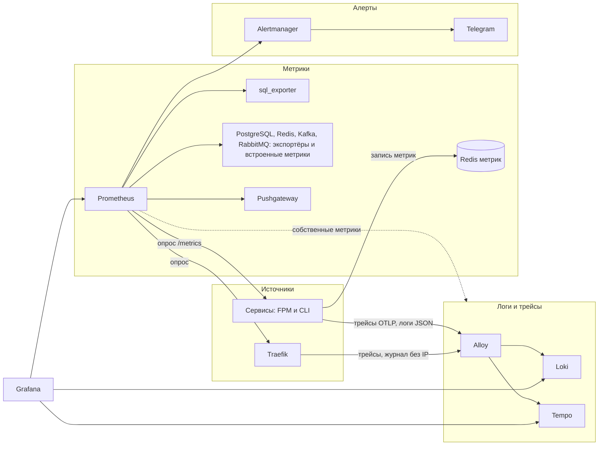

# ADR-0006: Наблюдаемость

- Статус: принято
- Дата: 2026-10-21
- Уточняет: [ADR-0001](0001-monorepo-and-structure.md) — correlation id это trace id из `traceparent`, отдельного заголовка нет; [ADR-0002](0002-service-boundaries-and-data-ownership.md) — сроки хранения логов, трейсов и метрик, IP-адрес в журнале шлюза, токен для `/metrics`, отдельный Redis для метрик, роль метрик и учётные записи мониторинга; [ADR-0003](0003-sync-and-async-interactions.md) — отставание консьюмеров и алерты на очереди; [ADR-0004](0004-booking-saga.md) — контроль расхождения часов, уведомления о принудительных завершениях; [ADR-0005](0005-outbox-and-inbox.md) — `traceparent` в конверте, проверка correlation id на шлюзе, журнал PostgreSQL без ошибок запросов

## Контекст

**НФТ-15** требует:
- сквозной трейс от запроса до канала и провайдера;
- алерты со стартовыми порогами из раздела 6 PRD;
- чтобы каждый алерт сработал, а срабатывание осталось в журнале.

**НФТ-14:** тестовые маркеры ПДн не должны находиться в логах, трейсах и метриках.

Прошлые ADR оставили этому решению:
- **ADR-0002** — срок хранения логов (IP-адрес — это ПДн), разрешённый список атрибутов спанов, запрет объектов сообщений и тел запросов в логах.
- **ADR-0003** — алерты на возраст очередей и outbox, на альтернативный обменник, на сообщения, застрявшие при dead-letter, и на failure transport; отставание консьюмеров.
- **ADR-0004** — heartbeat планировщика сроков, метрика «ожидает оплаты дольше D + 2 мин» вне планировщика, алерты саги, расхождение часов.
- **ADR-0005** — метрики и алерты outbox и inbox, сверка НФТ-7, проверка correlation id на шлюзе.

Ограничения:
- **Р-1:** весь стек помещается на машине разработчика.
- **PHP-FPM не делит память** между запросами, а CLI-воркеры живут долго.
- **Стенд:** один хост, у всех контейнеров одни часы.
- **Сборщик логов:** Promtail снят с поддержки 2 марта 2026 года, ему на смену пришёл Grafana Alloy.
- **RabbitMQ:** у кворумных очередей нет возраста головного сообщения. Воркеры Messenger забирают сообщения через `basic.get`, поэтому число консьюмеров у очереди всегда 0.

Механика OpenTelemetry для PHP, promphp, Alloy, Loki, Tempo, Prometheus, RabbitMQ, экспортёров и Traefik сверена с их документацией и исходным кодом.

## Варианты

1. **Всё через OpenTelemetry:** трейсы, метрики и логи — через SDK и коллектор.
   - Плюсы: один стандарт и один протокол.
   - Минусы:
     - метрики OpenTelemetry под PHP-FPM ломаются: каждый запрос отправляет свой счётчик с нуля, а дельты в Prometheus пока экспериментальны;
     - логи по OTLP — ещё одна сетевая зависимость на каждый запрос.
2. **Гибрид:** трейсы OpenTelemetry, метрики Prometheus через promphp, логи в JSON в stdout; логи и трейсы собирает Alloy.
   - Плюсы:
     - у каждого сигнала зрелый для PHP путь;
     - логи не зависят от сети;
     - алерты — правила Prometheus с тестами.
   - Минусы: три механизма вместо одного, свой код передачи контекста и выборки.
3. **Готовые стеки.**
   - ELK — Elasticsearch на JVM, это память (Р-1).
   - Облачные сервисы отпадают: ПДн и требование хранить данные в России (ADR-0002).
   - Образ grafana/otel-lgtm годится только для разработки, и ему нужно не меньше 2 ГБ.

## Решение

Гибрид:
- трейсы OpenTelemetry → Alloy → Tempo;
- логи в JSON → Alloy → Loki;
- метрики — Prometheus опрашивает сервисы и экспортёры;
- алерты — правила Prometheus → Alertmanager → Telegram;
- просмотр — Grafana.

### Телеметрия не тормозит работу

Телеметрию можно потерять, но она не должна замедлять запросы, шаги и консьюмеры. Иначе медленный Alloy или Redis метрик положил бы продукт.

**Трейсы.**
- `platform` отправляет их своим транспортом OTLP: без повторов, без учёта `Retry-After`, через HTTP-клиент без инструментации.
  - Транспорт SDK по умолчанию повторяет отправку до трёх раз и ждёт столько, сколько просит `Retry-After`. HTTP-клиент, который SDK находит сам, попадал бы под автоинструментацию, и экспорт трейсов порождал бы новые спаны.
- Таймаут — 200 мс в FPM и 1 с в CLI.

**Метрики.**
- Клиент Redis метрик держит постоянное соединение с таймаутами не больше 100 мс. У promphp по умолчанию таймаут чтения 10 с.
- Обновления копятся и пишутся вместе: в FPM — в `kernel.terminate`, уже после ответа, в CLI — после обработки сообщения или итерации.
- Если Redis метрик недоступен, обновления теряются, а `/metrics` отвечает 200 с `metrics_storage_up 0`.

**Предохранитель.** Если отправка трейсов или запись метрик не удалась или заняла больше половины таймаута, следующие 30 с они пропускаются. В FPM флаг лежит в APCu и общий для пула. Пропуски считаются — в APCu или в памяти процесса — и уходят в метрику со следующей удачной записью: так видно, что счётчики на нагрузочном тесте занижены.

**Проверка.** Во время нагрузочного теста Toxiproxy обрывает связь с Alloy и Redis метрик или добавляет задержку чуть меньше таймаута, например 80 мс. p95 создания брони остаётся в пределах НФТ-3, а темп воркеров не падает.

### Трейсы

**SDK и пакеты.**
- Расширение `opentelemetry`, SDK и расширение `protobuf`; экспорт — OTLP по http/protobuf в Alloy.
- Автоинструментация — только нужные пакеты:
  - Symfony — HttpKernel, HttpClient и Messenger. Messenger отдельно не выключается, а контекст между процессами не передаёт: это делает `platform` (см. «Передача контекста»);
  - Doctrine DBAL. PDO не ставится, чтобы спаны базы не дублировались.
- Инструментации ext-amqp и ext-rdkafka не ставятся: они перезаписывают `traceparent`, сохранённый в outbox.

**Экспорт.**
- **FPM:** пакетный процессор отправляет спаны в конце запроса, после `fastcgi_finish_request`, — клиент не ждёт. Переменные `OTEL_*` передаются через `env[]` пула: по умолчанию FPM чистит окружение.
- **CLI:** своего потока у пакетного процессора в PHP нет. Поэтому `platform` отправляет спаны по расписанию, не чаще раза в секунду, а ещё в простое и при остановке. В воркерах Messenger для этого служат события воркера, а в циклах relay и консьюмера Kafka — свой обработчик сигналов.
- **Очередь процессора** увеличена, чтобы массовые запросы не теряли спаны.

**Сэмплер `platform`.**
- Трейс может начаться только:
  - со спана входящего HTTP-запроса — кроме `/metrics` и `/health`;
  - со спана обработки сообщения;
  - со спана задачи, который `platform` открывает, когда опрос нашёл работу.

  Корневой спан другого вида — запрос к базе, Redis или HTTP вне запроса и сообщения — отбрасывается. Иначе каждый пустой опрос очереди, outbox и планировщика давал бы отдельный трейс, и Tempo заполнялся бы ими.
- Дочерний спан следует решению родителя в том же процессе.
- Спан с родителем из другого процесса и разрешённый корневой спан записываются по доле от trace id. Доля одна во всех сервисах, поэтому решение для одного trace id везде одинаковое.
- Флаг выборки во входящем `traceparent` не учитывается: клиент не может выключить запись.

**Выборка.**
- **Разработка, смоук-тест и учения** — 100 %.
- **Нагрузочный профиль** — доля меньше 100 %. Цепочка записывается целиком или не записывается совсем, потому что решение зависит только от trace id. Шлюз записывает все запросы.
- **Выборки по хвосту нет:** асинхронная цепочка длиннее окна ожидания хвостового сэмплера.

**Передача контекста.**

| Переход | Как |
|---|---|
| HTTP между сервисами | автоинструментация HttpClient и HttpKernel |
| запись в outbox | `platform` кладёт текущий контекст в заголовки строки. Relay публикует его без изменений, а его спан отправки ссылается на этот контекст (link) |
| RabbitMQ и очереди в базе | сериализатор `platform` при разборе создаёт штамп трассировки — из заголовка `traceparent` или из сохранённого штампа. Штамп переживает запись в failure transport, как штамп id и времени (ADR-0005). Слушатель `WorkerMessageReceivedEvent` с низшим приоритетом делает этот контекст текущим: событие приходит раньше, чем воркер передаёт сообщение в шину, поэтому спан обработки Messenger становится дочерним. Для одного сообщения соглашения OpenTelemetry такого родителя разрешают. После обработки или сбоя слушатель снимает контекст — позже записи в failure transport, а на всякий случай ещё и при следующем приёме |
| фоновый шаг | при постановке шаг получает текущий контекст в штампе, воркер делает его родителем |
| Kafka | спан пачки ссылается на контексты сообщений. Шаг, поставленный по сообщению, несёт контекст этого сообщения, поэтому цепочка «изменение наличия → канал» продолжается в трейсе события. Склеенная отправка в канал: родитель — первый контекст, остальные — ссылки, их число ограничено |
| провайдер и каналы | спан клиента HttpClient; `traceparent` уходит и к ним (см. «Принятые риски» в разделе «Correlation id») |
| планировщики и суточные задачи | свой корневой спан задачи |

- Отсутствующий или неверный `traceparent` не делает сообщение неразобранным: обработка начинает новый трейс.
- Распространяется только `tracecontext`. Заголовок `baggage` клиента дальше не передаётся, в конверте сообщения есть только `traceparent`.

**Модель спанов.**
- **Одна цепочка брони — один трейс:** запрос гостя → удержание → outbox → обработка команды в payment → шаг списания → исход → шаг «подтвердить» → событие наличия → канал.
- **Отдельные трейсы со ссылками на цепочку:** спаны отправки relay и спаны пачек Kafka.
- **Свои трейсы** у действий планировщиков, например у закрытия в D и у С-2. Связь с цепочкой — по id брони в логах.

**Фильтр ПДн в Alloy** — вторая линия защиты после кода.
- Атрибуты спанов, событий, ссылок и ресурса проходят по точному списку.
  - **Остаются:**
    - `http.request.method`, `http.route`, `http.response.status_code`;
    - `server.address`, `server.port`;
    - `messaging.system`, `messaging.destination.name`, `messaging.operation.name`, `messaging.operation.type`, `messaging.message.id`, `messaging.destination.partition.id`, `messaging.kafka.offset`;
    - `db.system.name`, `db.operation.name`, `db.collection.name`;
    - `error.type`, `exception.type`;
    - `app.booking.id`, `app.hotel.id` — внутренние id, их и так несут события;
    - `service.name`, `service.version`, `deployment.environment.name`.
  - **Остальное выбрасывается.** В частности:
    - `url.full`, `url.path`, `url.query`;
    - `user_agent.original`, `client.address`, `network.peer.address`;
    - `db.query.text`;
    - `exception.message`, `exception.stacktrace`;
    - аргументы процесса.
- Текст статуса спана стирается: в нём текст исключения.
- `tracestate` стирается: его задаёт клиент.
- Имя спана базы Alloy заменяет операцией и таблицей из начала текста запроса, а если разобрать текст не удалось — постоянным `db`: в исходном имени может оказаться сам запрос.

**Tempo.** Монолитный режим с локальным хранилищем, хранение 7 дней. По умолчанию Tempo хранит 14 дней, а в Tempo 3 переделана архитектура хранения. Поэтому развёртывание проверяет действующий срок через `/status/config`.

### Correlation id

Correlation id — это trace id из W3C `traceparent`, отдельного заголовка нет.
- **Шлюз.** Traefik начинает трейс или принимает валидный входящий `traceparent`. Неверный он заменяет новым — это и есть проверка «валидный или новый» (ADR-0005).
  - Трассировка включена на всех маршрутах шлюза: маршрут без неё пропустил бы заголовок клиента как есть.
  - Свой id запроса Traefik не генерирует, но пишет `TraceId` в журнал доступа.
- **Логи.** Trace id стоит в каждом логе: процессор Monolog в `platform` берёт текущий контекст.
- **Ответы.** Problem Details несут `trace_id`: гость или отель называет его поддержке. Это подсказка для поиска, а не доказательство владения. Повтор с тем же ключом идемпотентности возвращает сохранённый ответ с исходным `trace_id`.
- **Сообщения.** Конверт несёт `traceparent` (ADR-0001).
- **Принятые риски.**
  - Клиент, который жёстко задаёт свой `traceparent`, склеивает свои запросы в один трейс. Tempo тогда обрежет слишком большой трейс, а логи этого клиента окажутся под одним `trace_id`. Нагрузочный тест `traceparent` не задаёт.
  - Провайдер и каналы получают trace id цепочки и могут прислать его обратно в своих запросах — тогда их записи окажутся в том же трейсе. Прочитать трейс они не могут, а разбор опирается на id брони.

### Логи

**Формат.** Monolog пишет JSON в одну строку в stdout. Поля:
- `@timestamp` в UTC с миллисекундами;
- `level`;
- `message` — постоянный текст, без подстановки значений;
- `event` — постоянное имя события;
- `service`;
- `trace_id` и `span_id`;
- поля контекста по разрешённому списку: id брони, отеля, сообщения и строки outbox, очередь или топик, SQLSTATE и имя ограничения;
- `exception.class` и стек вызовов без аргументов функций (`zend.exception_ignore_args`). Текст исключения не пишется.

**Записи фреймворка.** Symfony, Messenger и обработчик ошибок PHP пишут готовые сообщения с текстом исключения и полным URL, причём на уровнях warning и выше. Пример — «Uncaught PHP Exception» в канале `request` и ошибки обработки в `messenger`. Поэтому форматтер `platform` переписывает записи, которые сделал не `platform`:
- `message` заменяется постоянным именем из канала, уровня и класса исключения;
- контекст вне разрешённого списка выбрасывается, в том числе `error` и текст исключения.

Каналы `request`, `http_client` и `messenger` пишутся с уровня warning, чтобы не было трёх строк на каждое сообщение.

**Мимо Monolog.**
- `display_errors=0` и `log_errors=0`: ошибки PHP пишет только обработчик Symfony через Monolog. Ошибка до его регистрации видна по коду ответа и выходу процесса.
- Падение консольной команды выводит только класс исключения — это делает слушатель `ConsoleErrorEvent`.
- Slowlog FPM выключен (`request_slowlog_timeout=0`): в нём путь и строка запроса.
- Оставшиеся строки сервиса не в JSON — сообщения мастера FPM и супервизора — Alloy заменяет постоянным текстом и считает метрикой.

**Запреты.**
- Тела запросов, объекты сообщений и ПДн в логи не попадают (ADR-0002).
- Внешний id брони канала тоже не попадает: это косвенный идентификатор гостя (ADR-0003).
- Текст ошибок базы очищен в источнике (ADR-0005).
- Процессор маскирует известные поля ПДн — вторая линия защиты.

**Журнал PostgreSQL** пишется без значений и текста запросов по настройкам ADR-0005.
- Ошибки запросов в него не пишутся вовсе (`log_min_messages=log`): основной текст ошибки типа несёт значение, например `invalid input syntax for type uuid: "…"`. Ошибки запросов видны в логах приложения по SQLSTATE.
- Вместе с ошибками из журнала уходят и предупреждения сервера, в том числе о приближении к переполнению номеров транзакций. Его заменяет метрика возраста `datfrozenxid` и алерт.
- Медленные запросы в журнал не попадают (`log_min_duration_statement=-1`).

**FPM и фронт.**
- Перед FPM стоит фронт FastCGI, выбор делает шаблон сервиса. Свой журнал доступа у фронта выключен: иначе в Loki попал бы адрес из `X-Forwarded-For`. Журнал доступа ведёт только Traefik.
- Строки воркеров FPM доходят целыми: `catch_workers_output=yes`, `decorate_workers_output=no`, `log_limit` не меньше 8 КиБ.

**Сбор.**
- Alloy находит контейнеры стенда через `discovery.docker`, читает их логи через `loki.source.docker` и разбирает JSON. К Docker API он ходит через прокси со списком путей (см. «Доступ и роли»).
- Метки Loki — сервис, уровень и источник: сервис, шлюз или инфраструктура. `trace_id` и `span_id` уходят в структурированные метаданные. Id в метки не попадают.
- Из логов шлюза и инфраструктуры Alloy вырезает IP-адреса, а из логов Alertmanager — токен бота: при ошибке отправки он может оказаться в URL.

**Сырые логи контейнеров.** Docker хранит json-файлы с ротацией по размеру (`max-size`, `max-file`), поэтому на тихом стенде строки живут дольше 14 дней. Это строки до фильтра Alloy, и граница ПДн в них — правила источников: журнал PostgreSQL без ошибок запросов, ошибки PHP только через Monolog, журнал доступа шлюза без IP и пути. Проверка НФТ-14 ищет маркеры и в сырых логах. Два принятых исключения:
- строка мастера FPM о превышении `request_terminate_timeout` несёт путь и строку запроса, а в строке запроса может быть всё, что прислал клиент. Обрыв запроса — последняя страховка и бывает редко. В Loki эту строку Alloy заменяет, а сырой лог видят только доступ к Docker на хосте и Alloy;
- если Alertmanager при ошибке отправки пишет URL с токеном бота, токен остаётся в сыром логе. Его видят доступ к Docker на хосте, с которым доступен и файл с токеном, и Alloy. Что пишет Alertmanager, проверяется на этапе 3. Если пишет, логи Alertmanager Alloy не собирает: ошибки доставки и так видны по метрике.

**Loki.** Хранение 14 дней задаёт компактор: `retention_enabled` и `delete_request_store`. Без компактора Loki хранит логи вечно.

**Журнал доступа шлюза.**
- JSON. Поля `ClientHost`, `ClientAddr`, `ClientPort` и `RequestPath` выброшены: IP-адрес клиента не пишется, а в пути есть строка запроса, которую задаёт клиент.
- Заголовки выброшены, так у Traefik по умолчанию.
- Остаются метод, маршрут (`RouterName`), статус, длительность и `TraceId`.
- Служебный журнал Traefik — уровень WARN. Что адресов клиентов в нём нет, проверяет поиск тестового IP в сырых логах.
- Правило для контрактов: в пути и строке запроса API нет ПДн, токенов и внешних id брони.

### Метрики

**Имена и метки.**
- Имена по правилам Prometheus, базовые единицы — секунды и байты, у счётчиков `_total`.
- Метки низкой кардинальности: сервис, исход или причина, канал, брокер, очередь или топик, вид шага. Значения — из закрытых наборов, неизвестное значение становится `other`.
- Id и ПДн в метках не бывает.
- Известные наборы меток заводятся с нулём при старте, иначе первое событие нового ряда не видно в `increase()`.

**Хранилище — promphp в отдельном Redis.**
- PHP-FPM и CLI-воркеры сервиса пишут метрики через promphp в отдельный маленький Redis. Он без вытеснения и без записи на диск, с пользователем ACL на сервис.
- Адаптер — RedisNg: он собирает ряды без `KEYS`, а обычный адаптер для сводок вызывает `KEYS`.
- Правила ADR-0002 для общего Redis не меняются: там у каждого ключа есть срок жизни, а ключи метрик живут без срока.
- `maxmemory` задан явно, заполнение больше 80 % даёт алерт.
- `metrics_storage_up` обработчик `/metrics` ставит по пробной записи, а не по чтению: когда память кончилась, запись падает, а чтение работает.
- Prometheus ограничивает число рядов и длину значений меток у каждой цели (`sample_limit`, `label_value_length_limit`).

**`/metrics` и статус FPM.**
- `/metrics` отдаёт отдельный маленький пул FPM на внутреннем маршруте, с bearer-токеном Prometheus; механизм токена — ADR о доступе. Через шлюз он не доступен.
- Статус основного пула отдаёт `pm.status_listen` на unix-сокете внутри контейнера, а обработчик `/metrics` добавляет его в свой ответ. Так статус доступен, даже когда все процессы основного пула заняты, и не виден из сети.

**Heartbeat процессов.**
- Gauge «последний такт» с меткой `slot` — номером процесса у супервизора. Это около 50 рядов на стенде.
- Такт ставится только после здоровой итерации. Процесс, который ждёт базу или готовности или падает раньше первой итерации, тактов не даёт.
- Сервис отдаёт ожидаемое число процессов каждой роли из своей конфигурации. Алерт срабатывает, если процессов со свежим тактом меньше ожидаемого дольше 5 минут, — запуск и выкладка в это время укладываются. Так виден и процесс без ряда: остановленный или потерявший ряд вместе с Redis метрик.
- Свежий такт моложе самой долгой законной итерации роли, например ожидания relay в Kafka после перехвата блокировки (ADR-0005).
- Счётчик запусков пишется при старте процесса и ловит процесс, который падает по кругу, но между падениями успевает дать такт. Он считается по слоту, а не по роли: выкладка перезапускает все процессы роли сразу.
- Жизнь критичных процессов видна и по симптомам в базе — их считает SQL. Так алерты о деньгах не зависят от того, что пишет сам процесс.

**Деньги, ПДн и задачи — из базы.** Алерты по деньгам, срокам ПДн и периодическим задачам считает `sql_exporter` по долговечному состоянию:
- журнал переходов брони;
- брони и возвраты;
- outbox, записи на ручном разборе, записи запусков суточных задач, результаты проверки сопоставлений.

Счётчик в Redis можно потерять, а запись в базе нет.

**Отставание консьюмеров** считается на стороне брокера и базы:
- **RabbitMQ** — готовые сообщения очереди, делённые на скорость подтверждений (`queue_messages_acked_total` из семейства `queue_delivery_metrics`).
  - Мёртвый консьюмер даёт бесконечность — это и есть правило «сообщения есть, выдач нет».
  - Если брокер не отдаёт ряд подтверждений совсем, например когда закрыты все каналы воркеров очереди, правило срабатывает по самим готовым сообщениям: `ready > 0 unless rate(acked) > 0`.
  - Очередь без трафика даёт пустой результат и тишину.
  - Очередь разбора в правило не входит, у неё свой алерт.
- **Kafka** — отставание группы в сообщениях, делённое на скорость фиксации смещений.
- **Очереди в базе** — возраст самого старого готового шага по SQL. Шаги, отложенные для повтора, не считаются.

Гистограмму консьюмера «время обработки минус время создания» видно на дашбордах, алерты по ней не строятся. Перехватчик времени приёма RabbitMQ не включается: свойство `timestamp` остаётся временем создания, на нём стоят сроки хранения (ADR-0003).

**Метрики НФТ.**

| НФТ | Метрика |
|---|---|
| НФТ-2 | гистограмма по каналу: ответ 2xx канала минус время события в inventory; плюс по SQL возраст самого старого неотправленного изменения канала |
| НФТ-3, НФТ-4 | длительность запросов по маршрутам Traefik; среди корзин есть 0,2 и 0,3 с |
| НФТ-5 | длительность саги от создания до исхода, по исходу |
| НФТ-7 | категории сверки, отсечённые дубли, заменённые события, сообщения вне окна inbox |
| НФТ-8, НФТ-16 | число и возраст ожидающих строк outbox по брокеру |
| НФТ-9 | удержания, у которых срок прошёл больше 60 с назад, а они не освобождены, — SQL |
| НФТ-10 | брони «ожидает оплаты» дольше D + 5 мин — SQL |
| НФТ-11 | попытки списания по исходу |
| НФТ-13 | длительность приёма вебхука по маршруту Traefik |

**SQL-метрики.**
- `sql_exporter` работает под ролью метрик и читает агрегирующие представления без ПДн в базах сервисов. Представления создают миграции сервиса, и отдают они только числа и возраст:
  - брони «ожидает оплаты» старше D + 2 и D + 5 мин;
  - принудительные завершения и противоречия исходов за последние 15 минут — по журналу переходов;
  - возвраты «не удался»; исходы, не выясненные 7 дней; email за 14 дней до предельного срока; ручной разбор после обезличенного email;
  - удержания с прошедшим сроком, которые не освобождены;
  - ожидающие строки outbox по брокеру — число и возраст; строки на разборе и отброшенные; держатель блокировки relay в Kafka по `pg_locks`;
  - строки failure transport — все, включая отложенные, и возраст по исходному времени создания;
  - отложенные сообщения Kafka — число и возраст;
  - возраст самого старого готового шага по виду шага;
  - запас партиций и партиции, которые не удалось удалить;
  - записи на ручном разборе в channel-sync, самое старое неотправленное изменение канала, отмены из канала, которые ждут брони, сопоставления, которые channel-sync при старте нашёл битыми;
  - итоги сверок С-3 и С-5;
  - время последнего успешного запуска суточных задач;
  - данные старше своего срока хранения — признак того, что задача сроков ПДн не отработала.
- Опрос — раз в 30–60 с, дорогие запросы кешируются.

**Экспортёры и цели.** Prometheus опрашивает их сам, без remote write:
- PostgreSQL — `postgres_exporter`;
- Redis — `redis_exporter` для обоих Redis;
- Kafka — `kafka_exporter`, версия брокера задаётся явно;
- RabbitMQ — встроенный `/metrics/detailed` с семействами `queue_coarse_metrics` и `queue_delivery_metrics`;
- Traefik — с корзинами под НФТ-3 и метками маршрутов;
- собственные метрики Prometheus, Alertmanager, Alloy, Loki и Tempo — на них стоят алерты о конвейере телеметрии и о доставке уведомлений.

Встроенные экспортёры Alloy не используются, чтобы `up` значило одно и то же для всех целей.

**Pushgateway** — только для задач эксплуатации вне сервисов: сверки НФТ-7 и очистки очереди разбора.
- `honor_labels: true`, группировка по задаче.
- Успешный запуск пишет свою группу через `PUT`, неудачный — отдельную группу, поэтому сбой не стирает результат последнего успешного.
- Файл хранения на томе, иначе рестарт стирает результаты.
- Basic auth действует на все пути: учётные данные есть у Prometheus для опроса и у задач эксплуатации для записи, у сервисов их нет.
- На постоянном стенде сверка НФТ-7 идёт раз в сутки и в конце каждого учения, очистка очереди разбора — раз в сутки. Алерты «не отработала» включаются вместе с расписанием.

**Часы** (ADR-0004).
- Каждый сервис отдаёт gauge «часы сервиса минус часы базы». Часы базы берутся из `clock_timestamp()`, а не `now()`, с поправкой на задержку запроса.
- Алерт — если разброс по всем сервисам больше 1 с.
- На одном хосте разброс всегда 0, поэтому алерт проверяется тестовым сдвигом в `ClockInterface`.
- На нескольких хостах добавляется смещение NTP каждого узла.

**Prometheus.** Хранение 15 дней с пределом по размеру, правила оцениваются раз в 15 с. Admin API и lifecycle выключены, а пределы запросов (`--query.max-samples`, `--query.max-concurrency`) снижены: тяжёлый запрос не должен уронить алерты. Предел действует и на правила, поэтому он с запасом выше самого тяжёлого правила, а ошибки вычисления правил дают свой алерт.

### Алерты

**Доставка.**
- Правила лежат в `deploy/observability` рядом с тестами `promtool test rules`, CI запускает тесты, `promtool check config` и `amtool check-config` для конфигурации Alertmanager.
- Alertmanager группирует алерты по имени и сервису и отправляет их в Telegram. Токен бота лежит в файле вне репозитория, исходящие соединения к Telegram разрешает ADR о доступе.
- В тексте алерта только метки и аннотации, без ПДн и без внешнего id брони канала. Подробности дежурный получает консольной командой сервиса-владельца (Р-11).
- События — принудительное завершение, новый овербукинг, противоречие исходов, «возврат не удался» — считаются за окно 15 минут. Пока события идут, раз в 15 минут приходит одно уведомление с их числом за окно. Для этого у них свой маршрут в Alertmanager: `group_interval` 15 минут и `repeat_interval` 14 минут. Повтор Alertmanager проверяет только на тике `group_interval`, а время прошлого уведомления записывает после отправки, чуть позже тика. Поэтому при равных интервалах уведомление приходило бы раз в 30 минут.
- Если Prometheus или `sql_exporter` не работал дольше окна, события за перерыв уведомления не дадут. Их смотрят консольной командой сервиса-владельца — это шаг runbook после сбоя мониторинга. Следы в базе остаются: причина «завершена принудительно» и противоречие исходов — в журнале переходов, статус возврата «не удался» — у брони, флаг овербукинга — у брони из канала.
- Подавление касается только предупреждений: при недоступном брокере — алертов отставания, при недоступном хранилище метрик или PostgreSQL — алертов о тактах. Алерты о деньгах не подавляются никогда.
- Ошибки доставки видны по `alertmanager_notifications_failed_total` в Grafana: алерт о них уходит в тот же Telegram и до дежурного может не дойти. Внешний получатель — Watchdog, он включается только на постоянно работающем стенде.
- Тишина в Alertmanager сама даёт алерт, но широкая тишина глушит и его. Поэтому по runbook тишину ставят только с именем алерта, а активные тишины видны на панели в Grafana.

**Журнал срабатываний.**
- Ряд `ALERTS` хранится в Prometheus 15 дней.
- Каждое учение и каждый сценарий проверки алертов сохраняет в отчёт имя, важность, сервис и время срабатывания из `ALERTS{alertstate="firing"}`. Метка `instance` в отчёт не попадает: на стенде в ней адрес.
- Каждый алерт срабатывает хотя бы на одном учении или в сценарии проверки на стенде (PRD, НФТ-15). Сценарий может:
  - создать данные со сдвинутым временем через консольные команды сервиса-владельца;
  - включить Toxiproxy;
  - сдвинуть часы в `ClockInterface`;
  - временно задать короткие пороги и бюджеты.

**Каталог.**
- Важность `critical` — нужны действия сейчас: деньги, наличие, сроки ПДн, потеря сообщений и отказ публичного API. `warning` — задержки, причины и ранние предупреждения. Например, у остановленного процесса или relay без блокировки есть своё critical-последствие — возраст outbox или ожидание оплаты.
- Длительность указана в правиле; если её нет, алерт срабатывает с первой оценки.
- Правило по счётчику событий срабатывает и на появление нового ряда: первое событие после перезапуска источника `increase()` не видит.
- SQL-ряды о деньгах и сроках ПДн проверяются и на отсутствие (`absent()`): упавший запрос `sql_exporter` иначе молча глушил бы алерт.
- Пороги стартовые и уточняются по нагрузочным тестам.

**Сага и деньги**

| Алерт | Правило и источник | Важность | Откуда | Где проверяется |
|---|---|---|---|---|
| бронь ожидает оплаты дольше D + 2 мин | SQL: таких броней больше 0 | critical | PRD, ADR-0004 | сценарий: остановлен планировщик сроков |
| принудительное завершение | SQL: завершения за 15 мин | critical | PRD, С-2 | сценарий: booking лежит дольше D + 5 мин |
| возврат «не удался» | SQL: новые за 15 мин | critical | PRD | учение «провайдер оплаты отвечает 5xx» с коротким бюджетом возврата |
| противоречие исходов оплаты | SQL: журнал переходов за 15 мин | critical | ADR-0004 | сценарий: заглушка «списал, но ответил отказом» |
| сверка нашла списание без возврата | SQL: итоги сверки | critical | PRD | сценарий: данные со сдвинутым временем |
| исход не выяснен дольше 7 дней | SQL | warning | PRD | сценарий: данные со сдвинутым временем |
| email за 14 дней до предельного срока | SQL | warning | PRD | сценарий: данные со сдвинутым временем |
| ручной разбор после обезличенного email | SQL | critical | ADR-0004 | сценарий: данные со сдвинутым временем |
| сверка платежей не отработала | SQL: последний успешный запуск старше 26 ч | warning | Р-12 | сценарий: сверка остановлена |

**Каналы и HTTP**

| Алерт | Правило и источник | Важность | Откуда | Где проверяется |
|---|---|---|---|---|
| доля 5xx больше 2 % за 5 минут | Traefik, по группе публичных маршрутов, при минимальном трафике | critical | PRD | сценарий: inventory недоступен |
| синхронизация с каналом медленнее 10 с дольше 10 минут | p95 НФТ-2 или самое старое неотправленное изменение канала старше 10 с | warning | PRD | учение «канал отвечает 429» |
| новый овербукинг из канала | SQL: брони с флагом за 15 мин | critical | PRD | сценарий: продажа из канала сверх наличия |
| ответы 401 на вебхуки | счётчик Traefik по маршруту | warning | PRD | сценарий: неверная подпись |
| ответы 403 «канал не подключён» | счётчик Traefik по маршруту | warning | PRD, К-2 | сценарий: чужой отель |
| бронь из канала ждёт ручного разбора | SQL: записи на разборе; канал номер уже продал, а наличие этого ещё не учитывает | critical | PRD | сценарий: несопоставленный тип номера |
| сопоставление ссылается на удалённый тип | SQL: битые сопоставления, найденные при старте channel-sync | warning | ADR-0002 | сценарий: удалённый тип |
| отмена из канала ждёт брони дольше 15 минут | SQL | warning | PRD, К-3 | сценарий: отмена без брони |

**Сообщения и очереди**

| Алерт | Правило и источник | Важность | Откуда | Где проверяется |
|---|---|---|---|---|
| отставание консьюмера больше 60 с дольше 5 минут | RabbitMQ, Kafka и очереди в базе — см. «Отставание консьюмеров» | warning | PRD, ADR-0003 | учение «консьюмер упал посреди пачки» |
| процессов роли со свежим тактом меньше ожидаемого дольше 5 минут, в том числе у планировщика сроков | heartbeat и ожидаемое число процессов | warning | ADR-0003, ADR-0004, ADR-0005 | сценарий: остановлен планировщик; не применена миграция |
| процесс перезапускается по кругу | больше трёх запусков одного слота за 10 минут | warning | — | сценарий: процесс падает на «ядовитом» сообщении |
| в очереди разбора есть сообщения | очередь альтернативного обменника не пуста | critical | PRD (DLQ), ADR-0003 | сценарий: сообщение без маршрута |
| failure transport не пуст | SQL: все строки, включая отложенные | critical | PRD (DLQ, К-1), ADR-0003 | учение «провайдер оплаты отвечает 5xx» |
| сообщения застряли при dead-letter | метрика кворумной очереди об ожидающих dead-letter, имя уточняется на этапе 3 | warning | ADR-0003 | сценарий: на тестовом стенде отвязана очередь разбора |
| возраст ожидающих строк outbox больше 60 с дольше 2 минут | SQL | critical | ADR-0005, НФТ-16 | учение «Kafka недоступна 10 минут» |
| строка outbox на разборе или отброшена | SQL | critical | ADR-0005 | сценарий: сообщение больше лимита брокера |
| общий отказ relay дольше минуты | счётчик отказов relay | warning | ADR-0005 | учение «Kafka недоступна 10 минут» |
| у relay в Kafka нет держателя блокировки дольше 2 минут | SQL по `pg_locks` | warning | ADR-0005 | сценарий: relay остановлен |
| есть отложенные сообщения Kafka | SQL; за 7 дней до 30 — critical | warning | ADR-0003, ADR-0005 | сценарий: «ядовитое» сообщение |
| сообщение из RabbitMQ вне окна inbox | счётчик по источнику; ручной повтор из failure transport и возврат из разбора с заголовком инструмента не считаются, из Kafka — только метрика | warning | ADR-0005 | сценарий: в очередь опубликовано сообщение старше 7 дней |
| сверка НФТ-7 нашла потерю | Pushgateway: «потеряно» больше 0 | critical | НФТ-7, ADR-0005 | учения «Kafka недоступна» и «консьюмер упал» |

**Задачи, партиции и ПДн**

| Алерт | Правило и источник | Важность | Откуда | Где проверяется |
|---|---|---|---|---|
| удержания не освобождаются | SQL: срок прошёл больше 60 с назад | critical | НФТ-9 | сценарий: остановлена задача истечения |
| запас партиций меньше 7 дней | SQL | critical | ADR-0005, Р-23 | сценарий: на тестовом стенде удалены будущие партиции |
| партиция не удалена | SQL: верхняя граница старше 8 дней и 26 часов — задача партиций идёт раз в сутки | warning | ADR-0005 | сценарий: ожидающая строка в старой партиции |
| задача сроков ПДн не отработала | SQL: данные старше срока остались — обезличивание, failure transport, тела outbox, ПДн вебхука, токен и email в payment | critical | ADR-0002, ADR-0003, ADR-0005 | сценарий: данные со сдвинутым временем |
| очистка очереди разбора не отработала | Pushgateway: успешный запуск старше 26 ч или его ряда нет; TTL очереди — только страховка, он длиннее сроков ПДн | critical | ADR-0003 | сценарий: задача остановлена |
| сверка НФТ-7 не отработала | Pushgateway: успешный запуск старше двух интервалов или его ряда нет | warning | ADR-0005 | сценарий: инструмент остановлен |

**Платформа**

| Алерт | Правило и источник | Важность | Откуда | Где проверяется |
|---|---|---|---|---|
| цель опроса недоступна дольше 2 минут | `up == 0` | warning | — | сценарий: остановлен экспортёр |
| PostgreSQL недоступен дольше минуты | `pg_up == 0`: при упавшей базе экспортёр отвечает, и его `up` остаётся 1 | critical | — | сценарий: остановлен PostgreSQL, алерты о тактах подавлены |
| основной Redis недоступен дольше 2 минут | `redis_up == 0` у основного Redis; сервисы работают и без него (Р-15) | warning | — | сценарий: остановлен основной Redis |
| нет хранилища метрик | `metrics_storage_up == 0` | warning | — | сценарий: остановлен Redis метрик |
| Redis метрик заполнен больше 80 % | `redis_exporter` | warning | — | сценарий: маленький `maxmemory` на тестовом стенде |
| FPM упёрся в предел дольше 5 минут | статус основного пула: `max_children` достигнут или очередь `listen` больше 0 | warning | НФТ-3 | нагрузочный тест |
| соединения PostgreSQL у предела дольше 5 минут | больше 80 % `max_connections` | warning | ADR-0003 | нагрузочный тест |
| разброс часов больше 1 с | метрика часов сервисов | warning | ADR-0004 | сценарий: сдвиг в `ClockInterface` |
| конвейер телеметрии теряет данные | отбросы в Alloy, Tempo или Loki за 10 минут | warning | — | сценарий: Tempo остановлен |
| уведомления не доставляются | рост `alertmanager_notifications_failed_total` за 15 минут; виден в Grafana | warning | — | сценарий: неверный токен бота |
| правило не вычисляется | рост `prometheus_rule_evaluation_failures_total` | critical | — | сценарий: заниженный предел запросов на тестовом стенде |
| запрос `sql_exporter` падает | ошибки запросов `sql_exporter` | critical | — | сценарий: сломанное представление на тестовом стенде |
| возраст транзакций PostgreSQL близок к пределу | `postgres_exporter`: возраст `datfrozenxid` больше половины предела | warning | — | сценарий: заниженный порог на тестовом стенде |
| в Alertmanager есть тишина | `alertmanager_silences{state="active"} > 0` | warning | — | сценарий: тишина на тестовый алерт |

### Дашборды

Дашборды хранятся как код в `deploy/observability`:
- обзор платформы — запросы, ошибки и длительность по сервисам;
- сага — ожидающие брони, исходы, длительность, возвраты;
- сообщения — outbox, relay, консьюмеры, очереди, отставание, DLQ, дубли и заменённые события;
- каналы — задержка синхронизации, 429, состояние breaker;
- инфраструктура — PostgreSQL, Redis, RabbitMQ, Kafka, FPM, телеметрия.

Grafana связывает лог и трейс по `trace_id` в обе стороны.

### Доступ и роли

**Сети.**
- Loki, Tempo, Alertmanager и Grafana стоят в отдельной сети, куда сервисы не входят. Prometheus и Alloy входят и в неё, и в сеть сервисов: Prometheus опрашивает цели, Alloy принимает OTLP.
- Prometheus, экспортёры и HTTP-сервер Alloy с его UI слушают только адрес в сети наблюдаемости, а в сети сервисов Alloy слушает только приёмник OTLP. Live debugging в Alloy выключен. Экспортёрам это нужно ещё и потому, что `redis_exporter` и `postgres_exporter` умеют подключаться к адресу, который задаёт запрос.
- Из сети сервисов видны только приёмник OTLP, Redis метрик и порты метрик RabbitMQ и Traefik — без ПДн.
- Как опубликовать на 127.0.0.1 порт процесса, который слушает только адрес в сети наблюдаемости, проверяется на этапе 3: при нескольких сетях Docker ведёт опубликованный порт в одну из них.
- Прокси Docker API стоит в своей сети, общей только с Alloy.

**Секреты** передаются контейнерам файлами — не переменными окружения и не аргументами командной строки: inspect в Docker API, который нужен Alloy, отдаёт и окружение, и команду запуска. Экспортёрам, которые принимают пароль только флагом, файл читает обёртка запуска.

| Кто | Что может | Ограничения |
|---|---|---|
| роль метрик PostgreSQL | только `SELECT` на агрегирующие представления без ПДн в базах сервисов; без `CREATE` и `TEMP` | граница — права, а не настройки: `default_transaction_read_only`, `statement_timeout` 5 с и `lock_timeout` 1 с защищают от ошибок, но роль может их переопределить. Представления с `security_barrier`; лимит соединений; исключение в `pg_hba`, как у роли проверок инвариантов (ADR-0002); секрет вне репозитория |
| экспортёр PostgreSQL | роль `pg_monitor` только в базе `postgres` | данных сервисов не читает; коллекторы с текстом запросов выключены |
| мониторинг Redis | `INFO`, `PING`, `LATENCY` и `SLOWLOG LEN` в обоих Redis | без `CONFIG` и `SLOWLOG GET`: они отдают пароли из настроек и аргументы команд. Экспортёр запускается без `CONFIG` |
| сервисы в Redis метрик | свой префикс, команды RedisNg и пробная запись | без `KEYS` и административных команд |
| экспортёр Kafka | своя учётная запись с правом Describe на группы и топики | сообщения не читает |
| Prometheus → `/metrics` сервисов | bearer-токен, механизм — ADR о доступе | не через шлюз |
| статус FPM | unix-сокет внутри контейнера | читает только обработчик `/metrics`; полный вывод с URI запросов не запрашивается |
| метрики Traefik | отдельная внутренняя точка входа | API и дашборд Traefik выключены, через шлюз метрики не доступны |
| порт метрик RabbitMQ | без аутентификации | виден из сети сервисов: данные без ПДн, а доступ к брокеру у сервиса и так есть |
| Pushgateway | basic auth на все пути: Prometheus читает, задачи эксплуатации пишут | у сервисов учётных данных нет |
| Loki и Tempo | принимают данные только от Alloy | в сети наблюдаемости |
| Alloy → Docker API | прокси со списком путей: `/_ping`, `/version`, `/events`, списки контейнеров и сетей, inspect и логи. Список сетей нужен `discovery.docker`: без него обновление обнаружения падает целиком, и Alloy не находит ни одного контейнера | `export` и `archive` закрыты, `docker.sock` напрямую не монтируется |
| Grafana | вход по паролю из файла вне репозитория, анонимный доступ выключен | на хосте только 127.0.0.1 |
| UI Alloy, Prometheus и Alertmanager | без входа | на хосте только 127.0.0.1 |
| Alertmanager → Telegram | токен бота из файла вне репозитория | исходящие — только к Telegram |

### Сроки хранения и ПДн

| Где | Срок | ПДн |
|---|---|---|
| логи сервисов, шлюза и инфраструктуры в Loki | 14 дней | нет: без тел, без IP, поля по списку |
| сырые json-логи Docker | ротация по размеру, временем не ограничены | нет по правилам источников, с двумя принятыми исключениями (см. «Сырые логи контейнеров»): это строки до фильтра Alloy; проверка — поиск маркеров |
| трейсы в Tempo | 7 дней | нет: атрибуты по списку, статус и `tracestate` стёрты |
| метрики в Prometheus | 15 дней и предел размера | нет: метки без id и ПДн |
| ряд `ALERTS` и отчёты учений | 15 дней в Prometheus; отчёты — в репозитории, без адресов | нет |
| сообщения в Telegram | по правилам Telegram | нет: только метки и аннотации |

### Ресурсы

Профиль compose «наблюдаемость» включается отдельно (Р-1).
- У каждого компонента `mem_limit`, а у программ на Go ещё `GOMEMLIMIT` около 85 % лимита.
- У Loki и Tempo пределы приёма: при перегрузке они отбрасывают данные, а не падают.
- Генератор метрик Tempo выключен.

| Профиль | Что включено | Оценка памяти |
|---|---|---|
| разработка | Alloy, Loki, Tempo, Prometheus, Grafana, Redis метрик | около 1 ГБ |
| стенд | всё, включая Alertmanager, Pushgateway и экспортёры | около 1,5 ГБ |
| нагрузка | как стенд, с долей выборки меньше 100 % | до 2 ГБ |

Оценки проверяются замером на этапе 3, потребление записывается в профиль стенда (PRD, раздел 6).

### Проверка

- **Смоук-тест** проверяет, что цепочка брони — один trace id с ожидаемым набором спанов и их родителей и со ссылками на спаны relay и пачек. Для этого в CI работают Alloy и Tempo.
- **Связь лога с трейсом** — у каждой строки лога запроса и сообщения есть `trace_id`.
- **Шлюз** — неверный `traceparent` клиента заменяется новым, флаг `-00` не выключает запись, `baggage` дальше сервиса не уходит.
- **Маркеры НФТ-14.** Тестовые маркеры ПДн и секретов ищутся в Loki, Tempo, метках Prometheus, текстах Alertmanager и в сырых логах контейнеров, включая PostgreSQL и Traefik. Исключены заглушки внешних систем и запуск тестов: они законно видят тестовые данные, а заглушки тела запросов не логируют. Секреты — токен бота, bearer-токен `/metrics`, API-ключ и подпись HMAC канала; ещё ищется тестовый IP клиента. Пути:
  - ошибка базы — ни в статусе, ни в событиях спана маркера нет;
  - маркер в параметре неверного типа — ошибка типа в PostgreSQL;
  - текст исключения при ответах 4xx и 5xx;
  - повтор Messenger;
  - падение консольной команды;
  - ошибка отправки в Telegram — токена бота нет в Loki.
- **Правила** — `promtool test rules` на каждый алерт, в том числе на отсутствие ряда и первое событие.
- **Сценарии проверки алертов** — каждый алерт срабатывает, отчёт сохраняет срабатывания. У алертов о событиях сценарий мерит и интервал между уведомлениями: он должен быть 15 минут.
- **Toxiproxy** на Alloy и Redis метрик, с обрывом и с задержкой чуть меньше таймаута, — запросы и воркеры не замедляются.
- **Простой стенда 5 минут** — ни одного нового трейса.
- **Redis метрик недоступен или заполнен** — сервисы работают, срабатывает «нет хранилища метрик».
- **Экспорт в FPM** не задерживает ответ.

## Последствия

- **Проще:**
  - один trace id в журнале шлюза, логах, трейсах и сообщениях;
  - алерты — код с тестами, и их не нужно настраивать руками в интерфейсе;
  - деньги и сроки ПДн видны по базе и не зависят от того, жив ли процесс, который пишет метрику.
- **Сложнее:**
  - своя передача контекста, свой сэмплер и свой транспорт OTLP в `platform`;
  - форматтер, который переписывает записи фреймворка;
  - роль метрик и представления в каждой базе;
  - отдельный Redis и Pushgateway;
  - правила Alloy — фильтр ПДн и разбор логов;
  - сценарии проверки для каждого алерта.
- **Риски:**
  - автоинструментация Symfony в тестах проверяется не на Symfony 7.4, а Messenger отдельно не выключается (Р-24);
  - метрики promphp пропадают вместе с Redis метрик, но алерты о деньгах и задачах от него не зависят;
  - имя метрики кворумной очереди об ожидающих dead-letter и поведение ряда подтверждений RabbitMQ при закрытых каналах уточняются на этапе 3;
  - сырые логи контейнеров на тихом стенде живут дольше 14 дней, и граница ПДн в них — только правила источников, с двумя принятыми исключениями.
- **Решают другие ADR и контракты:**
  - токен для `/metrics` и исходящие соединения к Telegram — ADR о доступе;
  - поле `trace_id` в Problem Details и правило «в пути и строке запроса нет ПДн, токенов и внешних id брони» — контракты.
- **Когда пересмотреть:**
  - экземпляров сервиса станет несколько — тогда метки `instance` и подсчёт по экземплярам;
  - трейсов станет много — постоянная доля выборки;
  - соглашения OpenTelemetry о сообщениях станут стабильными — тогда атрибуты по новой версии;
  - стенд будет работать постоянно — Watchdog с внешним получателем;
  - появятся настоящие данные гостей — тогда сырые логи контейнеров получат срок хранения по времени.
