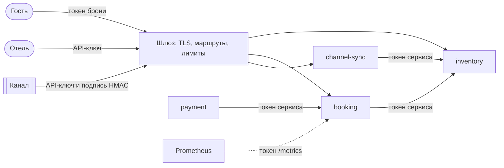

# ADR-0007: Доступ и аутентификация

- Статус: принято
- Дата: 2026-10-21
- Уточняет: [ADR-0001](0001-monorepo-and-structure.md) — сериализатор `platform` и для failure transport; [ADR-0002](0002-service-boundaries-and-data-ownership.md) — проверка API-ключей и внутренних вызовов, токен брони и сохранённый ответ, отправитель сообщения, сети, основной Redis без блокировок и скриптов; [ADR-0003](0003-sync-and-async-interactions.md) — отказ доступа и отказ конфигурации по ответу у внутреннего API, лимит вебхуков, права RabbitMQ, очередь разбора, исходящие соединения; [ADR-0004](0004-booking-saga.md) — хранение токена брони; [ADR-0005](0005-outbox-and-inbox.md) — `user_id` у relay, возврат из очереди разбора; [ADR-0006](0006-observability.md) — фронт FastCGI и `trace_id` в его ответах, журналы шлюза и nginx, сеть телеметрии, публикация интерфейсов, Lua в Redis метрик, выход Alertmanager наружу, новые алерты
- Уточнён: [контракты v1](../../contracts/README.md) — свои ответы фронта, 431 и ответы шлюза на неверно оформленный HTTP, отказ конфигурации по ответу внутреннего API, ключ HMAC отпечатков тел

## Контекст

**PRD (П-17, раздел 7):**
- гость обращается к своей брони по токену брони, отель — по API-ключу, канал — по API-ключу и подписи HMAC тела с меткой времени ±5 минут;
- чужие и несуществующие ресурсы отвечают 404, канал у неподключённого отеля — 403;
- внешние запросы идут через шлюз с лимитами;
- секреты хранятся вне репозитория.

Прошлые ADR оставили этому решению:
- **ADR-0002** — как проверять API-ключи; внутренний вызов без проверенной личности отклоняется, доверия по сети нет; как хранить токен брони и сохранённый ответ 201; нужна ли проверка отправителя по самому сообщению.
- **ADR-0003** — адреса провайдера и каналов только из конфигурации, исходящие соединения ограничены; аутентификация внутренних вызовов укладывается в бюджет НФТ-3.
- **ADR-0005** — проверка отправителя для inbox.
- **ADR-0006** — токен для `/metrics`, исходящие соединения к Telegram, правило «в пути и строке запроса нет ПДн, токенов и внешних id брони».
- **Р-4** — лимиты против ботов, которые занимают номера удержаниями.

После ревью безопасности ADR-0005 добавилось ещё одно правило: данные из хранилищ и брокеров не десериализуются нативно. `unserialize()` с любыми классами превращает запись в таблицу очереди или в Redis в выполнение кода через готовые цепочки классов из зависимостей.

Ограничения:
- **Стенд** — один хост с docker compose, разработка — на Windows через Docker Desktop.
- **PHP-FPM:** каждый запрос начинается с нуля, общее состояние между запросами — только APCu.
- **Traefik OSS 3.7** не умеет проверять API-ключи: это есть только в коммерческом Traefik Hub.
  - BasicAuth хранит хеши в своей конфигурации и пишет имя пользователя в журнал доступа даже при ответе 401.
  - ForwardAuth на каждый запрос делает подзапрос без кеша, с таймаутом, зашитым в 30 с, и при сбое отвечает 500.
  - Плагины работают внутри процесса Traefik и видят его окружение и файлы.
- **Бюджеты:** НФТ-3 — создание брони p95 ≤ 300 мс при 50 RPS, НФТ-13 — приём вебхука p95 ≤ 300 мс.

Механика Traefik, nginx, RabbitMQ, Kafka, Symfony Security и Cache, lcobucci/jwt, promphp, Prometheus, Alertmanager и Docker сверена с их документацией и исходным кодом.

## Варианты

1. **Ключи проверяет шлюз, сервис доверяет заголовку с личностью.**
   - Плюсы: неверные ключи не доходят до PHP, реестр ключей один.
   - Минусы:
     - в Traefik OSS для этого есть только BasicAuth с ключом в роли пароля и ForwardAuth с подзапросом и лишним воркером FPM на каждый запрос;
     - сервис доверяет заголовку, то есть сети, а ADR-0002 это запрещает: любой контейнер в сети подставит личность;
     - подпись вебхука шлюз всё равно не проверит, ей нужно тело.
2. **Ключи и токены проверяет сам сервис, внутренние вызовы подписывает вызывающий, шлюз отвечает за TLS, маршруты и лимиты.**
   - Плюсы:
     - доступ проверяется там, где принимается решение;
     - ни заголовкам, ни сети не доверяем;
     - лишнего перехода нет;
     - один механизм в `platform`.
   - Минусы: реестр ключей есть у нескольких сервисов, а неверный ключ доходит до FPM, хотя отказ дешёвый.
3. **mTLS между всеми компонентами, ключи проверяет сервис.**
   - Плюсы: каждое соединение зашифровано, и личность на нём проверена.
   - Минусы: свой центр сертификации, выпуск и ротация сертификатов, настройка фронтов — тяжело для одного хоста. Внешним клиентам ключи всё равно нужны.

## Решение

Вариант 2. Шлюз ничего не знает о ключах, личность запроса устанавливает сервис.

На схеме показаны не все сервисы, которые опрашивает Prometheus: он приходит к каждому со своим токеном.

### Шлюз

- **Версия** — Traefik 3.7 не ниже 3.7.16: ранние ветки 3.x исправлений уже не получают.
- **Маршруты** — из файлового провайдера: явный список публичных операций лежит в репозитории и проходит ревью. Docker-провайдер не используется: ему нужен Docker API, а это права root на хосте.
- **Сам Traefik** работает не от root, без `docker.sock`, файловая система только для чтения. Пути он не переписывает, только чистит их (`sanitizePath`): убирает `//`, `.` и `..`. Подпись вебхука на таком пути не сойдётся, и он получит 401.
- **TLS** на стенде.
  - Сертификат выдаёт Let's Encrypt через ACME с проверкой HTTP-01.
  - `acme.json` лежит на именованном томе с правами 600. Без тома сертификат выпускался бы заново при каждом рестарте и упёрся бы в лимиты Let's Encrypt.
  - HSTS включён с небольшим `max-age`.
  - Срок сертификата отслеживает алерт.
- **Порт 80** обслуживает только проверку ACME, на всё остальное отвечает 404 без редиректа. С редиректом клиент, настроенный на `http://`, годами отправлял бы ключ открытым текстом, и всё бы «работало».
- **Закрыто:** префикс внутреннего API, `/metrics` и `/health` (ADR-0002, ADR-0006).
- **Заголовки:**
  - заголовки-псевдонимы вроде `X_Auth` удаляются (`aliasHeadersStrategy: delete`): PHP-FPM сводит их к тем же переменным, что и `X-Auth`;
  - заголовки `X-Forwarded-*` и `X-Real-Ip` от клиента Traefik по умолчанию удаляет и выставляет сам, адрес клиента он передаёт в `X-Real-Ip` и `X-Forwarded-For`. Заголовок `Forwarded` от клиента он пропускает как есть. В FPM все три не попадают (см. «Фронт FastCGI»).
- **Ключи шлюз не проверяет**, плагинов нет.
- **Лимиты** (Р-4) стоят на маршрутах гостей и отелей.
  - Состояние хранится в памяти Traefik, источник — адрес соединения, у IPv6 — подсеть /64.
  - `X-Forwarded-For` не используется: на краю сети он даёт пустой источник, и лимит становится общим на всех.
  - Redis для лимитов шлюза не нужен: Traefik записал бы туда сырой IP, а ADR-0002 разрешает только HMAC адреса.
  - `burst` не больше скорости в секунду, у поминутных лимитов — 1. Иначе фактический предел выше заданного.
  - При наплыве новых адресов таблица источников вытесняет старые записи. Это защита от одного настырного клиента, а не от распределённой атаки.
  - Числа лимитов задаёт этап 4 (В-5), проверяют нагрузочные тесты.
- **Вебхуки шлюз не ограничивает.** На 429 канал доставку не повторит (PRD), а номер он уже продал. Лимит канала считает channel-sync (см. «Лимит вебхуков»). От анонимного потока маршрут защищён тем, что открыт не всем:
  - в продакшене — только адресам каналов (`ipAllowList`);
  - на стенде вебхуки шлют только заглушки каналов через отдельную точку входа, её порт не публикуется, и снаружи маршрута нет.
- **Нагрузка k6** идёт через отдельную точку входа без лимитов.
  - Она есть только в профиле нагрузки, её порт не публикуется.
  - k6 работает в своей сети вместе с Traefik и до фронтов сервисов напрямую не достаёт.
  - Ключа, который обходил бы лимиты, нет вовсе.
- **Ответы самого шлюза.** Ответы фронта и сервисов Traefik не трогает: они приходят клиенту как есть — с `trace_id`, если он в них есть, и с `Retry-After`.
  - **404 «нет маршрута»** — роутер с низшим приоритетом ведёт на сервер страниц ошибок. Сервер статический, без журналов и в своей сети. На любой метод и путь он отвечает 404 в формате Problem Details без `trace_id`.
  - **429 лимита** Traefik отдаёт сам, обычным текстом с `Retry-After`. Middleware `errors` его не переписывает: он отбросил бы заголовки исходного ответа, а `Retry-After` клиенту важнее формата тела.
  - **502, 503 и 504 самого Traefik** — когда контейнер сервиса недоступен — тоже идут обычным текстом.
  - **`Content-Type: text/plain`** у 429, 502 и 504 ставит middleware `contentType`, первым в цепочке публичных роутеров. Точка входа Traefik 3.7.16 отключает автоопределение типа (`contenttype.DisableAutoDetection`), а лимит и прокси свой `Content-Type` не ставят: без этого middleware такие ответы ушли бы без него. 503 «нет доступного сервера» идёт через `http.Error` и `text/plain` получает сам.
  - **431 и ответы на неверно оформленный HTTP** шлюз отдаёт сам, до маршрутизации.
    - 400, 501 и 505 — обычным текстом от Go-сервера (`conn.serve`, Go 1.26) или с пустым телом от обработчиков точки входа Traefik: `denyOpaque` и `denyFragment` — 400, `denyConnect` — 501 на CONNECT.
    - 431 — когда заголовки больше предела. По HTTP/1.x — `maxHeaderBytes`, по умолчанию 1 МиБ, плюс 4 КиБ запаса (`Server.initialReadLimitSize`), тело — обычный текст. По HTTP/2 — `maxHeaderBytes` плюс 320 байт, и каждое поле считается как имя, значение и 32 байта (`http2adjustHTTP1MaxHeaderSize`); Traefik 3.7.16 включает HTTP/2 через `http.Server.Protocols`, и 431 там пишет `http2handleHeaderListTooLong` с телом в HTML.

  429 и 5xx шлюза контракт описывает в ответах операций. 431 и ответы на неверно оформленный HTTP исправный клиент не получает, поэтому они описаны в [README контрактов](../../contracts/README.md), а не у операций.
- **Журнал доступа** — уточнение ADR-0006: выброшено и поле `ClientUsername`, режим заголовков `drop` задан явно.

### Фронт FastCGI

Фронт — nginx. ADR-0006 оставлял этот выбор шаблону сервиса.

**nginx и FPM в одном контейнере.**
- FPM слушает только unix-сокеты — и основной пул, и пул метрик. Порт FastCGI из сети недоступен. Иначе сосед по сети мог бы передать FPM свои `PHP_VALUE`, например `auto_prepend_file`, и выполнить код в обход любых токенов.
- nginx стартует, только когда сокеты FPM уже есть.
- Временные каталоги nginx, например для больших тел запросов, лежат на `tmpfs`: корневая файловая система только для чтения.

**Адрес клиента nginx не восстанавливает**: `realip` не настроен. `$remote_addr`, по которому работают списки доступа, и `REMOTE_ADDR` в FPM — это адрес соединения. Приложение адреса гостя не видит: заголовков с ним nginx в FPM не передаёт. Если этап 4 введёт лимит активных удержаний с одного адреса (В-5), nginx передаст адрес из `X-Real-Ip` только маршруту создания брони, а booking запишет в ключ лимита HMAC адреса.

**Заголовки:**
- заголовки с подчёркиванием nginx отбрасывает по умолчанию — это вторая линия защиты от псевдонимов;
- остальные заголовки запроса nginx передаёт в FPM (`fastcgi_pass_request_headers on`), кроме тех, чьи переменные заданы через `fastcgi_param`. Пустыми значениями закрыты:
  - `HTTP_PROXY` — заголовок `Proxy`;
  - `HTTP_X_REAL_IP`, `HTTP_X_FORWARDED_FOR` и `HTTP_FORWARDED` — адрес клиента, который ставит Traefik, и `Forwarded` самого клиента;
- эти `fastcgi_param` лежат в общем файле, который подключает каждый `location`: на уровень, где задан хоть один свой `fastcgi_param`, nginx их не наследует.

**Кто к чему допущен.** Подсети заданы в compose (см. «Сети и контейнеры»):
- внутренний API — только из подсетей пар;
- публичный — только из подсети шлюза;
- метрики — только из подсети телеметрии;
- `/health` — только изнутри контейнера.

**Свои ответы.** Всё, что nginx отдаёт сам, — 400, 403, 404, 405, 411, 413, 414, 494, 500, 501, 502 и 504 — идёт в формате Problem Details через `error_page`. Свой 404 nginx отдаёт только на путях вне операций, например на прямой запрос к `/errors/…`. Механика сверена с исходниками nginx 1.28.
- `error_page` задан на уровне `server`, цель — внутренний URI `/errors/…`, а не именованный location. Ошибки строки запроса nginx обрабатывает конфигурацией `server` по умолчанию, URI у них ещё пуст, и переход в именованный location отдал бы встроенную страницу 500 (`ngx_http_named_location`).
- В `location` своих `error_page` нет: иначе этот `location` не унаследовал бы ни одного `error_page` уровня `server`, как и с `fastcgi_param`. Страница `/errors/…` отдаёт тело через `return`.
- 494 перечислен явно: `error_page 400` его не ловит. Клиент получает 400: без `=код` nginx сам подставляет 400 (`ngx_http_core_error_page`).
- 408 nginx не отправляет. На таймаут строки запроса и заголовков он закрывает соединение (`ngx_http_process_request_line`, `ngx_http_process_request_headers`), таймаут тела `ngx_http_finalize_request` передаёт в `ngx_http_terminate_request`.
- **`trace_id`** берётся из `traceparent`, только если nginx успел его прочитать.
  - На публичных маршрутах `traceparent` ставит Traefik, на внутренних — вызывающий.
  - 414 nginx отдаёт ещё при разборе строки запроса (`ngx_http_process_request_line`), до заголовков. У 494 и части 400 прочитаны не все заголовки. В таких ответах `trace_id` нет.
  - Значение проходит строгий шаблон: версия `00`, trace id из 32 hex-символов и не из одних нулей, id спана и флаги. Иначе поля нет. Других переменных в телах ошибок нет — ни пути, ни строки запроса, ни заголовков: иначе заголовок вставил бы в JSON свои поля.
- Страница `/errors/…` — `internal` и доступна при любом списке доступа, а списки доступа стоят в рабочих `location`. Иначе внутренний переход в `/errors/403` снова получил бы 403, и ушла бы встроенная страница nginx.
- `fastcgi_intercept_errors off`: ответ сервиса с тем же кодом, например 400 `idempotency_key_missing`, идёт клиенту как есть.
- `server_tokens off` скрывает версию nginx. Заголовок `Server: nginx` остаётся.

502 и 504 бывают и тогда, когда PHP уже сделал часть работы, поэтому их текст не обещает, что повтор безопасен: повторяют с тем же ключом идемпотентности.

**Предел тела** задаёт `client_max_body_size`, превышение — 413.
- На маршруте вебхуков предел — 1 МиБ. Это защита от мусора, а не предел брони: такие 413 видны метрикой, алерта на них нет.
- Бронь из канала, которая не помещается в команду для booking, отбрасывать нельзя: канал уже получил 2xx и номер продал. Поэтому такой брони не должно быть по построению:
  - контракт вебхука ограничивает длины и число элементов полей из разрешённого списка так, что команда всегда меньше 256 КиБ строки outbox (ADR-0005);
  - бронь сверх этих пределов принимается с 2xx и уходит на ручной разбор (К-2), а дежурный оформляет её консольными командами booking и inventory по runbook;
  - страховка — проверка размера в фоновом шаге channel-sync, который строит команду, той же функцией, что и запись в outbox. Если команда всё же не помещается, шаг в той же транзакции создаёт запись на ручном разборе;
  - в записи — те же поля из разрешённого списка, что и у обычной брони из канала, а не сырое тело.

**Журналы.**
- Свой журнал доступа у фронта выключен (ADR-0006).
- Журнал ошибок nginx ведётся на уровне `alert`. Сообщения уровня `crit` и менее важных несут строку запроса, `Referer` и адрес клиента, например когда нет сокета FPM. Что nginx не достучался до FPM, видно по 502 в метриках шлюза.

### Внешние учётные данные

**Формат.** Префикс, затем 32 случайных байта в base64url:

| Префикс | Что это |
|---|---|
| `hk_` | API-ключ отеля |
| `ck_` | API-ключ канала |
| `bt_` | токен брони |

Секрет HMAC канала — тоже 32 случайных байта.

Зачем префикс:
- по нему аутентификатор выбирает проверку;
- поиск секретов находит ключи в логах, трейсах и репозитории;
- base64url проходит разбор заголовка в Symfony без экранирования.

**Передача.** Отель, канал и гость передают учётные данные в `Authorization: Bearer`. Схема `Bearer` распознаётся без учёта регистра. В пути и строке запроса учётных данных нет (ADR-0006).

**Реестр.** Отели, каналы и их ключи задаёт конфигурация стенда (PRD).
- Сервис хранит не ключ, а его SHA-256. Медленный хеш не нужен: 256 случайных бит не подобрать.
- Ключ отеля ведёт ровно к одному отелю. Хеши ключей отелей есть у inventory и booking.
- Ключ канала ведёт только к id канала. Подключения каналов к отелям — одна правда в конфигурации channel-sync (ADR-0002). У channel-sync есть хеши ключей каналов и сами секреты HMAC: подпись проверяется только сырым секретом.
- На время ротации у отеля или канала действуют два ключа, у канала — и два секрета HMAC.

**Аутентификатор `platform`** — свой аутентификатор Symfony Security, без сессий.
- Встроенный `access_token` не подходит: его обработчик получает только строку токена, без тела и заголовков. А вебхуку нужна подпись тела, токену брони — свои коды ответа.
- Какие учётные данные ждать, задаёт маршрут, а префикс выбирает проверку.
- **Ключ отеля:** SHA-256 → запись реестра → личность «отель».
- **Вебхук канала:**
  1. проверяется ключ канала;
  2. `X-Timestamp` — не дальше ±5 минут;
  3. `X-Signature: v1=<hex>` — HMAC-SHA256 секретом канала, который нашёлся по проверенному ключу, от строки `{метод}\n{путь}\n{метка}\n{сырое тело}`.
  - Сервис пробует каждый действующий секрет канала, подпись сравнивается после декодирования hex через `hash_equals`.
  - Строки запроса у маршрутов вебхуков нет: запрос со строкой запроса получает 401, иначе через неё прошли бы неподписанные параметры. Путь берётся в том виде, в каком пришёл: Traefik его не переписывает.
  - Метод и путь входят в подпись, чтобы подписанное тело брони нельзя было переслать на маршрут отмены.
  - Личность «канал» появляется только вместе с проверенной подписью: один `ck_` без подписи — всегда 401. Утёкший ключ без секрета ничего не даёт.
- **Токен брони:** аутентификатор передаёт его операции, хеш с бронью она сравнивает через `hash_equals`. На маршрутах брони любые учётные данные, кроме подходящего токена, дают 404, как требует Г-3.
- **Секреты в параметрах** помечены `#[\SensitiveParameter]`, поэтому в стек вызовов они не попадут.
- **В личности** — id, а не ключ.

**Личность запроса** — отель, канал, гость брони или сервис. `platform` отдаёт её доменному коду.
- Фильтр по отелю обязателен (ADR-0002).
- Канал берётся только из личности. Если поле канала в пути или теле с ней не совпадает — 403: канал A не может отменить бронь канала B.
- Адрес клиента приложение не использует. Symfony не доверяет `Forwarded`, `X-Forwarded-Host` и `X-Forwarded-Prefix`, а адреса в ответах строит из конфигурации.

**Доступ на маршруте.**
- Каждый маршрут объявляет, какая личность ему нужна. Маршрут без объявления закрыт.
- Тест в CI перебирает маршруты сервиса и сверяет их со `security` в OpenAPI. Внутренние маршруты он сверяет ещё и с матрицей вызовов ADR-0002: во внутреннем контракте она записана расширением `x-callers`. `/health` и `/metrics` в тесте — явный список исключений.
- Firewall Symfony два, они делятся по префиксу пути: внутренний API принимает только токен сервиса, публичный — только ключи и токены брони.
- `/health` открыт без аутентификации, но только изнутри контейнера. `/metrics` отдаёт отдельный пул FPM (ADR-0006), см. «`/metrics`».

**Ответы.**

| Ситуация | Ответ |
|---|---|
| нет учётных данных | 401, Problem Details с `WWW-Authenticate: Bearer` |
| на маршрутах отеля и канала неизвестный или неверно оформленный ключ | 401 |
| неверная подпись или метка времени вебхука, ключ канала без подписи, строка запроса у вебхука | 401 без побочных эффектов (К-2) |
| чужой или несуществующий ресурс отеля | 404 (П-17) |
| на маршруте брони токен не подходит, оформлен неверно или брони нет | 404 (Г-3) |
| канал обращается к неподключённому или несуществующему отелю | 403: при разных кодах ответ раскрыл бы, есть ли такой отель |
| канал в пути или теле не совпадает с личностью | 403 |
| вызывающий не из матрицы | 403 |
| сработал лимит вебхуков канала | 503 с `Retry-After` |

### Лимит вебхуков

- **Лимит канала** channel-sync считает через RateLimiter Symfony только после полной аутентификации: ключ, метка времени и подпись. Неудачные проверки идут отдельным счётчиком по каналу, квоту они не расходуют. Иначе держатель одного утёкшего ключа выбирал бы квоту канала.
- **Сверх лимита** — 503 с `Retry-After`: на 5xx канал повторит доставку. Каждый отказ лимитом даёт critical-алерт.
- **Порог** выше нагрузки НФТ-13 и учения «шторм дублей вебхуков». Лимит channel-sync действует и на точке входа k6.
- **Без Redis** лимит хранится в APCu и действует целиком: APCu общий для всех процессов FPM контейнера. Подключение к Redis идёт с коротким таймаутом и предохранителем в APCu, как запись метрик (ADR-0006): недоступный Redis не задерживает каждый вебхук на время таймаута.
- **Анонимный поток** до проверки подписи в продакшене не доходит: маршрут открыт только адресам каналов. На стенде снаружи маршрута нет (см. «Шлюз»).

### Внутренние вызовы

**Матрица из ADR-0002:**
- «удержать», «подтвердить», «снять» и продажу из канала вызывает только booking;
- справочные данные, типы номеров, наличие для сверки и выгрузку наличия — только channel-sync;
- выгрузку статусов броней — только payment.

Инструменты эксплуатации внутренний API не вызывают: им хватает консольных команд, ролей только для чтения и публичного API с ключом (ADR-0002).

**Токен сервиса** — JWT, который вызывающий подписывает на каждый запрос:
- алгоритм EdDSA (Ed25519), в заголовке `kid`;
- `iss` — вызывающий, `aud` — вызываемый, `iat`, `nbf`, `exp` не позже чем через 60 с;
- `htm` — метод, `htu` — путь со строкой запроса, `bh` — SHA-256 тела в base64url.

Вызывающий заранее собирает итоговый адрес в нормализованном виде и подписывает именно его. Опцией `query` HttpClient он не пользуется: HttpClient заново экранирует строку запроса, и подпись разошлась бы с тем, что ушло в сеть.

Привязка к запросу нужна потому, что внутри хоста HTTP идёт без TLS (Р-25).
- Подслушанный токен годится только для того же запроса и только 60 с.
- Повтор того же запроса безвреден: внутренние операции идемпотентны по id брони (ADR-0003).
- Без привязки перехваченный токен booking 60 с годился бы, например, на «снять» по любой брони.

**Проверка у вызываемого** — свой обработчик на lcobucci/jwt.
1. Открытый ключ выбирается по `iss` и `kid` из конфигурации вызываемого, то есть ключ привязан к вызывающему. Заголовки `jku`, `jwk` и `x5u` не читаются.
2. Принимается только EdDSA.
3. `aud` — одна строка, равная имени вызываемого.
4. Время проверяется с допуском 2 с: `exp − iat` не больше 60 с, `iat` не в будущем. Срок проверяет вызываемый, а не только обещает вызывающий. Часы сервисов сверяются алертом с порогом 1 с (ADR-0004, ADR-0006).
5. `htm`, `htu` и `bh` сверяются с запросом. `htu` сравнивается с сырым `REQUEST_URI` побайтово: Symfony при разборе сортирует параметры строки запроса.
6. Вызывающий проверяется по матрице, вне её — 403.

Встроенный обработчик OIDC в Symfony не подходит: EdDSA в нём нет, допуск по часам не задаётся, а любой ключ набора подписывает любой `iss`.

**Ключи.**
- Закрытые ключи есть только у вызывающих — booking, channel-sync и payment.
- Открытые ключи вызывающих лежат в конфигурации вызываемых, это не секрет.
- Ротация:
  1. вызываемый начинает принимать новый `kid`;
  2. вызывающий подписывает новым;
  3. старый ключ убирается.

**Отказ доступа — это отказ конфигурации.** 401 и 403 внутреннего API, в том числе 403 фронта из-за чужой подсети, и ошибка подписи у вызывающего, например пропавший файл ключа, означают сломанные ключи, матрицу или сети, а не ответ по существу. Поэтому они уточняют ADR-0003:
- в «удержать» гость получает 503, а circuit breaker считает их отказом;
- шаги «подтвердить», «снять», продажа и запросы channel-sync повторяются, как при недоступном получателе, «подтвердить» — до D + 60 с;
- счётчики отказов строк не растут;
- счётчик ведёт вызывающий, и critical-алерт срабатывает с первой минуты.

Так у дежурного есть время до D + 60 с, чтобы починить ключи, прежде чем оплаченные брони уйдут в «удержание не подтверждено» и возврат.

**Отказ конфигурации по ответу внутреннего API** — тоже не ответ по существу, а признак расхождения версий или ошибки. Это `hotel_mismatch`, 404 `hotel_not_found` у фоновых шагов, 400, 413 и 415, а также ответ вне контракта операции: код HTTP или тип, которых у операции нет, 404 без типа, 422 с `pointer` вне общих полей или с `parameter`. Полная таблица ответов — в [README контрактов](../../contracts/README.md#что-booking-делает-с-ответом-inventory). С таким ответом поступают так же, как с 401 и 403, с двумя отличиями на гостевом пути:
- circuit breaker его не считает. Такой ответ гость может вызвать своим вводом, если booking и inventory проверяют ввод хоть в чём-то по-разному, и серией запросов открыл бы breaker для всех. Breaker защищает пул от медленного inventory, а эти ответы быстрые;
- алерт по гостевому пути срабатывает по порогу за окно, а не с первого события, по той же причине. Настоящее расхождение версий даёт поток таких ответов, и порог переходит быстро.

У фоновых шагов — «подтвердить», «снять», продажи — отель и id брони уже зафиксированы, и вводом гостя такой ответ не вызвать. Там алерт critical с первой минуты, как у 401 и 403: иначе единичный `hotel_mismatch` на «подтвердить» тихо довёл бы оплаченную бронь до возврата. Метка метрики различает гостевой путь и фоновые шаги.

**Бюджет НФТ-3.** Подпись и проверка Ed25519 занимают десятки микросекунд, SHA-256 тела — микросекунды. Тест этапа 3 проверяет, что подпись и проверка укладываются в 1 мс по p99.

### `/metrics`

- Prometheus приходит к каждому сервису с его bearer-токеном. Токен лежит в `credentials_file`, Prometheus перечитывает файл при каждом опросе.
- Пул метрик хранит SHA-256 токена и сравнивает через `hash_equals`. На время ротации он принимает два токена.
- JWT здесь не нужен: Prometheus не умеет подписывать запросы, а в метриках нет ПДн.

### Сообщения

**Отправителя по самому сообщению получатель не проверяет: его доказывают права брокеров.**
- **RabbitMQ.** Сервис пишет только в свой обменник, а очередь получателя привязана только к обменникам допущенных отправителей. Тип сообщения сверяется с очередью (ADR-0003). Обменник в доставке ставит сам брокер, после проверки права записи.
- **Kafka.** В топик пишет только издатель (ACL).

Сверка `user_id` со списком отправителей у получателя ничего бы не добавила: список брался бы из той же конфигурации, что и привязки. Сообщения о деньгах дополнительно проверяет предметная область (ADR-0005). Пересмотреть решение, если появится общий обменник, привязка обменника к обменнику, shovel или federation.

**Одно место, где топологии мало, — очередь разбора.** В неё сливаются сообщения всех сервисов, а заголовки `x-*`, тип и любой заголовок инструмента издатель может подделать. Поэтому:
- **relay ставит `user_id`** — пользователя RabbitMQ своего сервиса. Брокер отклоняет чужой `user_id`: тега `impersonator` нет ни у кого.
- **406 из-за `user_id`** — отказ конфигурации, а не отказ строки: relay не ищет виноватую строку и не отправляет строки на разбор, срабатывает алерт общего отказа relay (уточнение ADR-0005). «Сообщение больше лимита» relay узнаёт только по известному тексту ответа брокера. Любой другой 406, в том числе с незнакомым текстом после обновления брокера, — отказ конфигурации. Тесты покрывают все три случая.
- **Возврат через обменник отправителя.** Инструмент разбора возвращает сообщение только через обменник отправителя, которого показывает `user_id`. Сообщение без `user_id` или с типом, который этот отправитель не публикует, не возвращается.
- **Заголовок исходного отправителя.** Возвращённое сообщение несёт `user_id` учётной записи эксплуатации: подставить чужой брокер не даст. Поэтому инструмент ставит заголовок исходного отправителя, и ему верят только при `user_id` эксплуатации — так сообщение можно вернуть и второй раз.
- **Сроки не сбрасываются.** `timestamp` и заголовок «ПДн хранить до» инструмент копирует без изменений, иначе срок хранения ПДн начался бы заново (ADR-0003).
- **Распознавание возврата.** Консьюмер узнаёт возврат из очереди разбора по `user_id` учётной записи эксплуатации, а не по заголовку инструмента. Иначе любой сервис поставил бы этот заголовок и обошёл алерт «сообщение вне окна inbox».

**Права RabbitMQ** — уточнение ADR-0003.
- **Теги.** Тегов `policymaker`, `administrator` и `impersonator` нет ни у сервисов, ни у учётной записи эксплуатации. Учётная запись с тегом `administrator` есть только у шага развёртывания.
- **Панель управления** есть только в разработке. Вход в неё — отдельным пользователем с тегом `monitoring`.
- **Плагины shovel и federation выключены:** shovel без учётных данных в адресе работает под внутренним пользователем брокера и обходит проверки.
- **Лимиты.** У пользователей сервисов есть лимиты соединений и каналов.
- **Слушатели.** AMQP слушает только адрес в сети данных, метрики — только адрес в сети телеметрии.
- **Узел один.** epmd и порт межузлового обмена слушают только loopback, а Erlang cookie лежит файлом.
- **Очередь разбора.** У неё `max-length-bytes` с `overflow: reject-publish`.
  - Сервис, который начал публиковать мусор без маршрута, получит отказы сам: он не заполнит диск брокера и не остановит остальных издателей.
  - Сообщения, которые ждут dead-letter, остаются в исходной очереди под алертом из ADR-0006.
- **Заголовки при возврате.** Инструмент разбора снимает `x-delivery-count`, `x-acquired-count`, `x-death`, `x-first-death-*` и `x-last-death-*`. Брокер сам не убирает заголовки `x-*`, которые поставил издатель.
- **Messenger в RabbitMQ не публикует:** это делает relay (ADR-0005), а у шин нет AMQP-отправителей. Поэтому ошибка Symfony 7.4.21 нас не касается: при переотправке `AmqpStamp` копирует `user_id` полученного сообщения.

**Kafka** — уточнение ADR-0002.
- **Аутентификация** — SCRAM-SHA-512, учётные записи хранятся в журнале метаданных KRaft.
- **Авторизатор** — `StandardAuthorizer`: без ACL доступ запрещён.
- **Права.** Издатель получает WRITE на свой топик без CREATE, и идемпотентному продюсеру этого хватает. Консьюмер получает READ на топик и на группу.
- **Слушатели.** Контроллерный и межброкерный слушатели — PLAINTEXT и только на loopback контейнера. Их principal `User:ANONYMOUS` записан в `super.users`, и это допустимо только потому, что извне к ним не подключиться.
- **Учётные записи SCRAM** создаёт обёртка запуска, поэтому пароли не попадают в аргументы команды, которые видит inspect (ADR-0006).

**Очереди в базе и failure transport** живут внутри базы сервиса. Их граница — учётные данные базы.

### Токен брони

- **Выдача.** 32 случайных байта, префикс `bt_`, base64url. Гость получает токен в ответе 201 (Г-2).
- **В брони** хранится SHA-256 токена, самого токена нет. Обезличивание (С-4) хеш не трогает: это не ПДн.
- **Статус и отмена.** id брони в пути, токен в `Authorization: Bearer`.
  - Нет заголовка — 401.
  - Неверный, неверно оформленный или чужой токен, несуществующая бронь — 404 (Г-3).
- **Сохранённый ответ 201** под ключом идемпотентности хранит токен зашифрованным.
  - Шифр — XChaCha20-Poly1305 ключом booking. Связанные данные — `kid` ключа и id записи ключа идемпотентности.
  - Запись живёт 24 часа, повтор возвращает тот же токен.
  - Утечка базы без ключа шифрования токенов не раскрывает.
  - Неизвестный `kid` или потерянный ключ: повтор отвечает 500 и даёт critical-алерт. Гость, который не получил первый ответ, остаётся без токена и не может отменить бронь.
- **Кеширование.** Ответ 201 и ответ со статусом брони идут с `Cache-Control: no-store`.
- **Логи.** Токена нет в логах, трейсах и ответах с ошибкой: заголовки не пишут ни журнал шлюза, ни приложение (ADR-0006).

### Нативная десериализация запрещена

Данные из хранилищ и брокеров не попадают в `unserialize()` с произвольными классами.

**Messenger.** На всех транспортах — в RabbitMQ, очередях в базе и failure transport — работает один сериализатор `platform`: JSON по карте типов. Это уточняет ADR-0001: стандартный сериализатор для failure transport не годится, он вызывает `unserialize()` со всеми классами.
- Штампы, без которых не работают повторы и failure transport, переносятся по той же карте типов: `BusNameStamp`, `RedeliveryStamp`, `DelayStamp`, `ErrorDetailsStamp`, `SentToFailureTransportStamp`. Без `BusNameStamp` сообщение ушло бы в шину по умолчанию, с её middleware и обработчиками: у `messenger:failed:retry` нет опции `--bus`, он отправляет через `RoutableMessageBus`.
- Из `ErrorDetailsStamp` переносятся класс исключения и код — HTTP-статус или SQLSTATE. Сообщение переносится только у своих доменных исключений с постоянным текстом, стек — никогда.
  - В стеке остались бы аргументы вызовов, например токен карты, который передали клиенту провайдера.
  - В сообщении чужого исключения — значения: HttpClient дописывает в него `detail` из ответа партнёра.
  - Кроме того, во всех образах `zend.exception_ignore_args=On`.
- Консьюмер Kafka тоже разбирает JSON по карте типов (ADR-0005).

**Doctrine.** В DBAL 4 типов на основе `serialize()` (`object`, `array`) больше нет, данные лежат в JSON-колонках.

**Кеш Redis.** У пулов Redis свой маршалер `platform`, его задаёт свой шаблон адаптера.
- `unserialize()` вызывается только с классами состояний лимитера Symfony — `Window`, `SlidingWindow`, `TokenBucket` — и с ограничением глубины. igbinary не принимается.
- Результат обходится целиком. Объект запрещённого класса или исключение при восстановлении, например из `Rate::fromString()` на мусоре, — это промах кеша и метрика, а не ошибка запроса.
- Свой кеш хранит только скаляры и массивы. Состояние Scheduler в кеше не хранится: суточные задачи пишут свои запуски в базу.
- JSON-маршалер не подходит: лимитер хранит объекты.
- Кеши метаданных и запросов Doctrine лежат в `cache.system` — файлах и APCu — со стандартным маршалером. Их пишет только сам сервис. Кеш результатов Doctrine, если он появится, идёт в Redis через маршалер `platform`.
- Запасной лимит вебхуков в APCu тоже сериализуется нативно. Записать туда может только код внутри FPM, а с ним атакующему десериализация уже не нужна.

**Основной Redis без скриптов Lua.** Разрешённые `SCRIPT LOAD` и `EVALSHA` дали бы то же, что `EVAL`: любой Lua-скрипт внутри общего Redis. А это уязвимости песочницы Lua и зависание на бесконечном цикле. Поэтому:
- в ACL основного Redis ни у кого нет команд `@scripting`;
- пулов кеша с тегами нет: `RedisTagAwareAdapter` вызывает `EVAL`. Это проверяет тест контейнера;
- Lock в Redis не используется. Блокировки корректности живут в PostgreSQL (ADR-0002), а лимитеру и защите кеша от одновременного пересчёта хватает `flock`.
  - Каталог блокировок — именованный том, общий для всех контейнеров сервиса: все процессы сервиса работают на одном хосте. Bind-монтирование не годится: на Docker Desktop `flock` на нём не работает.
  - Файлы блокировок `flock` не удаляет, поэтому ключи блокировок берутся из ограниченного набора: id канала и ключи кеша. Если на этапе 4 появится лимит по адресу (В-5), он работает без блокировки: небольшой перерасход квоты допустим.

**Redis метрик — исключение.** promphp с адаптером RedisNg обновляет счётчики через `EVAL`, поэтому там скрипты разрешены. Риск ограничен:
- это отдельный экземпляр только с метриками, без ПДн и без записи на диск (ADR-0006);
- версия Redis закреплена на ветке с исправлениями уязвимостей песочницы Lua 2025 года, а новые теги образа приходят автоматическим PR;
- зависший скрипт не снять даже `SCRIPT KILL`, поэтому сервисы ходят в Redis метрик с коротким таймаутом и предохранителем (ADR-0006): метрики теряются, а запросы не ждут.

**Проверки CI:**
- `unserialize(` встречается в нашем коде только в маршалере;
- тест контейнера: у каждого транспорта сериализатор `platform`, у пулов Redis — маршалер `platform`, пулов с тегами нет. Поиск по коду не заметил бы стандартный сериализатор, подключённый конфигурацией.

### Исходящие соединения

- **Адреса провайдера и каналов** берутся только из конфигурации. У каждого свой scoped-клиент HttpClient с `base_uri`.
  - `max_redirects: 0` задан и у них, и в общих опциях HttpClient.
  - Адрес из запроса или сообщения не используется.
  - Части пути из внешних данных, например внешний id брони, сначала проверяются строгим шаблоном вроде `^[A-Za-z0-9_-]{1,128}\z` — `$` в PCRE пропустил бы перевод строки в конце, — а затем подставляются через `rawurlencode` в шаблон, который начинается с `/`. Значения `.` и `..` так не пройдут: HttpClient убирает такие сегменты пути, и запрос ушёл бы на другой адрес партнёра.
- **Прокси** задаётся опцией клиента, а не переменными окружения. Переменные видит CLI, но не FPM, а внутренние вызовы через них ушли бы в прокси.
- **Сервисы на стенде** наружу не выходят: заглушки провайдера и каналов работают во внутренней сети.
- **Alertmanager** ходит в Telegram через прокси исходящих соединений — Squid, он есть только на стенде (`http_config.proxy_url`).
  - CONNECT разрешён только на `api.telegram.org:443`.
  - Частные адреса запрещены.
  - В продакшене в этот список добавляются хосты провайдера и каналов, а их клиенты получают прокси.
- **`NoPrivateNetworkHttpClient`** не используется: заглушки живут в частной сети, а адреса извне не приходят.

### Сети и контейнеры

Этот раздел уточняет ADR-0002 («по сети сервис доступен только тем, кому он нужен») и ADR-0006 (сеть телеметрии).

**Сети:**
- **Пары.** У каждой пары из матрицы вызовов своя сеть: booking и inventory, channel-sync и inventory, payment и booking. Traefik и наблюдаемость в эти сети не входят.
- **Шлюз** входит в сети с фронтами публичных маршрутов.
- **Хранилища и брокеры** — в сети данных.
- **Сеть телеметрии** (ADR-0006): приёмник OTLP, Redis метрик и опрос метрик Prometheus.
- **Наблюдаемость** — в своей сети.
- **Заглушки** — в своей сети вместе с payment, channel-sync и отдельной точкой входа Traefik, через которую заглушки каналов шлют вебхуки.
- **k6** — в своей сети с Traefik, только в профиле нагрузки.
- **Сервер страниц ошибок** — в своей сети с Traefik.
- **Наружу** выходят только три сети:
  - край — Traefik и ACME;
  - `ops-ui`;
  - выход — Squid, через него ходит Alertmanager.

  В CI нет ни Squid, ни `ops-ui`, ни ACME, и наружу не выходит ничего.

**Алиасы.** У любого контейнера, который стоит в нескольких сетях, — сервиса, RabbitMQ, Traefik, Redis метрик — в каждой сети свой алиас, отличный от имени в compose. Обращаются к нему только по алиасу нужной сети: вызывающий — по алиасу сети пары, Traefik — по алиасу сети шлюза, Prometheus — по алиасу сети телеметрии, сервис к RabbitMQ — по алиасу сети данных. Имя из compose может разрешиться в адрес из другой сети: там нужный порт не слушают, или фронт ответит 403, и breaker откроется. CI проверяет, что каждый адрес в конфигурации — алиас из нужной сети.

**Через общие сети сервисы видят друг друга** — в сетях данных, телеметрии и заглушек. Поэтому:
- фронт пускает к каждой части API только из её подсети (см. «Фронт FastCGI»). Без `NET_RAW` подделать адрес источника нельзя;
- внутренние точки входа Traefik — метрик, k6 и заглушек — и слушатели RabbitMQ привязаны к адресам своих сетей. Адреса заданы в compose. Точки входа края слушают все адреса: иначе до них не дошёл бы IPv6, а проверка ACME HTTP-01 работает только с одной точкой входа.

**Профили:**
- в профилях стенда, нагрузки и CI у всех сетей, кроме внешних, стоит `internal: true`;
- в разработке у PHP-контейнеров и хранилищ есть ещё обычная сеть, она нужна Composer, Xdebug и IDE. Изоляцию проверяет CI.

**Хост стенда.**
- Docker Engine не ниже 28: в более ранних версиях соседи по сегменту сети хостера достают до контейнеров обычных сетей и до портов, опубликованных на 127.0.0.1, прямой маршрутизацией.
- Входящий фильтр хоста пропускает только 80, 443 и SSH. Для контейнеров его правила стоят и в цепочке `DOCKER-USER`, для IPv4 и IPv6: трафик к опубликованным портам цепочку `INPUT` обходит.
- IPv6 доходит до Traefik с настоящим адресом. Для этого у сети края включён IPv6 с ULA и NAT, а userland-proxy Docker выключен. Иначе Docker принимает IPv6 через свой прокси, и все такие клиенты делят один адрес. Если так не выходит, порт на IPv6 не публикуется, а у домена нет записи AAAA.

**Интерфейсы.** Интерфейсы Grafana, Prometheus, Alertmanager и Alloy публикует на 127.0.0.1 один обратный прокси `ops-ui`. Контейнер, подключённый только к внутренним сетям, порты не публикует. `ops-ui` защищается от страниц в браузере разработчика:
- пропускает только `Host` со значением `localhost` или `127.0.0.1` — это защита от подмены DNS;
- из браузера пропускает только запросы с `Sec-Fetch-Site: none` или `same-origin`. Межсайтовые запросы и запросы с соседних портов `localhost` отклоняются, в том числе переход по ссылке. Запрос без этого заголовка пришёл не из браузера;
- служебные пути перезагрузки (`/-/reload`) через `ops-ui` закрыты: у Alloy их открывает даже GET.

Lifecycle и admin API Prometheus выключены (ADR-0006).

**Права контейнеров.**
- Контейнеры работают не от root (`user:` в compose), тома готовятся с нужными правами.
- У всех контейнеров `no-new-privileges`: setuid-файлы образа не поднимут права процесса.
- Образам, которые стартуют от root и потом сбрасывают права, возвращается только минимальный набор capabilities. `NET_RAW`, `NET_ADMIN` и `privileged` не выдаются никогда: без них контейнер не подслушает и не подменит трафик соседей. CI это проверяет.
- Traefik слушает непривилегированные порты.

### Секреты

Секреты лежат в файлах вне репозитория (ADR-0006).
- **Свой каталог у каждого контейнера.** Контейнер получает только свой подкаталог, смонтированный целиком. Права 0400 или 0440 выданы на пользователя его процесса. На Docker Desktop с каталогом на NTFS права не применяются, поэтому их проверяют CI и стенд.
- **Общего каталога нет.** Иначе взлом любого контейнера, например заглушки, отдал бы закрытые ключи всех сервисов, и привязка ключа к вызывающему потеряла бы смысл.
- **Проверка CI:** ни один контейнер не видит чужих файлов.

| Секрет | У кого | Ротация | Если утёк |
|---|---|---|---|
| ключ отеля | у отеля; у inventory и booking — SHA-256 | второй ключ, затем старый удаляется | данные одного отеля |
| ключ и секрет HMAC канала | у канала; у channel-sync — хеш ключа и сам секрет | второй ключ и второй секрет | вебхуки от имени канала, только если утекли оба |
| закрытый ключ сервиса | у вызывающего | новый `kid`, сначала у вызываемых | внутренние операции от имени сервиса |
| токен `/metrics` | у Prometheus; у пула метрик — хеш | второй токен | метрики без ПДн |
| ключ шифрования ответов 201 | у booking | новый `kid`, старый живёт, пока не истекут записи — 24 часа | вместе с базой — токены броней за последние 24 часа |
| ключ HMAC отпечатков тел под ключом идемпотентности | у booking, отдельным файлом | новый `kid`, старый живёт 24 часа плюс самая долгая аренда. Неистёкшая запись с неизвестным `kid` — 500 и сигнал, как у ключа шифрования ответов 201: запись не перезаписывается, id брони в ней не меняется, иначе повтор с тем же ключом дал бы второе удержание | вместе с базой — проверка догадок о телах запросов создания брони за последние 24 часа |
| `APP_SECRET` | у каждого сервиса свой | пересоздание | ничего: фрагменты, ESI и SSI выключены, маршрута `/_fragment` нет |
| секрет HMAC для ключей лимитов с адресом | у сервиса, если на этапе 4 появится лимит по адресу (В-5) | новый секрет, старые ключи истекут сами | связь адресов с лимитами |
| токен бота Telegram | у Alertmanager | новый токен бота | сообщения от имени бота |
| учётные данные PostgreSQL, Redis, RabbitMQ, Kafka | у каждого сервиса свои | пересоздание пользователя | данные этого сервиса |
| учётные записи мониторинга и экспортёров (ADR-0006) | у экспортёров и `sql_exporter` | пересоздание пользователя | сводки и агрегаты без ПДн |
| Erlang cookie RabbitMQ | у брокера, файлом | пересоздание узла | брокер — если открыт порт межузлового обмена |
| суперпользователи PostgreSQL и Kafka, учётная запись развёртывания RabbitMQ | только у шага развёртывания | вручную | всё |
| учётные данные провайдера и каналов | у payment и channel-sync | по правилам партнёра | операции от нашего имени |
| учётная запись эксплуатации RabbitMQ, роли проверок, Pushgateway, пароль Grafana | у инструментов и дежурного | вручную | своя область |
| `acme.json` | у Traefik, том с правами 600 | автоматически | сертификат домена |

- **Ротация** — это пересоздание контейнеров с новым содержимым каталога, горячую перезагрузку сервисы не обещают. Файл, смонтированный сам по себе, после атомарной замены внутри контейнера остаётся старым, поэтому монтируется каталог.
- **Формат файла:**
  - ASCII без BOM;
  - переводы строк по краям обрезаются;
  - BOM — ошибка старта. PowerShell 5.1 по умолчанию пишет BOM, и хеш ключа не совпал бы.
- **Какой ключ в ходу.** Метрика показывает слот ключа — текущий или прежний, — а для ключей каналов ещё и канал: id отеля в метках не бывает (ADR-0006). В лог пишется номер ключа из конфигурации или короткий префикс SHA-256 ключа, без `hk_` и `ck_`. Так видно, когда старый ключ можно убрать.
- **Начальная генерация** — одна идемпотентная команда.
  - Она создаёт недостающие секреты и не трогает существующие.
  - Каждому контейнеру она раскладывает его секреты по своему подкаталогу. Сырые ключи клиентов — заглушек, k6 и тестов — лежат отдельно от хешей для сервисов.
  - Всё записывается в каталог вне репозитория: контекст сборки образов — корень репозитория (ADR-0001).
  - В CI секреты создаются заново на каждый прогон.
- **Образы и CI.**
  - Образы стенда собираются без dev-зависимостей, без Xdebug и с `APP_DEBUG=0`. Профайлера Symfony в них нет: он пишет на диск заголовки и тела запросов.
  - В CI публичного репозитория нет `pull_request_target`, а секреты будущего деплоя берутся из защищённых окружений.

### Схемы безопасности в OpenAPI

- `hotelApiKey`, `channelApiKey` и `bookingToken` — тип `http`, схема `bearer`. У операций вебхука ещё есть заголовки `X-Signature` и `X-Timestamp`.
- `serviceToken` — `http`, `bearer`, `bearerFormat: JWT`. Описан во внутреннем контракте вместе с расширением `x-callers`.
- Поиск и создание брони — гостевые операции без учётных данных, у них `security: []`.
- Ответы:
  - 401 — Problem Details с `WWW-Authenticate`;
  - свои ответы фронта — Problem Details, список и правила — в «Фронте FastCGI»; `trace_id` в них есть, только если nginx прочитал `traceparent`;
  - 404 «нет маршрута» шлюза — Problem Details без `trace_id`;
  - 429 и 5xx самого шлюза — обычный текст, у 429 есть `Retry-After`;
  - 431 и ответы на неверно оформленный HTTP — в README контрактов, к операциям не привязаны.

### Алерты

В каталог ADR-0006 добавляются:
- 401 и 403 внутреннего API и ошибки подписи у вызывающего — critical, с первой минуты;
- отказ конфигурации по ответу внутреннего API — critical: у фоновых шагов с первой минуты, у гостевого пути по порогу за окно, потому что одиночный такой ответ может вызвать гость, а расхождение версий даёт поток ответов. Метка метрики различает гостевой путь и фоновые шаги;
- отказ лимитом вебхука — critical. Бронь, которая не поместилась в команду, уходит на ручной разбор, и её ловит алерт «бронь из канала ждёт ручного разбора»;
- ошибка расшифровки сохранённого ответа 201 — critical;
- сертификат шлюза истекает меньше чем через 14 дней — critical;
- значение кеша с запрещённым классом — warning: это ошибка в коде или попытка записать в Redis чужой объект.

Алерт «ответы 403 „канал не подключён“» считает channel-sync по причине отказа, а не Traefik по маршруту. Иначе он смешал бы этот отказ с 403 «канал не совпадает с личностью».

### Проверка

**Этап 3:**
- внутренний вызов отклоняется с 401 в каждом случае:
  - без токена;
  - с чужим `aud`;
  - с просроченным токеном или с `exp` дальше 60 с от `iat`;
  - с подписью не тем ключом;
  - с другим методом, путём или телом;
- подпись запроса со спецсимволами в строке запроса сходится;
- вызывающий вне матрицы получает 403;
- у вызывающего пропал закрытый ключ — запрос не уходит, шаг повторяется, алерт срабатывает;
- у каждого маршрута есть вид доступа, и он совпадает с OpenAPI и матрицей;
- публичный маршрут через шлюз не получает 403 от фронта: алиасы разрешаются в адрес нужной сети, и каждый адрес в конфигурации — алиас из нужной сети;
- порт FastCGI из сетей данных и телеметрии не отвечает;
- FPM не получает `X-Real-Ip`, `X-Forwarded-For` и `Forwarded` ни на одном маршруте, в том числе когда клиент прислал их сам;
- из сети данных не отвечают контроллерный и межброкерный порты Kafka, epmd и порт межузлового обмена RabbitMQ;
- `/health` снаружи контейнера не отвечает;
- подпись и проверка токена укладываются в 1 мс по p99;
- значение кеша с чужим классом — промах, объект не создаётся;
- тест контейнера: у транспортов сериализатор `platform`, у пулов Redis — маршалер `platform`, пулов с тегами нет;
- сообщение не из шины по умолчанию после `messenger:failed:retry` возвращается в свою шину;
- в строке failure transport нет маркера ни после ошибки с маркером в аргументе вызова, ни после ответа заглушки с маркером в `detail`;
- relay отправляет на разбор только строку с 406 «больше лимита», а 406 из-за `user_id` и с незнакомым текстом считает отказом конфигурации;
- сервис не выходит наружу, Alertmanager выходит только в Telegram;
- ни у одного контейнера нет `NET_RAW`, `NET_ADMIN` и `privileged`, у всех есть `no-new-privileges`, и ни один не видит чужих секретов;
- `unserialize(` встречается только в маршалере.

**Этап 4:**
- чужой отель — 404;
- для канала неподключённый или несуществующий отель — 403;
- поле канала, которое не совпадает с личностью, — 403;
- неверная подпись или метка вебхука, ключ без подписи, строка запроса у вебхука — 401;
- лимит вебхука считается только после верной подписи, отвечает 503 с `Retry-After` и даёт алерт;
- бронь из канала, которая не помещается в команду, — ручной разбор, канал получил 2xx;
- токена брони нет в базе в открытом виде;
- повтор 201 возвращает тот же токен;
- неверный токен брони — 404;
- 404 и 503 сервиса через шлюз сохраняют тело Problem Details, `trace_id` и `Retry-After`;
- 404 неизвестного маршрута — Problem Details шлюза на любой метод, в том числе POST;
- у 429 шлюза есть `Retry-After`;
- Traefik видит настоящий адрес клиента по IPv4 и по IPv6;
- в журнале доступа нет `ClientUsername` и заголовков;
- 401 внутреннего API на шаге «подтвердить» повторяется, и до D + 60 с бронь не закрывается.

**Этап 5:**
- поиск тестовых маркеров (НФТ-14):
  - ищет конкретные тестовые значения;
  - ищет ключи и токены по шаблону `(hk|ck|bt)_` и 43 символа base64url, а JWT — по `eyJ` с двумя точками;
  - проходит пути «429 шлюза с маркером ключа и тестовым IP», «413 и 504 с маркером в строке запроса и в `Referer`» и «нет сокета FPM»;
- ревью безопасности.

**Развёртывание стенда (этап 6):**
- сертификат выпускается и тогда, когда у домена есть запись AAAA;
- с другого хоста по IPv4 и IPv6 недоступно всё, кроме 80 и 443: служебные точки входа Traefik, `ops-ui` и Squid в том числе.

## Последствия

- **Проще:**
  - личность запроса устанавливается в одном месте — `platform`, а не в шлюзе и сервисе по частям;
  - ни сети, ни заголовкам доверять не нужно;
  - перехваченный внутренний токен бесполезен для других запросов;
  - утечка базы не раскрывает ни ключей, ни токенов брони;
  - в основном Redis нет ни блокировок, ни скриптов.
- **Сложнее:**
  - свой аутентификатор, обработчик токена сервиса и маршалер в `platform`;
  - у вызывающих есть ключи, которые нужно ротировать;
  - в compose много сетей с заданными подсетями и адресами, у каждого контейнера свой каталог секретов;
  - прокси исходящих соединений, сервер страниц ошибок и `ops-ui` на стенде;
  - отдельная генерация секретов.
- **Риски:**
  - внутри хоста HTTP, AMQP, протоколы PostgreSQL, Redis и Kafka идут без TLS (Р-25);
  - сервис доверяет содержимому сообщений соседей (Р-26);
  - в Redis метрик скрипты Lua разрешены: от уязвимостей песочницы защищают закреплённая версия и отдельный экземпляр без ПДн;
  - числа лимитов ещё не выбраны (В-5);
  - 429 и 5xx самого шлюза — обычный текст, а не Problem Details: контракт описывает их отдельно.
- **Решают другие ADR и контракты:**
  - схемы безопасности, заголовки подписи и коды ответов — контракты;
  - числа лимитов и лимит активных удержаний с одного адреса — этап 4 (В-5).
- **Когда пересмотреть:**
  - сервисы разъедутся по хостам — нужен TLS или mTLS внутри, а `flock` — заменить общими блокировками, например в PostgreSQL;
  - стенд переедет в Kubernetes (В-7) — сети, TLS и прокси исходящих соединений заменяются на NetworkPolicy, ingress и cert-manager;
  - появятся настоящие отели и каналы — нужно управление ключами через API и ротация по запросу партнёра;
  - у канала не окажется постоянных адресов — маршрут вебхуков понадобится защищать лимитом по адресу с ответом 503;
  - появится общий обменник, shovel или federation — получатели начинают сверять `user_id`;
  - понадобится хранить в кеше другие объекты — список классов маршалера расширяется только классами без побочных эффектов при восстановлении.
