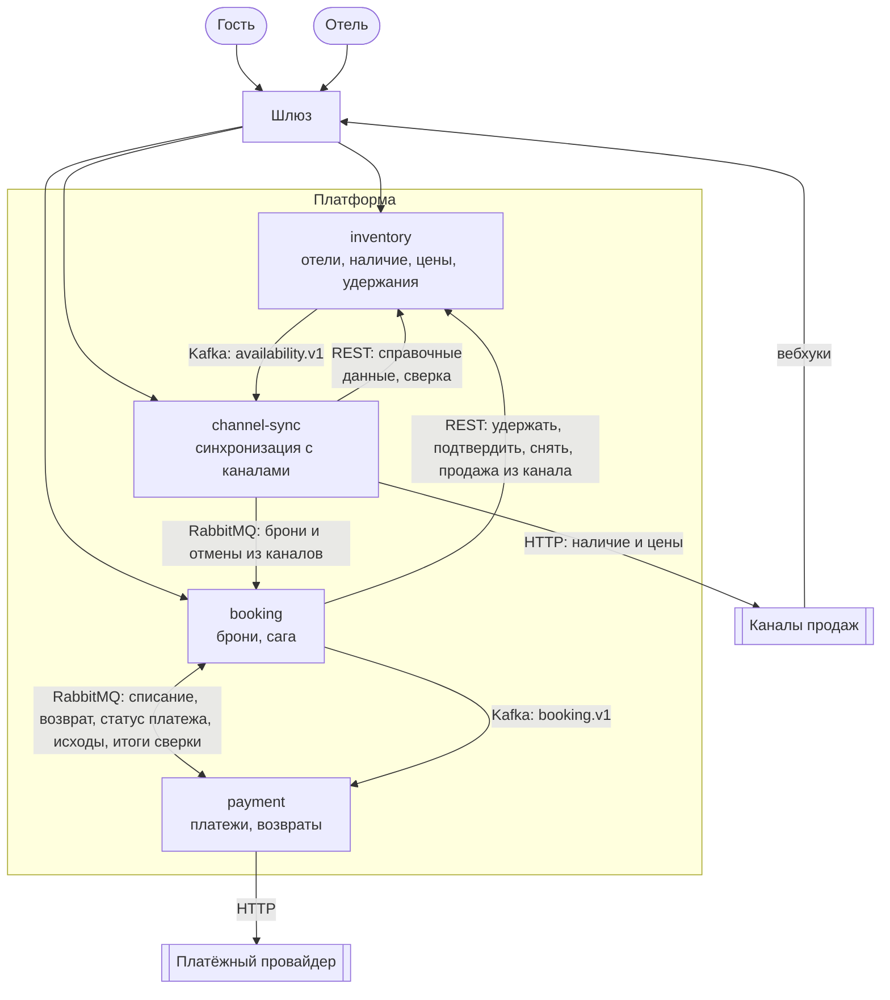

# PRD: Hotel Booking Platform, первая версия

- Версия: 1.8
- Дата: 2026-10-23
- Статус: утверждён

Архитектура, сервисы и стек описаны в [README](../README.md), термины — в [глоссарии](glossary.md). Здесь — поведение системы и гарантии, на которые опираются контракты и сервисы.

## 1. Назначение и рамки

Платформа продаёт номера отелей напрямую и через каналы продаж. Отель выставляет наличие и цены по типам номеров и датам. Гость бронирует и сразу оплачивает бронь. Каналы получают изменения наличия и присылают свои брони.

Первая версия покрывает сквозной путь: отель выставил наличие и цены → гость нашёл номер, забронировал и оплатил → каналы получили новый остаток → бронь из канала принята, даже если номеров уже не осталось. Всё, что не нужно для этого пути, перечислено в разделе [«Вне рамок»](#8-вне-рамок-первой-версии).

Допущения:

- Каналы повторяют доставку вебхука при ответах 5xx и таймаутах, пока не получат 2xx. На ответы 4xx доставку не повторяют.
- Платёжный провайдер:
  - поддерживает ключ идемпотентности и одноразовые токены карт, которые действуют не дольше часа;
  - по ключу идемпотентности отдаёт статус платежа;
  - сам формирует чеки по 54-ФЗ.
- Часы сервисов синхронизированы. Сроки считаются в абсолютном времени, даты проживания — по часовому поясу отеля.
- Отели, их API-ключи и подключения каналов задаются конфигурацией стенда.
- На стенде работает по одному экземпляру каждого сервиса. Экземпляр — это один деплой с несколькими процессами, их число задаёт [ADR-0003](adr/0003-sync-and-async-interactions.md).

## 2. Роли и внешние системы

| Роль | Что делает | Как аутентифицируется | Какие данные видит |
|---|---|---|---|
| Гость | ищет наличие и цены в отеле, создаёт и оплачивает бронь, смотрит её статус, отменяет | без регистрации; к своей брони — по токену брони, который выдаётся при создании | только свою бронь |
| Отель | управляет типами номеров, наличием и ценами, смотрит свои брони и превышение по ночам | API-ключ отеля | данные своего отеля, включая персональные данные гостей своих броней |
| Канал продаж | получает наличие и цены, присылает брони и отмены | API-ключ канала и подпись HMAC запросов | только подключённые отели и брони из этого канала |

Внешние системы и служебные роли:

- **Платёжный провайдер** списывает деньги, делает возвраты, отдаёт статус платежа и формирует чеки по 54-ФЗ. В первой версии это заглушка с настраиваемыми задержками и ошибками.
- **Дежурный** получает алерты, разбирает DLQ, неудачные возвраты, брони из каналов на ручном разборе и зависшие операции. Отдельного API для него нет, он работает через мониторинг и инструменты эксплуатации.

## 3. Продуктовые правила

**П-1. Отели.** Платформа обслуживает несколько отелей.

- У отеля свои часовой пояс (IANA), время заезда (по умолчанию 14:00), типы номеров, цены и подключённые каналы.
- Отель есть в каждом ресурсе API и в ключе каждого события.
- Ключ отеля и ключ канала дают доступ только к своим отелям.

**П-2. Наличие.** Единица наличия — тип номера на одну ночь. Конкретный номер отель назначает при заселении, вне системы. Для каждой пары «тип номера, ночь» отель выставляет количество номеров.

- Если отель ничего не выставил на дату, количество равно нулю.
- Остаток = выставлено − продано − удержано. Наружу остаток не бывает меньше нуля.
- Превышение — сколько номеров на ночь продано сверх выставленного. Оно возникает только из-за броней из каналов.
- Выставленное нельзя опустить ниже проданного плюс удержанного.

**П-3. Даты.** Проживание — ночи в полуинтервале [дата заезда, дата выезда). Даты считаются по часовому поясу отеля.

- Горизонт продаж — 365 дней. Ночи брони лежат в полуинтервале [сегодня, сегодня + 365 дней), где «сегодня» — текущая дата отеля. Значит, дата выезда не позже чем сегодня + 365 дней.
- Заезд — не раньше текущей даты отеля.

**П-4. Цены.** Одна цена за ночь на тип номера и дату: рубли, целые копейки, конечная цена для гостя.

- Сумма брони — сумма цен её ночей, умноженная на число номеров.
- Сумму считает сервер в момент удержания и фиксирует в брони. Последующие изменения цен на неё не влияют.

**П-5. Состав прямой брони.** Одна бронь — один отель, один тип номера, от 1 до 5 номеров, непрерывные ночи, от 1 до 30.

- Удержание по принципу «всё или ничего»: удерживаются все номера на все ночи или ничего.
- Изменить бронь нельзя, только отменить целиком и создать новую.
- Какие из этих ограничений не действуют для броней из каналов, перечислено в П-11.

**П-6. Статусы брони.** Все переходы статусов делает booking.

- «Ожидает оплаты» переходит в «подтверждена» или «не подтверждена». У «не подтверждена» есть причина:
  - «оплата отклонена» — провайдер отказал или по запросу статуса деньги не списаны;
  - «нет исхода оплаты» — к истечению удержания исход оплаты неизвестен даже после запроса статуса у провайдера или запросить статус невозможно, окончательно его выясняет С-5;
  - «удержание не подтверждено» — деньги списаны, но подтвердить удержание до его истечения не удалось, деньги возвращаются;
  - «завершена принудительно» — бронь закрыта по С-2.
- «Подтверждена» переходит в «отменена».
- Статус возврата: «нет» → «в процессе» → «выполнен» или «не удался». Если деньги нужно вернуть, а email уже обезличен (П-15), статус переходит из «нет» сразу в «не удался» с алертом: возврат и чек оформляются вручную. Из «не удался» после ручного разбора — снова «в процессе».
- Источник брони: прямая или канал.
- Флаг овербукинга ставится один раз, когда бронь из канала принята при нехватке номеров, и больше не снимается. Текущее превышение по ночам отель видит в наличии (О-2).
- Бронь из канала создаётся сразу в статусе «подтверждена».

**П-7. Оплата прямой брони.** Полная предоплата в один шаг.

- Клиент получает у провайдера одноразовый токен карты.
- Токен передаётся в запросе создания брони вместе с ожидаемой суммой.
- Ответ приходит сразу после удержания: статус «ожидает оплаты» и токен брони. Итог гость узнаёт по статусу.
- Если сумма, посчитанная сервером, не совпала с ожидаемой, ответ 409 «сумма изменилась» с текущей суммой, удержание не создаётся.
- Если одновременно нет мест и сумма изменилась, ответ — 409 «нет мест».
- Чтобы отправить запрос с новой ожидаемой суммой, нужен новый ключ идемпотентности.

**П-8. Удержание и сроки.**

- Удержание действует 15 минут.
- Удержание считается истёкшим по сроку, а не по факту освобождения. Подтвердить удержание после его срока нельзя, даже если номера ещё не освобождены.
- Удержание идемпотентно. Повтор запроса создания брони с тем же ключом идемпотентности и тем же телом продолжает то же удержание, а не создаёт второе.
- Подтверждение удержания идемпотентно: повтор возвращает результат первого подтверждения.
- Отказываясь от брони, booking отправляет в inventory команду «снять». Она снимает и удержание, и продажу по этой брони, если подтверждение всё же прошло, и тоже идемпотентна.
- Повторы оплаты укладываются в 10 минут и не выходят за срок удержания. Команда на списание несёт крайний срок — срок удержания. После него новых попыток списания нет, только запрос статуса, поэтому повтор из DLQ после крайнего срока деньги не списывает.
- Если к истечению удержания бронь не подтверждена, она становится «не подтверждена», номера освобождаются. Исключение — деньги списаны, а inventory не ответил на подтверждение: тогда итог подтверждения выясняется ещё не дольше минуты после срока.
- Подтверждение — точка невозврата: после него бронь можно только отменить.
- Недоступность Kafka до 10 минут не меняет ни исход брони, ни её сроки.

**П-9. Деньги.** Каждое списание относится к брони, которая была подтверждена (сейчас она «подтверждена» или «отменена»), либо по нему запущен возврат.

- Если удержание не подтверждено по любой причине — оплата отклонена, удержание истекло, inventory недоступен, — списание по этой брони возвращается автоматически. Номера заново не удерживаются.
- Если исход списания неизвестен, например потерялся ответ провайдера, перед закрытием брони запрашивается статус платежа. Если исход всё ещё неизвестен или запросить статус невозможно, бронь закрывается с причиной «нет исхода оплаты», а окончательно исход выясняет С-5.
- Раз в сутки платежи сверяются с провайдером (С-5). Списание по брони, которая так и не была подтверждена, возвращается, если по нему ещё нет возврата.
- Неудачный возврат повторяется, затем уходит в DLQ, срабатывает алерт, дальше — ручной разбор.
- Повторное списание по той же брони исключено.

**П-10. Отмена прямой брони.** Гость отменяет подтверждённую бронь целиком.

- **Момент заезда** — дата заезда и время заезда отеля в его часовом поясе. Если такого местного времени нет из-за перевода часов, берётся ближайший следующий момент. Если оно встречается дважды, берётся первый.
- **Срок бесплатной отмены** — момент заезда минус 24 часа абсолютного времени.
- Момент заезда и срок бесплатной отмены фиксируются в брони при создании как абсолютное время. Если отель потом сменит время заезда, на эту бронь это не повлияет.
- Запрос, полученный сервером не позже срока бесплатной отмены: отмена бесплатная, возврат 100 %.
- Запрос, полученный позже, но до момента заезда: отмена без возврата. Бронь, созданная меньше чем за 24 часа до заезда, сразу невозвратная.
- В обоих случаях номера освобождаются и снова продаются.
- После момента заезда, а также в статусах «ожидает оплаты» и «не подтверждена» отмена даёт 409.
- Отмена фиксируется сразу и отвечает 200. Номера освобождаются и деньги возвращаются асинхронно, с повторами.
- Повторная отмена отвечает 200 с текущим состоянием брони.

**П-11. Брони из каналов.** Канал уже получил оплату. Поэтому его бронь подтверждается сразу, без оплаты через платформу, и не отклоняется ни из-за нехватки номеров, ни из-за ограничений прямых броней.

- К броням из каналов не применяются ограничения прямых броней на число номеров и ночей, на заезд в прошлом при запоздалой доставке и на тип номера, снятый с продажи. Остальное из П-3 и П-5 действует: один отель, один тип номера, ночи в пределах горизонта продаж. Бронь, которая этому не отвечает, уходит на ручной разбор.
- Если номеров не хватает:
  - бронь принимается с флагом овербукинга;
  - превышение фиксируется по ночам;
  - дежурный получает алерт, отель видит флаг в списке броней;
  - переселяет гостя отель, вне системы.
- Бронь на тип номера без сопоставления, на несколько типов номеров, с ночами за горизонтом продаж или с типами номеров и датами, которые не отвечают контракту вебхука, тоже принимается: канал получает 2xx, дежурный получает алерт. Так же принимается бронь с внешним id, который канал уже прислал для другого отеля. До разбора это запись в channel-sync, а не бронь: в booking и в списке броней отеля её нет. Отмена такой записи запоминается и применяется после разбора.
- Данные гостя бронь из канала не останавливают: поле, которое не прошло проверку, не сохраняется, а бронь проходит обычным путём. Запись на разборе не уменьшает наличие, и номер успели бы продать снова.
- Отмена брони из канала сначала гасит превышение, если оно есть.
- Деньги по броням из каналов платформа не возвращает.
- Согласие гостя на обработку персональных данных получает канал.

**П-12. Собственные продажи.** Прямая бронь создаётся, только если остаток есть на все её ночи. Овербукинг из собственных продаж исключён.

**П-13. Синхронизация с каналами.**

- В каналы уходят абсолютные значения остатка и цены по паре «тип номера, дата» на весь горизонт продаж. Частые изменения склеиваются.
- Устаревшее значение не перезаписывает более новое.
- Раз в сутки идёт сверка на 30 дней вперёд, расхождения отправляются заново.
- Сопоставление типов номеров отеля с кодами канала задаётся конфигурацией.

**П-14. Идемпотентность.**

- Создание брони требует ключ идемпотентности в заголовке `Idempotency-Key`. Это UUID v4 или v7, который генерирует клиент, регистр не важен. Ключ уникален в рамках операции создания брони и хранится 24 часа.
- Ответы, которые относятся к самому ключу:
  - нет ключа — 400;
  - тот же ключ с другим отелем или телом запроса — 422;
  - запрос с этим ключом ещё выполняется — 409.
- Ключ привязывается к отелю и телу первого запроса на всё время хранения. Тот же ключ с другим отелем или телом всегда получает 422, в том числе после 503.
- Под ключом сохраняется итог запроса: 201, 409 «нет мест», 409 «сумма изменилась» и 409 «удержание истекло». Повтор с тем же ключом получает этот же ответ.
- Ошибки валидации, нечитаемое тело (400), «отель не найден» (404), 503 и другие 5xx итогом не считаются. Повтор с тем же ключом и тем же телом выполняется заново и продолжает удержание, если оно уже было создано и ещё действует. Исправленный после ошибки валидации запрос отправляется с новым ключом.
- Если удержание уже истекло или снято или до его срока меньше минуты, повтор получает 409 «удержание истекло»: второго удержания у брони не бывает, и бронь создаётся заново с новым ключом.

Ещё три правила идемпотентности:

- Изменения наличия и цен отелем задают абсолютные значения, поэтому повторный запрос безопасен.
- Вебхуки каналов идемпотентны по каналу, внешнему id брони и виду вебхука: бронь или отмена.
- Повторная доставка исхода оплаты не даёт второго подтверждения.

**П-15. Персональные данные (152-ФЗ).**

- Собираем имя, фамилию, email и число гостей; телефон — по желанию. Паспортные данные и свободные комментарии не собираются.
- У брони из канала все эти данные необязательны: канал передаёт то, что у него есть. Денег, возврата и чека у такой брони нет, поэтому email для чека не нужен. Контакты хранятся для связи с гостем, например при переселении из-за овербукинга.
- Для прямой брони обязательно отдельное согласие на обработку, с версией текста согласия. Для брони из канала согласие получает канал.
- Через 30 дней после даты выезда, отмены брони или её перехода в «не подтверждена» персональные данные обезличиваются. Суммы, даты и статусы остаются.
- Пока возврат по брони «в процессе» или «не удался», откладывается обезличивание email: он нужен для чека возврата. Остальные данные гостя обезличиваются в срок.
- Пока исход оплаты не выяснен — по брони «не подтверждена» неизвестно, списаны ли деньги, при любой причине, а С-5 ещё не дала итога, — email тоже ждёт: если сверка найдёт списание, он понадобится для чека возврата.
- Email ждёт не дольше 90 дней после обычного срока. Затем он обезличивается, а бронь уходит дежурному на ручной разбор: если деньги ещё нужно вернуть, возврат и чек оформляются вручную через провайдера.
- Запись о брони из канала на ручном разборе хранит данные гостя до разбора. Неразобранная запись обезличивается через 30 дней после самой поздней даты выезда или после отмены каналом, смотря что наступит раньше, но не позже чем через 395 дней после получения. Если дату выезда определить нельзя — через 30 дней после получения.

**П-16. Чеки (54-ФЗ).** При списании провайдер выдаёт чек предоплаты 100 %, при возврате — чек возврата. В заглушке оба чека — это событие «чек отправлен».

**П-17. Доступ.**

- Гость — без регистрации, по токену брони.
- Отель — по API-ключу отеля.
- Канал — по API-ключу канала и подписи HMAC тела запроса с меткой времени. Метка допускает расхождение не больше ±5 минут.
- Чужая бронь, чужой отель и любые несуществующие ресурсы отвечают 404: так их существование не раскрывается. Канал, который обращается к неподключённому или несуществующему отелю, получает 403.
- Все внешние запросы проходят через шлюз. Лимиты запросов гостей и отелей стоят на шлюзе. Вебхуки ограничивает channel-sync по каналу: сверх лимита он отвечает 503, и канал повторяет доставку.

## 4. Карта контекстов

Платформа делится на четыре контекста. У каждого своя модель и своя база, в чужую базу контексты не ходят. Шлюз — инфраструктура, а не контекст: он маршрутизирует внешние запросы и применяет лимиты, а ключи и токены проверяют сами сервисы ([ADR-0007](adr/0007-access-and-authentication.md)). Правило выбора между синхронным вызовом, командой и событием, повторы и поведение при отказах описаны в [ADR-0003](adr/0003-sync-and-async-interactions.md).

Овалы — роли, двойная рамка — внешние системы, прямоугольники — контексты и шлюз. Стрелки показывают поток вызовов и сообщений, а кто поставщик и кто потребитель — в таблице.

| Связь | Транспорт | Паттерн |
|---|---|---|
| booking → inventory: удержать, подтвердить, снять, продажа из канала | синхронный REST | заказчик и поставщик (customer–supplier): inventory — поставщик, его операции скроены под сагу booking |
| booking ↔ payment: списание, возврат, статус платежа, их исходы и итоги сверки платежей | команды и ответы через RabbitMQ | заказчик и поставщик: booking решает, что сделать, payment — поставщик |
| booking → payment: статусы броней для сверки платежей | Kafka, `booking.v1` | опубликованный язык (published language): booking — поставщик |
| inventory → channel-sync: изменения наличия и цен | Kafka, `availability.v1` | опубликованный язык: inventory — поставщик |
| channel-sync → inventory: справочные данные отеля, типы номеров для проверки сопоставлений, наличие и цены для сверки с каналами | синхронный REST, внутренний API | заказчик и поставщик: inventory — поставщик |
| channel-sync → booking: брони и отмены из каналов | команды через RabbitMQ | открытый сервис (open host service): booking — поставщик, channel-sync переводит формат канала в его команды |
| payment → будущие потребители: уведомления, аналитика | Kafka, `payment.v1` | опубликованный язык; внутренних потребителей в первой версии нет, исходы в booking идут через RabbitMQ |
| payment → платёжный провайдер | HTTP | антикоррупционный слой (anti-corruption layer): модель провайдера не проникает в платформу |
| channel-sync ↔ каналы продаж: наличие и цены уходят в канал, брони и отмены приходят вебхуками | HTTP | антикоррупционный слой на каждый канал |

Booking и payment зависят друг от друга по ролям: booking — заказчик payment по списаниям и возвратам, а payment зависит от booking как от поставщика `booking.v1` для сверки. Booking — оркестратор саги: он ведёт прямую бронь по шагам и запускает компенсации, состояния и сроки саги описаны в [ADR-0004](adr/0004-booking-saga.md). Inventory — единственный источник правды о наличии, остальные контексты узнают о нём через API и события. Кто какими данными владеет, какие копии чужих данных держат сервисы и где лежат персональные данные, описано в [ADR-0002](adr/0002-service-boundaries-and-data-ownership.md).

## 5. Сценарии

Номер сценария складывается из буквы актора и порядкового номера: Г — гость, О — отель, К — канал, С — система. В таблицах ветвлений «код» — HTTP-код ответа, «статус» — статус брони.

Ошибки отдаются в формате Problem Details. У отказов, которые клиент различает по смыслу, свой тип: «нет мест», «сумма изменилась», «удержание истекло», «запрос ещё выполняется», «ключ использован с другим телом», «ошибка валидации» и так далее. У отказов без смысла сверх кода HTTP, например 401 и 404, тип — `about:blank`.

### Г-1. Поиск наличия и цен

1. Гость запрашивает отель, даты заезда и выезда и число номеров.
2. Для каждого типа номера считается остаток на весь период, то есть минимум по ночам, цены по ночам и сумма.
3. Ответ — список типов номеров, которых хватает на весь период. Ничего не удерживается.

| Условие | Поведение | Код |
|---|---|---|
| Неверные даты, больше 30 ночей, заезд в прошлом или за горизонтом продаж, число номеров не от 1 до 5 | запрос отклоняется | 422 |
| Отель не найден | запрос отклоняется | 404 |
| Номеров нет | пустой список, это не ошибка | 200 |

### Г-2. Создание брони с оплатой

1. Гость отправляет запрос: отель, тип номера, даты, число номеров, данные гостя, согласие на обработку данных, токен карты, ожидаемая сумма. В заголовке передаётся ключ идемпотентности.
2. booking синхронно удерживает номера в inventory на 15 минут и создаёт бронь «ожидает оплаты».
3. Гость получает ответ 201: номер брони, токен брони, статус «ожидает оплаты».
4. booking отправляет в payment команду на списание, payment списывает деньги у провайдера.
5. booking подтверждает удержание в inventory. Это точка невозврата, бронь становится «подтверждена».
6. Публикуются события о брони и об изменении наличия, каналы получают новые остатки.

Итог: бронь «подтверждена», деньги списаны, чек предоплаты отправлен, остаток уменьшился.

| Условие | Поведение | Код или статус |
|---|---|---|
| Нет остатка хотя бы на одну ночь | бронь не создаётся | 409 «нет мест» |
| Сумма не совпала с ожидаемой | удержание не создаётся, в ответе текущая сумма | 409 «сумма изменилась» |
| Нет мест, и сумма изменилась | ответ про места | 409 «нет мест» |
| Ошибка валидации или нет согласия | бронь не создаётся; исправленный запрос отправляется с новым ключом | 422 |
| Отель не найден | бронь не создаётся | 404 |
| Нет ключа идемпотентности | запрос отклоняется | 400 |
| Тот же ключ, другой отель или другое тело запроса | запрос отклоняется | 422 |
| Запрос с этим ключом ещё выполняется | запрос отклоняется | 409 |
| Повтор с тем же ключом | возвращается исходный ответ | как в исходном ответе |
| inventory недоступен при удержании | быстрый отказ: ожидание не больше 2 с. Повтор с тем же ключом и телом продолжает то же удержание, второго не возникает | 503 |
| Повтор после 503, а удержание уже истекло или снято или до его срока меньше минуты | бронь не создаётся, её создают заново с новым ключом | 409 «удержание истекло» |
| Провайдер отказал (4xx) | удержание снимается сразу | «не подтверждена», «оплата отклонена» |
| Провайдер отвечает 5xx, 429 или не отвечает | повторы с backoff и jitter в пределах 10 минут и не позже срока удержания. Затем запрашивается статус платежа. Если исход неизвестен — команда в DLQ, алерт, бронь закрывается, исход выясняет С-5 | «не подтверждена», «нет исхода оплаты» не позже истечения удержания |
| Повторы исчерпаны или команда пришла в payment уже после окна попыток, а по запросу статуса деньги не списаны | удержание снимается сразу | «не подтверждена», «оплата отклонена» |
| Деньги списаны, но подтвердить удержание не удалось: inventory недоступен или удержание истекло | повторы подтверждения до истечения удержания; если inventory не отвечает, итог выясняется ещё не дольше минуты после срока. Затем команда «снять» в inventory и автоматический возврат | «не подтверждена», «удержание не подтверждено» |
| Списание обнаружено после закрытия брони: поздний ответ провайдера, запрос статуса, сверка | автоматический возврат, номера заново не удерживаются, статус брони не меняется | возврат «в процессе», затем «выполнен» |
| Автоматический возврат не удался | повторы, затем DLQ, алерт и ручной разбор | возврат «не удался» |
| booking упал посреди саги | после рестарта сага продолжается с сохранённого шага. Если booking недоступен дольше удержания, его освобождает inventory (С-1), а бронь завершается по С-2 | — |
| Kafka недоступна | исход и сроки брони не меняются, события уходят после восстановления | — |
| RabbitMQ недоступен до 5 минут | исход и сроки брони не меняются, команды уходят после восстановления (НФТ-16) | — |
| RabbitMQ или payment недоступны так долго, что к концу удержания исхода нет | бронь закрывается, не дожидаясь ответа на запрос статуса, исход выясняет С-5; списания, исход которых застрял в outbox payment, возвращаются автоматически | «не подтверждена», «нет исхода оплаты» |
| Повторная доставка исхода оплаты | второго подтверждения и второго списания нет | — |

### Г-3. Статус брони

1. Гость запрашивает бронь по номеру и токену брони.
2. Ответ: статус и причина отказа, статус возврата, даты, тип и число номеров, сумма, срок бесплатной отмены.

| Условие | Поведение | Код |
|---|---|---|
| Неверный токен, чужая или несуществующая бронь | запрос отклоняется | 404 |

### Г-4. Отмена прямой брони

1. Гость отправляет запрос отмены с токеном брони.
2. Срок проверяется по П-10. Бронь сразу становится «отменена», гость получает ответ 200.
3. Асинхронно, с повторами: номера освобождаются, каналы получают новые остатки.
4. Если положен возврат, payment возвращает деньги, провайдер выдаёт чек возврата.

| Условие | Поведение | Код или статус |
|---|---|---|
| Запрос получен не позже срока бесплатной отмены | полный возврат | 200, возврат «в процессе», затем «выполнен» |
| Запрос получен позже срока, но до момента заезда | отмена без возврата | 200, возврат «нет» |
| Момент заезда наступил | отмена невозможна | 409 |
| Бронь «ожидает оплаты» или «не подтверждена» | отмена невозможна | 409 |
| Повторная отмена | текущее состояние брони | 200 |
| inventory недоступен | отмена уже зафиксирована, номера освобождаются после восстановления | 200 |
| Возврат не удался | повторы, затем DLQ, алерт и ручной разбор. Бронь остаётся отменённой | возврат «не удался» |

### О-1. Типы номеров

1. Отель создаёт или изменяет тип номера: название, вместимость.
2. Тип номера можно снять с продажи. Удалить можно только тип без будущих броней.

| Условие | Поведение | Код |
|---|---|---|
| Удаление типа с будущими бронями | тип не удаляется | 409 |
| Чужой отель | запрос отклоняется | 404 |

### О-2. Наличие и цены

1. Отель задаёт количество номеров и цену для типа номера на диапазон дат в пределах горизонта продаж.
2. Изменение применяется атомарно: весь диапазон или ничего.
3. Публикуется событие об изменении наличия, каналы получают новые значения (НФТ-2).
4. По каждой дате отель видит выставленное количество, продано, удержано, остаток и превышение.

Чтобы закрыть продажи на дату, отель выставляет количество, равное проданному. Если на эту дату есть активные удержания, запрос получит 409, а при постоянном спросе закрыть продажи так может не получиться совсем. Отдельной операции закрытия продаж в первой версии нет, см. [«Вне рамок»](#8-вне-рамок-первой-версии).

| Условие | Поведение | Код |
|---|---|---|
| Количество ниже проданного плюс удержанного хотя бы на одну дату | ничего не меняется, в ответе список дат | 409 |
| Цена не больше нуля, даты в прошлом или за горизонтом продаж | запрос отклоняется | 422 |
| Чужой отель | запрос отклоняется | 404 |

### О-3. Брони отеля

1. Отель получает список своих броней с фильтрами по датам, статусу, источнику и флагу овербукинга.
2. Карточка брони содержит данные гостя. Обезличенные данные показываются как обезличенные.

Флаг овербукинга отмечает брони, принятые при нехватке номеров. Текущее превышение по ночам видно в наличии (О-2).

| Условие | Поведение | Код |
|---|---|---|
| Чужой отель или чужая бронь | запрос отклоняется | 404 |

### К-1. Наличие и цены в каналах

1. inventory публикует событие об изменении наличия или цены.
2. channel-sync склеивает изменения по каждому каналу и отправляет абсолютные значения.
3. Канал отвечает 2xx, состояние канала обновляется.

| Условие | Поведение |
|---|---|
| Канал отвечает 429 | соблюдается Retry-After и лимит запросов канала |
| Канал отвечает 5xx или не отвечает | повторы с backoff |
| Серия ошибок | circuit breaker срабатывает только для этого канала, остальные каналы не тормозят |
| Прочие ответы 4xx | без повторов: сообщение в DLQ, алерт |
| Пришло устаревшее событие | более новое значение не перезаписывается |
| Канал восстановился | получает актуальные значения |

### К-2. Бронь из канала

1. Канал присылает вебхук с бронью.
2. Проверяются ключ канала и подпись. Бронь надёжно фиксируется, канал получает 2xx.
3. channel-sync передаёт бронь в booking. Она создаётся в статусе «подтверждена» с источником «канал», остаток уменьшается.
4. Публикуются события, все каналы получают новые остатки.

| Условие | Поведение | Код |
|---|---|---|
| Повторный вебхук: тот же канал и внешний id | тот же ответ, вторая бронь не создаётся | 2xx |
| Номеров не хватает | бронь подтверждена с флагом овербукинга, превышение по ночам, алерт | 2xx |
| Бронь нарушает ограничения прямых броней: больше 5 номеров или 30 ночей, заезд в прошлом, тип снят с продажи | бронь принимается | 2xx |
| Тип номера не сопоставлен, в брони несколько типов номеров, ночи за горизонтом продаж, типы номеров или даты не отвечают контракту вебхука, внешний id уже пришёл для другого отеля, бронь не помещается в команду для booking | запись в channel-sync ждёт ручного разбора, алерт; в booking брони пока нет | 2xx |
| Данные гостя не прошли проверку | неверное поле не сохраняется, бронь проходит обычным путём | 2xx |
| Неверная подпись или метка времени вне ±5 минут | без побочных эффектов, алерт | 401 |
| Канал не подключён к отелю, такого отеля нет или канал в пути не совпадает с ключом | запрос отклоняется, алерт | 403 |
| Тело не JSON, не объект, без внешнего id, с неверным `Content-Type` или сжатое; неверно оформлен канал или отель в пути | вебхук не принят, канал доставку не повторяет, алерт | 400, 404, 415 или 422 |
| Канал превысил лимит вебхуков | вебхук не принят, канал повторяет доставку, алерт | 503 |
| channel-sync недоступен | канал повторяет доставку, бронь появится после восстановления | — |

### К-3. Отмена брони из канала

1. Канал присылает вебхук с отменой.
2. Бронь становится «отменена», номера освобождаются. Если было превышение, сначала гасится оно.
3. Публикуются события, каналы получают новые остатки.

| Условие | Поведение | Код |
|---|---|---|
| Повторная отмена | без эффекта | 2xx |
| Отмена пришла раньше брони | отмена запоминается и применяется, когда бронь появится. Если брони нет 15 минут — алерт | 2xx |
| Брони с этим каналом и внешним id в отеле из запроса нет, а в другом отеле есть | та бронь не отменяется | 2xx |
| Отмена с внешним id, который уже пришёл в отмене для другого отеля | запись ждёт ручного разбора, алерт | 2xx |
| Неверная подпись или метка времени вне ±5 минут | без побочных эффектов, алерт | 401 |
| Канал не подключён к отелю, такого отеля нет или канал в пути не совпадает с ключом | запрос отклоняется, алерт | 403 |
| Тело не JSON, не объект, без внешнего id, с неверным `Content-Type` или сжатое; неверно оформлен канал или отель в пути | вебхук не принят, канал доставку не повторяет, алерт | 400, 404, 415 или 422 |
| Канал превысил лимит вебхуков | вебхук не принят, канал повторяет доставку, алерт | 503 |

### С-1. Истечение удержаний

inventory сам освобождает удержания с истёкшим сроком, не дожидаясь booking: не позже чем через 60 с после истечения (НФТ-9). Удержание истекает по сроку (П-8). Остаток восстанавливается, каналы получают новые значения.

### С-2. Зависшие саги

Бронь, которая находится в статусе «ожидает оплаты» дольше срока удержания плюс 5 минут, принудительно завершается: статус «не подтверждена», причина «завершена принудительно», в inventory уходит команда «снять».

- Если деньги списаны или исход оплаты неизвестен, статус платежа запрашивается у провайдера. Списанные деньги возвращаются.
- Если возврат не удался — повторы, затем DLQ, алерт и ручной разбор.

Принудительное завершение вызывает алерт. Завершения за 15 минут приходят дежурному одним уведомлением с их числом.

### С-3. Сверка с каналами

Раз в сутки остатки и цены на 30 дней вперёд сравниваются с последним подтверждённым состоянием в каждом канале. Расхождения отправляются заново, их число попадает в метрику.

### С-4. Обезличивание персональных данных

Раз в сутки обезличиваются персональные данные броней, у которых прошло 30 дней после даты выезда, отмены брони или её перехода в «не подтверждена», и записей на ручном разборе по П-15. Пока исход оплаты не выяснен или возврат по брони «в процессе» или «не удался», откладывается только email, и не дольше 90 дней (П-15). Суммы, даты и статусы остаются.

### С-5. Сверка платежей

Раз в сутки списания и возвраты сверяются с данными провайдера. Сверка проверяет все неподтверждённые прямые брони. Здесь же окончательно выясняется исход оплаты для броней, у которых он не выяснен, при любой причине «не подтверждена». Если найдено списание по брони, которая так и не была подтверждена, и по нему нет возврата, запускается возврат и срабатывает алерт. Число расхождений попадает в метрику.

### Учения и сценарии

| Учение из README | Какие ветки проверяет |
|---|---|
| Kafka недоступна 10 минут | Г-2 «Kafka недоступна», НФТ-7, НФТ-8 |
| Провайдер оплаты отвечает 5xx | Г-2 «Провайдер отвечает 5xx», С-2, С-5, НФТ-10, НФТ-11 |
| Канал отвечает 429 | К-1 «Канал отвечает 429», НФТ-6 |
| Шторм дублей вебхуков | К-2 «Повторный вебхук», НФТ-12 |
| Консьюмер упал посреди пачки | К-1 и К-2 при повторной доставке событий, НФТ-7 |

## 6. Нефункциональные требования

Условия измерения:

- Профиль стенда записывается в каждый отчёт: версии, ресурсы, по одному экземпляру каждого сервиса и число его процессов.
- Заглушка провайдера отвечает за 100–300 мс, подключены две заглушки каналов.
- Данные: 100 отелей × 10 типов номеров × 365 дней.
- Нагрузка k6 идёт через шлюз, через отдельную точку входа без лимитов: она есть только в профиле нагрузки. Наличия заложено с запасом, чтобы ответы 409 не преобладали.
- Замер: 2 минуты прогрева, затем 10 минут при постоянном темпе. Ответ 409 ошибкой не считается.

| № | Требование | Цель | Как измеряется | Где проверяется |
|---|---|---|---|---|
| НФТ-1 | Овербукинг из собственных продаж | 0 ночей сверх выставленного | инвариант по каждой паре «тип номера, ночь»: превышение объясняется только бронями из каналов с флагом | интеграционный тест «20 параллельных запросов на последний номер — 1 успех и 19 ответов 409»; гонка в k6 на стенде |
| НФТ-2 | Задержка изменения наличия до каналов | p95 ≤ 10 с для точечных изменений по каждому исправному каналу; массовое изменение доставляется целиком за ≤ 60 с | от времени события в inventory до ответа 2xx канала, гистограмма по каналу | k6; Toxiproxy при деградации соседнего канала; алерт |
| НФТ-3 | Создание брони | p95 ≤ 300 мс при 50 RPS; ответов 5xx и таймаутов < 1 % | через шлюз, при условиях измерения выше | k6 |
| НФТ-4 | Поиск наличия и цен | p95 ≤ 200 мс при 100 RPS | отдельный сценарий через шлюз | k6 |
| НФТ-5 | Время до исхода брони | p95 ≤ 5 с от создания до «подтверждена» или «не подтверждена» | гистограмма длительности саги; k6 опрашивает статус | k6 |
| НФТ-6 | Деградация каналов | при недоступном channel-sync, недоступном канале или ответах 429 НФТ-3 выполняется; брони из каналов доходят после восстановления, отставание возвращается в норму за ≤ 5 минут | метрики НФТ-2 и НФТ-3 во время сбоя | Toxiproxy; интеграционный тест изоляции каналов; учение «канал отвечает 429» |
| НФТ-7 | Потеря событий | 0; повторная доставка не даёт повторного эффекта | сверка id в outbox отправителя и в inbox получателя; счётчик отсечённых дублей | интеграционные тесты: откат транзакции, падение relay; Toxiproxy; учения «Kafka недоступна 10 минут» и «консьюмер упал посреди пачки» |
| НФТ-8 | Недоступность Kafka до 10 минут | исходы и сроки броней не меняются, НФТ-3 и НФТ-5 выполняются; outbox пустеет за ≤ 5 минут после восстановления | сравнение с контрольным прогоном; размер outbox | Toxiproxy; учение «Kafka недоступна 10 минут» |
| НФТ-9 | Освобождение удержаний | не позже чем через 60 с после истечения удержания | от истечения удержания до роста остатка | интеграционный тест с подменой времени |
| НФТ-10 | Сага и деньги | нет броней в «ожидает оплаты» дольше срока удержания плюс 5 минут; у каждого списания по брони, которая не была подтверждена, возврат «в процессе» или «выполнен», либо «не удался» с алертом; ни одного возврата по невозвратной отмене | сверка платежей и броней (С-5) | интеграционные тесты: отказ оплаты, потерянный ответ провайдера, сбой подтверждения удержания, поздняя оплата, зависшая сага, сверка после невозвратной отмены; учение «провайдер оплаты отвечает 5xx» |
| НФТ-11 | Повторы оплаты | повторы только на 5xx, 429, таймауты и ответ «запрос с этим ключом ещё выполняется»; backoff с jitter; бюджет ≤ 10 минут и не позже срока удержания, затем запрос статуса и DLQ; повтор из DLQ после срока удержания не списывает деньги; 0 двойных списаний | счётчики попыток; журнал заглушки провайдера | интеграционный тест «5xx — повтор, 4xx — сразу отказ»; Toxiproxy |
| НФТ-12 | Дубли | повтор с тем же ключом идемпотентности даёт тот же ответ и не создаёт второго удержания; 100 одинаковых вебхуков дают одну бронь | число броней и удержаний до и после | интеграционные тесты; k6; учение «шторм дублей вебхуков» |
| НФТ-13 | Приём вебхука | p95 ≤ 300 мс; при неверной подписи 401 без побочных эффектов | время ответа на вебхук через шлюз | k6; интеграционный тест |
| НФТ-14 | Персональные данные | тестовые маркеры персональных данных не находятся в логах, трейсах, событиях и метриках; обезличивание через 30 дней | поиск маркеров после прогона | интеграционный тест; ревью безопасности |
| НФТ-15 | Наблюдаемость | сквозной трейс от запроса до канала и провайдера; алерты со стартовыми порогами ниже; каждый алерт срабатывает хотя бы на одном учении или в сценарии проверки алертов на стенде | трейсы в Tempo; срабатывания алертов в отчётах учений и сценариев | смоук-тест; учения; сценарии проверки алертов |
| НФТ-16 | Недоступность RabbitMQ до 5 минут | исходы и сроки броней не меняются: брони, созданные во время простоя, получают исход в пределах срока удержания; НФТ-3 выполняется | сравнение с контрольным прогоном; возраст команд в outbox | тест на сбои через Toxiproxy |

Стартовые пороги алертов:

- отставание консьюмера больше 60 с дольше 5 минут;
- в DLQ есть сообщения;
- бронь в статусе «ожидает оплаты» дольше срока удержания плюс 2 минуты;
- принудительное завершение брони (С-2);
- возврат «не удался»;
- бронь из канала ждёт ручного разбора;
- доля ответов 5xx больше 2 % за 5 минут;
- p95 задержки синхронизации с каналом больше 10 с дольше 10 минут;
- новый овербукинг из канала;
- ответы 4xx на вебхуки канала, кроме 403 и 413: канал такой ответ не повторяет;
- ответы 403 на вебхуки канала: канал не подключён к отелю или канал в пути не совпадает с ключом;
- сверка нашла списание по неподтверждённой брони без возврата;
- исход оплаты не выяснен сверкой дольше 7 дней;
- до предельного срока хранения email осталось 14 дней, а исход оплаты не выяснен или возврат не завершён.

## 7. Безопасность и требования законов

**Персональные данные (152-ФЗ):**

- состав, согласие и срок хранения — по П-15;
- шифрование при хранении, маскирование в логах и трейсах;
- в событиях Kafka персональных данных нет. Email покупателя для чека уходит провайдеру в команде на списание. Сообщения с персональными данными в DLQ хранятся не дольше срока хранения этих данных;
- базы с реальными персональными данными граждан РФ размещаются в России. На стенде используются только синтетические данные.

**Оплата:**

- данные карт в платформу не попадают, только одноразовый токен провайдера;
- сумму считает сервер;
- списание и возврат идемпотентны по брони.

**54-ФЗ:** чек предоплаты 100 % и чек возврата формирует провайдер, в заглушке это событие «чек отправлен».

**Доступ:**

- у гостя токен брони, у отеля и канала — свои API-ключи;
- подпись HMAC вебхуков с меткой времени ±5 минут, подпись сравнивается за постоянное время;
- ключи и токены проверяют сами сервисы, внутренний вызов без токена сервиса отклоняется;
- лимиты запросов публичного API стоят на шлюзе, вебхуков — в channel-sync по каналу, с ответом 503;
- секреты хранятся вне репозитория.

## 8. Вне рамок первой версии

| Что | Почему |
|---|---|
| Интерфейсы: сайт, виджет, личные кабинеты гостя и отеля, роли сотрудников отеля | первая версия — это API и его гарантии; интерфейс не добавляет распределённых сценариев |
| Поиск по нескольким отелям | гость бронирует конкретный отель |
| Тарифные планы, питание, цена по числу гостей, ограничения и закрытие продаж, наценки каналов | одной цены за ночь достаточно для саги и синхронизации |
| Изменение брони, частичная отмена, групповые брони | удержание остаётся одной атомарной операцией |
| Депозит, оплата в отеле, 3-D Secure, СБП, мультивалютность | одна схема оплаты в один шаг |
| Налоги и чек полного расчёта при заселении | расчёты при заселении ведёт отель |
| Функции PMS: назначение номера, заселение, паспортные данные, миграционный учёт | платформа продаёт наличие, а не управляет номерами |
| Реальные каналы и платёжные провайдеры, API подключения отелей и каналов | заглушки воспроизводят нужные сбои, подключения задаются конфигурацией |
| Уведомления гостю по email и SMS | платформа публикует события, по которым их можно отправлять |
| Отмена брони отелем и переселение гостя внутри системы | при овербукинге гостя переселяет отель, вне системы |
| Автоматизация запросов субъектов персональных данных | такие запросы обрабатываются вручную |
| SLA доступности, RPO и RTO | на одном стенде их не измерить; сохранность броней задают НФТ-7, НФТ-8 и НФТ-10 |

## 9. Ключевые решения

| Решение | Отвергнутые варианты | Почему |
|---|---|---|
| Несколько отелей | один отель | добавить отель в контракты позже — ломающее изменение, а платформа задумана для многих отелей |
| Одна цена за ночь на тип номера и дату | тарифные планы | тарифы усложняют модель, события и сопоставление в каналах, но не дают новых распределённых сценариев |
| Полная предоплата в один шаг | депозит, оплата в отеле, оплата через редирект | сага идёт без ожидания гостя, удержание остаётся страховкой; редирект потребовал бы входящих вебхуков провайдера |
| Отмена бесплатна за 24 часа до заезда, позже — без возврата | штраф за первую ночь, политика каждого отеля | одна политика без расчёта штрафов; номер освобождается и снова продаётся |

## 10. История изменений

| Версия | Дата | Что изменилось |
|---|---|---|
| 1.0 | 2026-10-20 | первая версия |
| 1.1 | 2026-10-20 | карта контекстов (раздел 4), ссылка на глоссарий |
| 1.2 | 2026-10-20 | П-15 и С-4: срок хранения данных гостя в записях на ручном разборе, обезличивание откладывается до выяснения исхода оплаты; раздел 4: связь channel-sync → inventory, итоги сверки платежей, ссылка на ADR о владении данными; раздел 6: алерт «исход оплаты не выяснен сверкой дольше 7 дней» |
| 1.3 | 2026-10-20 | раздел 4: способы взаимодействия зафиксированы в ADR-0003; допущения и условия измерения: что такое экземпляр сервиса; НФТ-16 и ветки Г-2 о недоступности RabbitMQ и payment; П-6 и П-9: «нет исхода оплаты», если запросить статус невозможно; П-14: идемпотентность вебхуков с учётом вида вебхука; НФТ-11: повтор на «запрос с этим ключом ещё выполняется»; допущение о сроке действия токена карты |
| 1.4 | 2026-10-21 | сага зафиксирована в ADR-0004: П-6 — «оплата отклонена» и тогда, когда по запросу статуса деньги не списаны, возврат «не удался» сразу из «нет», если email уже обезличен; П-8 и Г-2 — итог подтверждения выясняется ещё не дольше минуты после срока; П-14 и Г-2 — итог 409 «удержание истекло»; Г-2 — ветка «по запросу статуса не списано»; П-15, С-4 и С-5 — исход не выяснен при любой причине, сверка проверяет все неподтверждённые прямые брони, откладывается только email и не дольше 90 дней; раздел 6 — алерт за 14 дней до предельного срока хранения email |
| 1.5 | 2026-10-21 | наблюдаемость зафиксирована в ADR-0006: НФТ-15 — каждый алерт срабатывает на учении или в сценарии проверки алертов, срабатывания попадают в отчёт; С-2 — принудительные завершения за 15 минут приходят одним уведомлением с их числом |
| 1.6 | 2026-10-21 | доступ зафиксирован в ADR-0007: ключи и токены проверяют сервисы, а не шлюз (раздел 4); вебхуки ограничивает channel-sync по каналу ответом 503, который канал повторяет (П-17, К-2, К-3, раздел 7); канал у несуществующего отеля получает 403, как у неподключённого; бронь из канала, которая не помещается в команду для booking, уходит на ручной разбор (К-2); k6 идёт через отдельную точку входа шлюза |
| 1.7 | 2026-10-22 | контракты v1 ([README контрактов](../contracts/README.md)): свой тип Problem Details — у отказов, которые клиент различает по смыслу, у остальных `about:blank` (раздел 5); ключ идемпотентности — UUID v4 или v7, привязан к отелю и телу первого запроса, нечитаемое тело (400) и «отель не найден» (404) итогом не считаются (П-14, Г-2); Г-2 — ветка «отель не найден» |
| 1.8 | 2026-10-23 | контракты каналов v1 ([README контрактов](../contracts/README.md#каналы)): данные гостя брони из канала необязательны и не останавливают бронь, неверное поле не сохраняется (П-11, П-15, К-2); на ручной разбор уходят ещё типы номеров и даты вне контракта вебхука и внешний id, который уже пришёл для другого отеля (П-11, К-2, К-3); отмена применяется только в отеле из запроса (К-3); 403 — и когда канал в пути не совпадает с ключом (К-2, К-3); вебхук, который нельзя опознать, отклоняется с 400, 404, 415 или 422, а алерт считает любой 4xx на вебхук, кроме 403 и 413; у 403 свой алерт по обеим причинам (К-2, К-3, раздел 6) |
